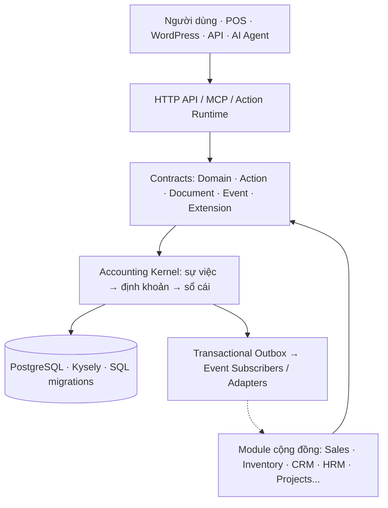

# open-ketoan
<!-- [2026-10-29 10:24 PM Johnny Chu - Chu Hoàng Anh] INIT — khởi tạo Bizcity Core Framework: sổ cái chỉ thêm, cửa nạp sự việc, CANON, hợp đồng, bộ kiểm chuẩn. -->
<!-- [2026-10-30 12:10 PM Johnny Chu - Chu Hoàng Anh] ADR-0007 — chuẩn hoá mã lỗi, quan sát, bộ giám sát, cài nhanh, kiến trúc, đóng góp. -->
<!-- [2026-10-30 12:50 PM Johnny Chu - Chu Hoàng Anh] CONG-BO — bản công bố kiến trúc: 4 lớp hợp đồng, luật hạ tầng, checklist nhận việc. -->
<!-- [2026-10-30 01:11 PM Johnny Chu - Chu Hoàng Anh] CONG-BO — tuyên bố tối thượng, 7 nguyên tắc AP, ba lớp kiểm soát, ma trận tuân thủ, kiểm nâng cấp migration. -->
<!-- [2026-10-30 01:17 PM Johnny Chu - Chu Hoàng Anh] README — tuyên ngôn open-ketoan, lối vào cài đặt / sử dụng / viết module / vận hành. -->
<!-- [2026-10-30 01:22 PM Johnny Chu - Chu Hoàng Anh] R-LICENSE — giấy phép GPL-2.0-or-later, chính sách nhãn hiệu BizCity. -->
<!-- [2026-10-30 01:36 PM Johnny Chu - Chu Hoàng Anh] AUDIT — thư mục phase PHASE-001…017, SC-PHASE-1. -->
<!-- [2026-10-30 01:37 PM Johnny Chu - Chu Hoàng Anh] AUDIT — đánh giá kiến trúc 2026-10-30, mục lục phase. -->

**Kế toán mở. Dữ liệu thuộc về doanh nghiệp. Cộng đồng tự do xây dựng ứng dụng.**

> **open-ketoan** là dự án Accounting Core Framework do **Bizcity** khởi xướng, hướng tới một nền tảng kế toán mở, có thể tự triển khai, kết nối và phát triển các module nghiệp vụ bằng code truyền thống hoặc AI-assisted development (*vibe coding*).
>
> **Định hướng kiến trúc:** *Accounting Core ổn định — Module mở rộng — Hợp đồng rõ ràng — Dữ liệu do người dùng kiểm soát.*

**Đi nhanh:** [Cài đặt](#cài-đặt) · [Sử dụng](#sử-dụng) · [Viết module](#phát-triển-và-viết-module) · [Vận hành](#vận-hành) · [Đóng góp](CONTRIBUTING.md) · [Bản công bố kiến trúc](docs/CONG-BO-KIEN-TRUC.md)

## Vì sao có open-ketoan?

Nhiều doanh nghiệp và hộ kinh doanh Việt Nam đang dùng các phần mềm kế toán đóng hoặc SaaS. Những hệ thống đó có giá trị thực tế. Nhưng khi doanh nghiệp muốn mở rộng một quy trình riêng, kết nối với POS / CRM / kho, tự viết ứng dụng trên dữ liệu kế toán, hay vibe-code thêm module mới để thích ứng với nhu cầu phát triển, họ thường bị giới hạn bởi API, quyền truy cập, chi phí và chính sách của nhà cung cấp.

Trong kỷ nguyên AI, người dùng có thể tạo phần mềm nhanh hơn rất nhiều. Nhưng **viết một màn hình mới dễ hơn rất nhiều so với viết một lõi kế toán đúng, kiểm toán được và không làm hỏng dữ liệu**.

**open-ketoan chọn việc xây một lõi kế toán chung đủ rõ ràng để mọi người có thể xây dựng phần còn lại.**

Doanh nghiệp cần được sở hữu và chủ động với dữ liệu của mình, còn cộng đồng developer, kế toán và AI builders có thể tạo ra những ứng dụng phù hợp với nhu cầu thực tế, thay vì bắt đầu lại từ sổ cái.

## Tầm nhìn: chuyển đổi số tận gốc bắt đầu từ phần mềm kế toán

**Đưa kế toán mở trở thành hạ tầng dữ liệu tin cậy, để chủ doanh nghiệp hoàn toàn làm chủ phần mềm và dữ liệu kế toán của mình. Đó là chuyển đổi số tận gốc cho doanh nghiệp Việt Nam.**

Kế toán là nơi phản ánh tiền, hàng, công nợ, chi phí và kết quả kinh doanh. Nếu có một Accounting Core đáng tin cậy cùng API / contract mở, doanh nghiệp có thể tự phát triển hệ sinh thái ứng dụng xung quanh nó: bán hàng, mua hàng, quản lý kho, CRM, tài sản, nhân sự, hợp đồng, dự án, báo cáo quản trị và trợ lý AI.

Dự án hướng đến ba nhóm cùng tạo giá trị:

- **Doanh nghiệp và hộ kinh doanh:** có lựa chọn tự triển khai, kiểm soát dữ liệu, xuất dữ liệu và kết nối công cụ phù hợp với mình.
- **Kế toán và chuyên gia nghiệp vụ:** tham gia định nghĩa, phản biện, kiểm thử và duy trì các quy tắc kế toán, gói cấu hình theo ngành.
- **Developer và AI builders:** sử dụng SDK, API, MCP và các hợp đồng công khai để xây module, không cần và không được sửa trực tiếp sổ cái.

## Bốn nguyên tắc quan trọng lưu ý nhé:

1. **Không chứng từ / sự việc hợp lệ thì không có bút toán.** Mọi bút toán truy nguyên được nguồn và phiên bản.
2. **Sổ cái chỉ thêm.** Không âm thầm sửa hoặc xoá bút toán đã ghi; sai sót được xử lý bằng nghiệp vụ điều chỉnh / đảo phù hợp, giữ lại lịch sử.
3. **Một cửa ghi sổ.** Giao diện, POS, WordPress, API, module hay AI đều phải đi qua Accounting Core và Domain Contract.
4. **Kế toán sở hữu cấu hình định khoản.** Module gửi `docType`, `reasonCode` và mã danh mục, không được tự quyết định tài khoản Nợ / Có hoặc ghi thẳng vào `ledger_*`.

Luật chi tiết và cấp độ kiểm soát: [00-CANON.md](docs/00-CANON.md) · [Domain Contract](docs/contracts/BIZCITY-DOMAIN-v1.md) · [RULE-LEDGER](docs/rules/RULE-LEDGER.md).

## Kiến trúc: lõi ổn định, phần mở rộng tự do



**Accounting Kernel** giữ các bất biến: chứng từ, phiên bản, định khoản, khoá kỳ, sổ cái chỉ thêm, cân Nợ / Có, sổ phụ và biên nhận. **Module** quản lý dữ liệu và quy trình riêng, tương tác với Kernel bằng năng lực được cấp quyền. **Platform** cung cấp xác thực, Action Runtime, chứng từ, sự kiện, audit, quan sát hệ thống và SDK.

Kiến trúc gốc được công bố tại [CONG-BO-KIEN-TRUC.md](docs/CONG-BO-KIEN-TRUC.md). Tài liệu này là nguồn chi tiết cho ranh giới và quyền thay đổi của từng lớp. Sơ đồ bối cảnh, lớp, luồng chứng từ và triển khai: [docs/architecture/README.md](docs/architecture/README.md). Quyết định kiến trúc: [docs/adr/](docs/adr/README.md).

## Mở rộng theo hợp đồng, không mở rộng bằng cách sửa lõi

Một module cộng đồng có thể có bảng, giao diện, quy trình duyệt và các event riêng. Nhưng khi nghiệp vụ ảnh hưởng đến sổ kế toán, module phải gọi `ctx.ledger.submit` hoặc action công khai, để Kernel kiểm quyền, kiểm tra chứng từ, chọn cấu hình định khoản và ghi sổ trong giao dịch hợp lệ.

Bộ hợp đồng đang được chuẩn hoá gồm:

| Hợp đồng | Trách nhiệm | Trạng thái |
|---|---|---|
| **[Domain Contract](docs/contracts/BIZCITY-DOMAIN-v1.md)** | Các bất biến kế toán không được phá vỡ | Chấp nhận |
| **[Action / Capability Contract](docs/contracts/BIZCITY-ACTION-v1.md)** | Input / output schema, quyền, tác dụng phụ, idempotency, lỗi và biên nhận | Đề xuất |
| **[Document Contract](docs/contracts/BIZCITY-DOCUMENT-v1.md)** | Chứng từ, trạng thái duyệt, phiên bản, liên kết và chữ ký | Đề xuất |
| **[Data Contract](docs/contracts/BIZCITY-DATA-v1.md)** | Quyền sở hữu bảng, cô lập tenant, SQL migrations và truy cập dữ liệu | Đề xuất |
| **[Event Contract](docs/contracts/BIZCITY-EVENT-v1.md)** | Sự kiện, nguồn phát, payload, version, subscriber, retry và replay | Đề xuất |
| **[MCP Tool Contract](docs/contracts/BIZCITY-MCP-v1.md)** | Công cụ AI có quyền giới hạn, xem trước và xác nhận khi cần | Đề xuất |
| **[Extension](docs/contracts/BIZCITY-EXTENSION-v1.md) / [Module Contract](docs/contracts/BIZCITY-MODULE-v1.md)** | Đăng ký module, extension points, khả năng tương thích và kiểm chuẩn | Đề xuất |
| **[Compliance Contract](docs/contracts/BIZCITY-COMPLIANCE-v1.md)** | 9 yêu cầu tuân thủ bắt buộc, ma trận pháp lý | Chấp nhận |
| [Ledger Intake](docs/contracts/BIZCITY-LEDGER-INTAKE-v1.md) · [Errors](docs/contracts/BIZCITY-ERRORS-v1.md) · [Evidence](docs/contracts/BIZCITY-EVIDENCE-v1.md) · [Posting Template](docs/contracts/BIZCITY-POSTING-TEMPLATE-v1.md) · [Preset](docs/contracts/BIZCITY-PRESET-v1.md) | Khuôn nạp sổ, mã lỗi, bằng chứng, gói định khoản ngành, cài nhanh | xem từng tệp |

Các hợp đồng có **trạng thái khác nhau**: một số đã được chấp nhận / ổn định, một số còn là bản dự thảo. Vui lòng kiểm tra [CANON](docs/00-CANON.md) và [danh mục hợp đồng](docs/contracts/README.md) trước khi sử dụng như API bảo đảm tương thích.

## Event-driven, nhưng sự thật kế toán nằm ở sổ cái

open-ketoan phân biệt **sự việc kinh tế đưa vào kế toán** (`accounting_events`, `docKey`, `version`) với **domain / integration event** thông báo một việc đã xảy ra cho các module khác.

Ví dụ: khi Kernel ghi sổ thành công, nó có thể phát sự kiện `bizcity.ledger.entry.posted`. Event này giúp CRM, báo cáo hoặc hệ thống ngoài đồng bộ trạng thái; **không module nào được tự phát event của Kernel để giả lập một bút toán đã được ghi**.

Hướng triển khai là **transactional outbox**: dữ liệu nghiệp vụ và bản ghi chờ phát event cùng commit trong PostgreSQL; sau commit worker mới chuyển event đến subscriber. Consumer phải chịu được việc nhận lại; NATS chỉ là adapter khi cần mở rộng, không phải điều kiện để chạy lõi. Luật: [RULE-INFRASTRUCTURE](docs/rules/RULE-INFRASTRUCTURE.md) (R-OUTBOX, R-CACHE).

> Event Runtime, outbox, registry, replay và các bảo đảm delivery hiện còn trong lộ trình hoàn thiện. Không hiểu mô tả kiến trúc này là lời khẳng định toàn bộ EDA đã sẵn sàng production.

## AI-native, nhưng AI không được vượt luật kế toán

open-ketoan hướng đến việc để ChatGPT, Claude, Bizcity Cell hoặc agent khác có thể **đọc số dư, tra cứu chứng từ, lập nháp và đề xuất nghiệp vụ** qua MCP / API. Những thao tác nhạy cảm phải tuân thủ quyền, trạng thái chứng từ, bước xem trước và quy trình xác nhận / duyệt bởi con người.

**AI có thể giúp viết phần mềm và đề xuất nghiệp vụ. AI không được tự duyệt chứng từ, tự vượt khoá kỳ hoặc sửa trực tiếp sổ cái.** Các công cụ MCP có khả năng khác nhau theo phiên bản triển khai; xem trạng thái trong [Bản công bố kiến trúc §2.1](docs/CONG-BO-KIEN-TRUC.md) và [bizcity_mcp@1](docs/contracts/BIZCITY-MCP-v1.md). Bản đang chạy tự liệt kê công cụ ở `POST /mcp` (`tools/list`) và năng lực ở `/api/v1/system/capabilities`.

## Công nghệ và cách triển khai

- **Backend:** TypeScript, Node.js 22, Fastify 5, Zod.
- **Frontend:** React, Vite.
- **Database:** PostgreSQL 16; **Kysely + SQL migrations, không dùng Prisma** ([ADR-0007](docs/adr/ADR-0007-goi-chia-se-va-ha-tang.md)).
- **Kiểm thử:** Vitest trên PostgreSQL thật; bộ kiểm chuẩn [tests/conformance](tests/conformance/README.md).
- **Triển khai ban đầu:** Docker Compose; có thể tự host và tuỳ chọn hạ tầng theo quy mô.
- **Quan sát vận hành:** Prometheus / Grafana / Loki tuỳ chọn; Redis / NATS / Kong / Kubernetes không phải điều kiện bắt buộc cho bản cài cơ bản.

Dự án ưu tiên **Modular Monolith + Contracts + Adapters** trước, mở rộng từng phần khi có tải và nhu cầu thật ([ADR-0008](docs/adr/ADR-0008-cay-thu-muc-lean.md)). Chi tiết lựa chọn công nghệ: [cong-nghe.md](docs/cong-nghe.md).

## Cài đặt

### Thử nhanh trên một máy (Docker)

Cần Docker. Không cần cài Node nếu chỉ chạy thử.

```bash
cp .env.example .env                       # đổi JWT_SECRET, mật khẩu quản trị
docker compose up -d --build               # db + migration + api + web
```

Nạp cấu hình ngành và dữ liệu mẫu **hư cấu** (cần Node ≥ 22.12):

```bash
BIZCITY_PASSWORD='Admin@123' node scripts/cai-preset.mjs thuong-mai-ban-le \
  --api http://localhost:8088 --tenant demo --email admin@ketoan.local
```

| Địa chỉ | Nội dung |
|---|---|
| http://localhost:8088 | Giao diện (đơn vị `demo`, `admin@ketoan.local` / `Admin@123`, **đổi mật khẩu ngay**) |
| http://localhost:8088/api/docs | Tài liệu API (OpenAPI, sinh từ zod), thử trực tiếp |
| `/api/v1/system/health` · `/health/ready` | Sống · sẵn sàng (migration, trigger bảo vệ sổ, CSDL ghi được) |
| `/api/v1/system/diagnostics` | Tự chẩn đoán toàn vẹn sổ |
| `/api/v1/system/capabilities` | Năng lực Standard của bản đang chạy |
| `POST /mcp` | Công cụ MCP cho trợ lý AI |

### Tài liệu cài đặt

| Việc | Tài liệu |
|---|---|
| Triển khai lên máy chủ (Ubuntu, aaPanel, Docker, HTTPS) | [trien-khai.md](docs/trien-khai.md) |
| Chuẩn một bản cài: biến môi trường, cổng, bí mật, sao lưu | [ops/DEPLOY.md](docs/ops/DEPLOY.md) |
| Cài nhanh theo ngành, dữ liệu mẫu | [presets/README.md](presets/README.md) · [bizcity_preset@1](docs/contracts/BIZCITY-PRESET-v1.md) |
| Bật giám sát Prometheus / Grafana / Loki | [infrastructure/monitoring](infrastructure/monitoring/README.md) |
| Cơ sở dữ liệu, migration | [db/README.md](db/README.md) · [RULE-DATABASE](docs/rules/RULE-DATABASE.md) |

## Sử dụng

| Bạn là | Đọc |
|---|---|
| **Kế toán, người dùng mới** | [Bắt đầu sử dụng](docs/huong-dan/00-bat-dau.md): thứ tự thiết lập lần đầu, các màn làm việc chính |
| Kế toán trưởng, quản trị, thủ kho… | [Đào tạo theo vai trò](docs/huong-dan/dao-tao-theo-vai-tro.md) · hướng dẫn từng màn ở [docs/huong-dan/](docs/huong-dan/00-bat-dau.md) (mỗi màn có nút **Hướng dẫn** trong giao diện) |
| Cần biết chức năng dựa trên văn bản pháp luật nào | [Căn cứ pháp lý](docs/can-cu/00-cach-dung.md) |
| Câu hỏi thường gặp | [Hỏi đáp](docs/tro-ly/hoi-dap.md) |
| **Hệ thống bán hàng / POS / WordPress** gửi chứng từ sang | [API tích hợp](docs/api-tich-hop.md) · [API nhận chứng từ, kèm JSON mẫu](docs/api/README.md) · [Cổng kết nối](docs/cong-ket-noi.md) · [bizcity_ledger_intake@1](docs/contracts/BIZCITY-LEDGER-INTAKE-v1.md) |
| **Kết nối trợ lý AI** (Claude, ChatGPT, Cell) | [bizcity_mcp@1](docs/contracts/BIZCITY-MCP-v1.md) · [Cell MCP](docs/standard/CELL-MCP.md) |
| Đọc mã lỗi API trả về | [bizcity_errors@1](docs/contracts/BIZCITY-ERRORS-v1.md) |

## Phát triển và viết module

### Chạy máy dev

```bash
npm install                                # Node ≥ 22.12
cp .env.example .env
docker compose up -d db                    # PostgreSQL (127.0.0.1:5434)
npm run db:seed                            # migration + dữ liệu khởi tạo
npm run dev                                # API :4100 + giao diện :4180
```

Chạy theo phân hệ, chỉ chạy giao diện, lộ trình đọc 4 ngày cho người mới: [phat-trien.md](docs/phat-trien.md). Chưa học kế toán: đọc [Kế toán cho lập trình viên](docs/nghiep-vu/01-ke-toan-cho-lap-trinh-vien.md) trước.

### Viết module mới (người hoặc AI)

Module **không sửa Kernel, không sửa module khác**. Làm theo thứ tự:

1. **[Bizcity Framework Standard v1](docs/standard/README.md)**: 7 hợp đồng, bảng năng lực Core, luật `STD-*`.
2. **[Ca mẫu Hợp đồng](docs/standard/GOLDEN-CASE-HOP-DONG.md)**: một module đầy đủ từ manifest tới test; [manifest mẫu](docs/standard/examples/hop-dong.bizcity.module.json).
3. **Viết `bizcity.module.json` trước**, kiểm theo [schema](docs/contracts/BIZCITY-MODULE-v1.schema.json). Năng lực Core đang có: [bizcity-standard.json](docs/standard/bizcity-standard.json) (năng lực `planned` chưa dùng được).
4. Thao tác ghi viết bằng `defineAction` ([bizcity_action@1](docs/contracts/BIZCITY-ACTION-v1.md)); tiền vào sổ qua `ctx.ledger.submit` với `docType` + `reasonCode`, **không** viết số tài khoản ([gói định khoản](docs/contracts/BIZCITY-POSTING-TEMPLATE-v1.md) §7). Khách hàng, mặt hàng, chi nhánh dùng [danh mục chuẩn](docs/contracts/BIZCITY-MASTER-DATA-v1.md).
5. Thiếu năng lực Core thì **dừng phần đó** và đề xuất theo [VERSIONING §5](docs/standard/VERSIONING.md), không tự vá Core.
6. **Tự kiểm:** `node tests/conformance/selfcheck.mjs --module <thư mục module>` phải ĐẠT ([CONFORMANCE](docs/standard/CONFORMANCE.md)).

| Muốn làm | Tài liệu |
|---|---|
| Ba cách mở rộng (module, add-in, kết nối ngoài): chọn cách nào | [framework/03-MO-RONG.md](docs/framework/03-MO-RONG.md) |
| Add-in nhỏ: báo cáo riêng, xuất số liệu | [add-in.md](docs/add-in.md) |
| Gói định khoản theo ngành (cho kế toán) | [bizcity_posting_template@1](docs/contracts/BIZCITY-POSTING-TEMPLATE-v1.md) · [gói mẫu TT99 thương mại](docs/standard/examples/vn-tt99-thuong-mai.posting-pack.json) |
| API của `@bizcity/module-sdk` (bản nháp) | [packages/module-sdk/API.md](packages/module-sdk/API.md) |
| Ranh giới module, chiều import giữa các lớp | [RULE-MODULE-BOUNDARY](docs/rules/RULE-MODULE-BOUNDARY.md) |
| Đặt tên bảng, sự kiện, quyền, khoá cấu hình | [04-DAT-TEN-BIZCITY](docs/framework/04-DAT-TEN-BIZCITY.md) · [settings registry](docs/contracts/bizcity-settings.registry.json) |
| Cây thư mục đích sau khi tách gói | [TARGET-LAYOUT](docs/standard/TARGET-LAYOUT.md) |
| Dùng agent AI (Claude Code, Copilot, Cursor…) | [AGENTS.md](AGENTS.md): agent đọc tệp này đầu tiên |

### Kiểm trước khi mở PR

```bash
node tests/conformance/selfcheck.mjs       # bộ kiểm chuẩn + bảng điểm + ma trận tuân thủ (không cần npm install)
bash scripts/kiem-chuan.sh                 # ranh giới
npm run typecheck
npm test                                   # PostgreSQL thật; sau mỗi tệp test tự kiểm bất biến sổ
```

## Vận hành

| Việc | Tài liệu |
|---|---|
| Log, trace, số đo `/metrics`, cảnh báo | [OBSERVABILITY](docs/ops/OBSERVABILITY.md) |
| Tự chẩn đoán, khối bằng chứng khi báo lỗi | [DIAGNOSTICS](docs/ops/DIAGNOSTICS.md) |
| Sao lưu, thử khôi phục, PITR | [RULE-INFRASTRUCTURE](docs/rules/RULE-INFRASTRUCTURE.md) (R-BAK) · `scripts/kiem-khoi-phuc.sh` |
| Nâng cấp phiên bản, kiểm migration trên CSDL nâng cấp | [RELEASE](docs/ops/RELEASE.md) · `scripts/kiem-nang-cap.sh` |
| CI / CD | [CI-CD](docs/ops/CI-CD.md) |
| Dòng lệnh | [CLI](docs/ops/CLI.md) |
| Bảo mật, báo lỗ hổng | [SECURITY.md](SECURITY.md) · [RULE-SECURITY](docs/rules/RULE-SECURITY.md) |

## Tự chủ dữ liệu và mối quan hệ với Bizcity Cell

**open-ketoan phải có khả năng vận hành độc lập cho nghiệp vụ kế toán cốt lõi.** Dữ liệu kế toán lưu trong PostgreSQL do đơn vị triển khai quản lý, không bắt buộc gửi về Bizcity Cell để ghi sổ, đọc báo cáo hay xuất dữ liệu.

Bizcity Cell có thể cung cấp **dịch vụ tuỳ chọn** như API key, AI, OCR, RAG và orchestration. Đây là các lớp giá trị gia tăng, không phải điều kiện để sở hữu hay sử dụng Accounting Core.

## Ai có thể tham gia?

Chúng tôi chào đón developer TypeScript / PostgreSQL, kế toán viên, chuyên gia thuế, người làm POS / ERP / CRM, giảng viên và những người dùng AI để xây dựng ứng dụng doanh nghiệp.

Các đóng góp có giá trị bao gồm: kiểm thử nghiệp vụ thật; viết hoặc phản biện Domain Contract; phát triển module theo SDK; xây connectors; kiểm tra bảo mật, tenant isolation, backup và migration; viết hướng dẫn, ví dụ và bộ dữ liệu thử **không chứa thông tin thật của khách hàng**.

Quy tắc chung: **module tự do sáng tạo trong ranh giới của mình; Accounting Core chỉ thay đổi theo quy trình review, test và ADR được CANON quy định.** Quy trình PR, mức thay đổi Kernel và người duyệt: [CONTRIBUTING.md](CONTRIBUTING.md). Việc đang chờ người nhận: checklist G1–G3 ở [Bản công bố kiến trúc §6](docs/CONG-BO-KIEN-TRUC.md), nhận việc bằng [mẫu issue](.github/ISSUE_TEMPLATE/nhan-viec.yml). Báo lỗi: [mẫu báo lỗi](.github/ISSUE_TEMPLATE/bao-loi.yml).

## Lộ trình và trạng thái dự án

open-ketoan đang trong giai đoạn **xây dựng / chuẩn hoá framework**. Không phải tất cả nội dung dưới đây đều đã hoàn thành:

| Thành phần | Tình trạng theo tài liệu dự án (30/10/2026) |
|---|---|
| Kernel sổ cái, chứng từ, định khoản, PostgreSQL | Đã có nền tảng và bất biến được kiểm thử |
| HTTP API, JWT, báo cáo kế toán cơ bản | Đã có những chức năng triển khai |
| Domain Contract, Compliance Contract | Đã chấp nhận |
| Module SDK, Action / Document / Data / Extension Contracts | Đang chuẩn hoá và chuyển đổi |
| MCP tools | Có công cụ đọc; một số công cụ ghi / đề xuất còn dự kiến |
| Transactional outbox, domain event runtime | Chưa hoàn thành; nằm trong lộ trình |
| RLS, PITR và hardening cho multi-tenant | Cần tiếp tục hoàn thiện |
| NATS, Redis, Kong, Kubernetes | Tuỳ chọn ở các giai đoạn sau |

Tiến độ chi tiết: [PHASES](docs/standard/PHASES.md) (máy đọc: `docs/standard/roadmap.json`). Việc chia thành **17 thư mục phase** (kế hoạch, checklist con, bằng chứng; phase nào đã có code): [docs/phases/](docs/phases/README.md). Đánh giá codebase so với kiến trúc (khoảng 50% kiến trúc công bố): [AUDIT-2026-10-30-KIEN-TRUC](docs/audits/AUDIT-2026-10-30-KIEN-TRUC.md). Điểm tuân thủ 9 yêu cầu bắt buộc tự tính mỗi lần chạy bộ kiểm: [Bản công bố kiến trúc §4.1](docs/CONG-BO-KIEN-TRUC.md). Thay đổi theo phiên bản: [CHANGELOG.md](CHANGELOG.md).

**Không coi bản công bố kiến trúc là chứng nhận tuân thủ pháp luật hoặc bảo đảm sẵn sàng production.** Các chế độ kế toán và quy định pháp lý cần được đối chiếu theo đối tượng sử dụng, thời điểm áp dụng và kiểm nghiệm thực tế.

## Bắt đầu từ đâu?

1. Đọc [Bản công bố kiến trúc](docs/CONG-BO-KIEN-TRUC.md) để hiểu các lớp và ranh giới.
2. Đọc [CANON](docs/00-CANON.md) để nắm những điều không được phá vỡ.
3. Đọc [Domain Contract](docs/contracts/BIZCITY-DOMAIN-v1.md) và [Event Contract](docs/contracts/BIZCITY-EVENT-v1.md) trước khi viết module chạm tới sổ kế toán.
4. Chạy môi trường thử nghiệm theo [Cài đặt](#cài-đặt) hoặc [máy dev](docs/phat-trien.md), rồi chạy bộ test.
5. Gửi issue / PR theo [quy trình đóng góp](CONTRIBUTING.md), kèm test và bằng chứng cho thay đổi nghiệp vụ.

## Giấy phép và trách nhiệm

Mã nguồn và tài liệu trong repository được cấp phép **GNU GPL phiên bản 2 hoặc mới hơn (GPL-2.0-or-later)**, cùng giấy phép với `bizcity-twin-ai`. Bản quyền © 2026 Johnny Chu (Chu Hoàng Anh) / BizCity. Toàn văn và phạm vi: **[LICENSE](LICENSE)**.

- Bạn được dùng, sửa, phân phối lại, kể cả cho mục đích thương mại, theo điều khoản GPL. Khi **phân phối** bản sửa đổi, bạn phải phân phối kèm mã nguồn theo cùng giấy phép và giữ nguyên ghi nhận tác giả.
- Dịch vụ Bizcity Cell chạy tại bizcity.vn và các module thương mại phân phối riêng **không** thuộc phạm vi giấy phép này ([LICENSE](LICENSE), mục *Note on scope*).
- GPL **không** cấp quyền nhãn hiệu. Tên và logo BizCity, Bizcity Core, Bizcity Cell: xem **[TRADEMARK.md](TRADEMARK.md)**. Định danh kỹ thuật như `bizcity.module.json`, `bizcity_*@N` được dùng tự do để tương thích.
- Phần mềm được cung cấp **không kèm bảo đảm**. Người triển khai tự chịu trách nhiệm đối chiếu chế độ kế toán, thuế và kiểm tra trước khi dùng cho sổ sách thật.

**open-ketoan là tên dự án. Bizcity là đơn vị khởi xướng và phát triển hệ sinh thái xung quanh dự án.** Kiến trúc do **Johnny Chu – Chu Hoàng Anh** thiết kế; tuyên bố tối thượng, bảy nguyên tắc kiến trúc và quy trình quản trị được ghi trong [Bản công bố kiến trúc](docs/CONG-BO-KIEN-TRUC.md):

> *Cộng đồng được tự do phát triển module, nhưng không được tự do thay đổi sự thật kế toán.*

---

### Tuyên ngôn open-ketoan

**Chúng tôi tin rằng doanh nghiệp Việt Nam cần có quyền sở hữu dữ liệu, quyền lựa chọn công nghệ và khả năng tự xây dựng phần mềm phù hợp với mình.**

**Chúng tôi mở đường cho cộng đồng sáng tạo ở phía trên, bằng cách giữ cho sổ cái ở phía dưới luôn nhất quán, minh bạch và có thể kiểm toán.**

*Không phải ai cũng cần tự viết phần mềm kế toán. Nhưng ai cũng nên có quyền xây dựng hệ thống của mình trên một lõi kế toán đáng tin cậy.*
