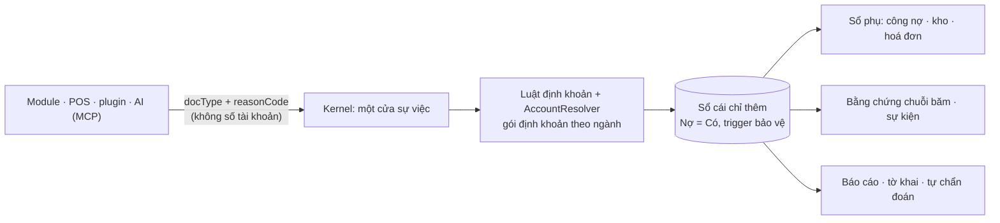

# Bizcity Core (open-ketoan)

**Khung ứng dụng doanh nghiệp lấy sổ cái kế toán làm lõi.** Bán hàng, mua hàng, kho, nhân sự, sản xuất, dự án… là các *module* cài / gỡ được. Tiền của mọi module đi vào sổ qua **một cửa**: sự việc có phiên bản → định khoản theo gói ngành → sổ cái chỉ thêm, có bằng chứng chống sửa. AI (Claude, ChatGPT, Bizcity Cell trên Zalo) đọc sổ và lập chứng từ qua **MCP**, luôn xem trước rồi người dùng xác nhận.

- **Chạy được trên một máy:** chỉ cần PostgreSQL. Redis, NATS, Keycloak, Meilisearch là adapter tuỳ chọn ([ADR-0007](docs/adr/ADR-0007-goi-chia-se-va-ha-tang.md)).
- **Viết module bằng người hoặc AI (vibecode):** theo [Bizcity Framework Standard v1](docs/standard/README.md) (7 hợp đồng), tự kiểm bằng một lệnh.
- **Kế toán Việt Nam:** hệ thống tài khoản TT99, thuế GTGT / TNDN, hoá đơn điện tử, gói định khoản theo ngành.

> **Kiến trúc do Johnny Chu – Chu Hoàng Anh thiết kế.** *SQL minh bạch, Accounting Core ổn định, cộng đồng tự do vibe-code phần mở rộng mà không làm mất tính toàn vẹn của dữ liệu kế toán. Cộng đồng được tự do phát triển module, nhưng không được tự do thay đổi sự thật kế toán.*
> Bảy nguyên tắc kiến trúc, ba lớp kiểm soát (Domain · Event · Compliance), ba đường vào (Capability · MCP Tool · Extension), ma trận tuân thủ và checklist nhận việc: **[Bản công bố kiến trúc](docs/CONG-BO-KIEN-TRUC.md)**.

> Stack: Node 22 · TypeScript · Fastify 5 · zod · Kysely · PostgreSQL 16 · React 18 + Vite · Docker Compose. Giám sát tuỳ chọn: Prometheus · Grafana · Loki.

## Thử nhanh (5 phút)

```bash
cp .env.example .env                       # đổi JWT_SECRET, mật khẩu quản trị
docker compose up -d --build               # db + migration + api + web
BIZCITY_PASSWORD='Admin@123' node scripts/cai-preset.mjs thuong-mai-ban-le \
  --api http://localhost:8088 --tenant demo --email admin@ketoan.local   # cấu hình + dữ liệu mẫu hư cấu
```

| Địa chỉ | Nội dung |
|---|---|
| http://localhost:8088 | Giao diện (đơn vị `demo`, `admin@ketoan.local` / `Admin@123` — **đổi ngay**) |
| http://localhost:8088/api/docs | Tài liệu API (OpenAPI, sinh từ zod) |
| `/api/v1/system/health` · `/health/ready` | Sống (L0) · sẵn sàng (L1: migration, trigger bảo vệ sổ, CSDL ghi được) |
| `/api/v1/system/diagnostics` | Tự chẩn đoán toàn vẹn sổ (L3) |
| `/api/v1/system/capabilities` | Năng lực Standard của bản đang chạy |
| `POST /mcp` | Công cụ MCP cho trợ lý AI |

Giám sát (tuỳ chọn): `docker compose -f docker-compose.yml -f infrastructure/monitoring/docker-compose.monitoring.yml up -d` → Grafana http://127.0.0.1:3000. Xem [infrastructure/monitoring](infrastructure/monitoring/README.md).

## Kiến trúc trong một hình



Sơ đồ đầy đủ (bối cảnh, lớp, luồng chứng từ, module tương lai, AI ghi sổ, triển khai): **[docs/architecture/README.md](docs/architecture/README.md)**.

## Cấu trúc thư mục

```
apps/api/            API (Fastify). Mỗi tệp có nhãn lớp // @bizcity-layer K|P|M|D|A|U
  src/core/          Platform: lỗi, xác thực, runtime action (defineAction), bằng chứng, số đo, quan sát
  src/modules/       Kernel (documents, posting, ledger, periods…) + danh mục + báo cáo + hệ thống (MCP, chẩn đoán)
  src/phan-he/<key>/ Phân hệ nghiệp vụ (ke-toan, quy, mua-hang, ban-hang, kho, tai-san, thue…)
  test/              Kiểm thử trên PostgreSQL thật; sau mỗi tệp tự kiểm bất biến sổ
apps/web/            Giao diện React
packages/contracts/  Hợp đồng dùng chung: khuôn chứng từ, khuôn phản hồi, danh mục mã lỗi
packages/module-sdk/ Bản nháp API @bizcity/module-sdk
db/migrations/       SQL đánh số, có COMMENT từng bảng / cột
presets/             Gói cài nhanh theo ngành (dữ liệu mẫu hư cấu)
infrastructure/      Cấu hình vận hành tuỳ chọn: monitoring/ (Prometheus, Grafana, Loki)
tests/conformance/   Bộ kiểm chuẩn: selfcheck + diagnostics, bảng điểm, lộ trình
docs/                Luật, hợp đồng, chuẩn, ADR, kiến trúc, vận hành, hướng dẫn
```

Cây đích sau khi tách gói (`packages/kernel`, `packages/*`, `modules/<key>`, `adapters/*`): [TARGET-LAYOUT](docs/standard/TARGET-LAYOUT.md).

## Chuẩn và hợp đồng

| Chủ đề | Tài liệu |
|---|---|
| **Bản công bố kiến trúc**: 4 lớp hợp đồng, luật bắt buộc, checklist 3 giai đoạn | [docs/CONG-BO-KIEN-TRUC.md](docs/CONG-BO-KIEN-TRUC.md) |
| Luật và chỉ mục (bắt đầu ở đây) | [docs/00-CANON.md](docs/00-CANON.md) |
| Bất biến kế toán (Domain Contract) | [bizcity_domain@1](docs/contracts/BIZCITY-DOMAIN-v1.md) |
| Cache, outbox, sao lưu / PITR | [RULE-INFRASTRUCTURE](docs/rules/RULE-INFRASTRUCTURE.md) |
| Viết module | [Standard v1](docs/standard/README.md) · [ca mẫu Hợp đồng](docs/standard/GOLDEN-CASE-HOP-DONG.md) · [bộ kiểm](docs/standard/CONFORMANCE.md) |
| Nạp chứng từ vào sổ | [bizcity_ledger_intake@1](docs/contracts/BIZCITY-LEDGER-INTAKE-v1.md) |
| Action, idempotency, dry-run | [bizcity_action@1](docs/contracts/BIZCITY-ACTION-v1.md) |
| Bằng chứng, biên nhận | [bizcity_evidence@1](docs/contracts/BIZCITY-EVIDENCE-v1.md) |
| Mã lỗi, thông báo, gợi ý | [bizcity_errors@1](docs/contracts/BIZCITY-ERRORS-v1.md) |
| MCP cho AI | [bizcity_mcp@1](docs/contracts/BIZCITY-MCP-v1.md) |
| Gói định khoản theo ngành | [bizcity_posting_template@1](docs/contracts/BIZCITY-POSTING-TEMPLATE-v1.md) |
| Cài nhanh | [bizcity_preset@1](docs/contracts/BIZCITY-PRESET-v1.md) |
| Log, trace, số đo, cảnh báo, báo lỗi | [OBSERVABILITY](docs/ops/OBSERVABILITY.md) · [DIAGNOSTICS](docs/ops/DIAGNOSTICS.md) |
| Quyết định kiến trúc | [docs/adr/](docs/adr/README.md) |
| Lộ trình | [PHASES](docs/standard/PHASES.md) · tiến độ máy đọc `docs/standard/roadmap.json` |

## Lệnh thường dùng

```bash
npm install                                # Node ≥ 22.12
docker compose up -d db                    # chỉ PostgreSQL (cổng 5434)
npm run dev                                # API :4100 + giao diện :4180
npm test                                   # kiểm thử (PostgreSQL thật)
npm run typecheck
node tests/conformance/selfcheck.mjs       # bộ kiểm chuẩn + bảng điểm + lộ trình (không cần npm install)
bash scripts/kiem-chuan.sh                 # ranh giới
```

## Đóng góp

Đọc **[CONTRIBUTING.md](CONTRIBUTING.md)**: bốn câu không thương lượng, quy trình PR, mức thay đổi Kernel, lệnh kiểm trước khi mở PR. Báo lỗi theo [mẫu](.github/ISSUE_TEMPLATE/bao-loi.yml). Lỗ hổng bảo mật: [SECURITY.md](SECURITY.md). Agent AI: [AGENTS.md](AGENTS.md).
