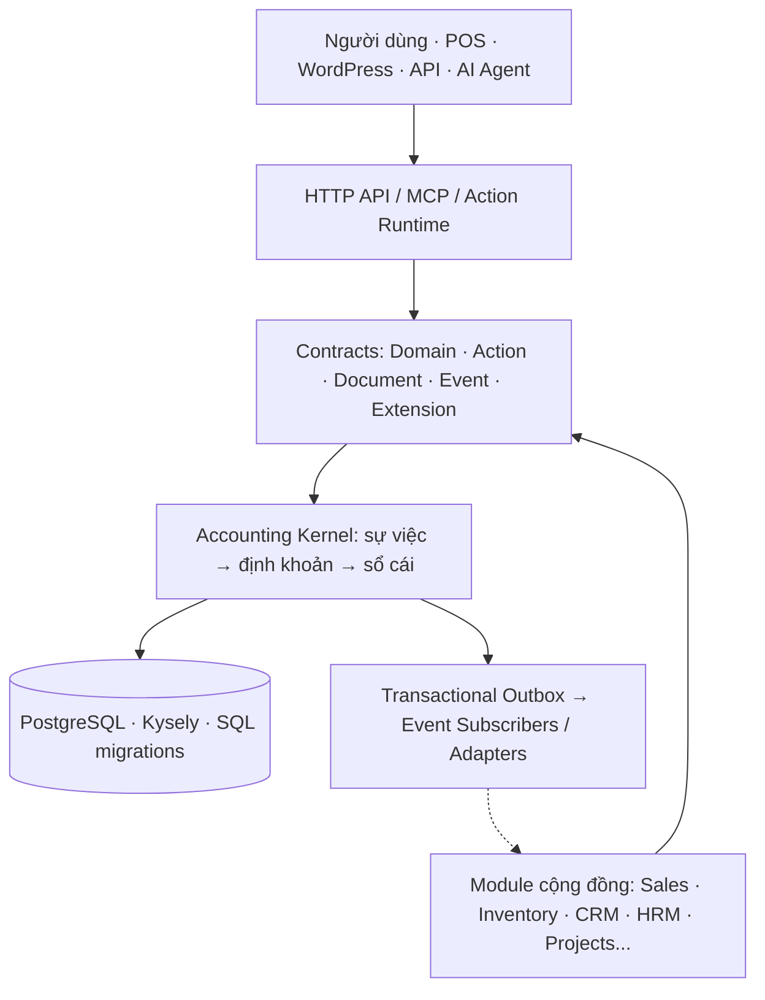

# open-ketoan
<!-- [2026-10-29 10:24 PM Johnny Chu - Chu Hoàng Anh] INIT — khởi tạo Bizcity Core Framework: sổ cái chỉ thêm, cửa nạp sự việc, CANON, hợp đồng, bộ kiểm chuẩn. -->
<!-- [2026-10-30 12:10 PM Johnny Chu - Chu Hoàng Anh] ADR-0007 — chuẩn hoá mã lỗi, quan sát, bộ giám sát, cài nhanh, kiến trúc, đóng góp. -->
<!-- [2026-10-30 12:50 PM Johnny Chu - Chu Hoàng Anh] CONG-BO — bản công bố kiến trúc: 4 lớp hợp đồng, luật hạ tầng, checklist nhận việc. -->
<!-- [2026-10-30 01:11 PM Johnny Chu - Chu Hoàng Anh] CONG-BO — tuyên bố tối thượng, 7 nguyên tắc AP, ba lớp kiểm soát, ma trận tuân thủ, kiểm nâng cấp migration. -->
<!-- [2026-10-30 01:17 PM Johnny Chu - Chu Hoàng Anh] README — tuyên ngôn open-ketoan, lối vào cài đặt / sử dụng / viết module / vận hành. -->
<!-- [2026-10-30 01:22 PM Johnny Chu - Chu Hoàng Anh] R-LICENSE — giấy phép GPL-2.0-or-later, chính sách nhãn hiệu BizCity. -->
<!-- [2026-10-30 01:36 PM Johnny Chu - Chu Hoàng Anh] AUDIT — thư mục phase PHASE-001…017, SC-PHASE-1. -->
<!-- [2026-10-30 01:37 PM Johnny Chu - Chu Hoàng Anh] AUDIT — đánh giá kiến trúc 2026-10-30, mục lục phase. -->
<!-- [2026-11-01 01:01 AM Johnny Chu - Chu Hoàng Anh] PHASE-018 — ảnh kiến trúc Core, cài nhanh 3 bước (scripts/cai-nhanh.sh), giám sát Prometheus / Grafana / Loki, kết nối API + MCP để trợ lý AI ghi nhận sổ sách và đọc báo cáo. -->
<!-- [2026-11-03 03:40 PM Johnny Chu - Chu Hoàng Anh] G3-01 — lối vào "POS của bạn ghi sổ trong 4 bước" + skill kế toán cho AI -->
<!-- [2026-11-05 11:50 PM Johnny Chu - Chu Hoàng Anh] README — ảnh kiến trúc: bốn ảnh, sửa cú pháp liên kết (ngoặc trong tên tệp mã hoá %28 %29) -->
<!-- [2026-11-06 06:55 PM Johnny Chu - Chu Hoàng Anh] README — lời giới thiệu của chủ dự án: "Rút gọn thời gian viết ứng dụng", vì sao AE dev cần open-ketoan, không thay thế Misa / Bravo mà là chủ động; mục "Các nguyên tắc quan trọng" -->

** Rút gọn thời gian viết ứng dụng.**

Anh em Dev muốn viết ERP nội bộ, POS, pm bán hàng, CRM , quản lý mua hàng, tài sản, nhân sự cho công ty dùng, chỉ cần init Repo này dùng luôn, không cần phải xây dựng nghiệp vụ kế toán lại từ đầu, bởi vì tất cả kho, bán hàng, mua hàng, nhân sự đều phải ghi và khai báo về kế toán.

> **open-ketoan** là dự án Accounting Core Framework hướng tới một nền tảng kế toán mở đã chuẩn hóa, tuân thủ nguyên tắc kế toán để bất cứ ai cũng có thể tự triển khai, kết nối và phát triển các module nghiệp vụ kinh doanh, bán hàng, các ứng dụng mới nhưng luôn chắc chắn rằng, số liệu kinh doanh, marketing được phản ánh minh bạch, đúng nghiệp vụ kế toán dù bằng việc tự code hay dùng AI-assisted development (*vibe coding*).
>
> **Định hướng kiến trúc:** *Accounting Core ổn định — Module mở rộng — Hợp đồng rõ ràng — Dữ liệu do người dùng kiểm soát.*

**Đi nhanh:** [Cài nhanh 3 bước](#cài-nhanh-3-bước-trên-máy-của-bạn) · [Kết nối API và trợ lý AI](#kết-nối-api-và-trợ-lý-ai-với-bizcity) · [Giám sát](#giám-sát-vận-hành-prometheus--grafana--loki) · [Sử dụng](#sử-dụng) · [Viết module](#phát-triển-và-viết-module) · [Vận hành](#vận-hành) · [Đóng góp](CONTRIBUTING.md) · [Bản công bố kiến trúc](docs/CONG-BO-KIEN-TRUC.md )
[Cài đặt](#cài-đặt)

**Xem thử** (hệ thống chung, đừng nhập dữ liệu thật; dữ liệu có thể được đặt lại; bản demo có thể chạy phiên bản cũ hơn repo):

| | Kế toán | Đăng nhập |
|---|---|---|
| <https://ketoan.bizcity.vn/> | Mã đơn vị: otchuong / Email: admin@otchuongmart.local  / Mật khẩu: Otcfa8719fd1c0b! |


| | Quản trị kho, POS |  Đăng nhập |
|---|---|---|
| <https://quantri.bizcity.vn/> | Quản trị: admin / Otc-464cb5973c | 


## Vì sao có open-ketoan?

Nhiều ae muốn tự build ERP nội bộ cho mình nhưng lại chưa hiểu quá sâu về nghiệp vụ kế toán hoặc bản chất 1 phần mềm kế toán cần có gì, các nguyên tắc ghi sổ là gì.

Nhiều doanh nghiệp và hộ kinh doanh Việt Nam đang dùng các phần mềm kế toán đóng hoặc SaaS, nhưng khi doanh nghiệp muốn mở rộng một quy trình riêng, kết nối với ERP/ POS / CRM / kho, tự viết ứng dụng trên dữ liệu kế toán, hay vibe-code thêm module mới để thích ứng với nhu cầu phát triển, bị giới hạn bởi API, quyền truy cập, chi phí và chính sách của nhà cung cấp không cho phép.

Điều này làm mất khả năng tự chủ động kỹ thuật trong kỷ nguyên AI với các CEO, Dev.
Không phải là câu chuyện thay thế Misa, hay Bravo, các phần mềm kế toán dạng "đóng" truyền thống, mà còn là việc chủ động.
Chủ doanh nghiệp, IT, Dev cần được sở hữu và chủ động với dữ liệu của mình, còn cộng đồng developer, kế toán và Dev có thể tạo ra những ứng dụng phù hợp với nhu cầu thực tế, thay vì bắt đầu lại từ sổ cái.

## Open - Kế toán bảo đảm tất cả các sự kiện kinh tế phát sinh ghi vào dữ liệu đều chuẩn theo nguyên tắc của kế toán và quy định của nhà nước.


## Các nguyên tắc quan trọng lưu ý cho AE dev:

1. **Không chứng từ / sự việc hợp lệ thì không có bút toán.** Mọi bút toán truy nguyên được nguồn và phiên bản.
2. **Sổ cái chỉ thêm.** Không âm thầm sửa hoặc xoá bút toán đã ghi; sai sót được xử lý bằng nghiệp vụ điều chỉnh / đảo phù hợp, giữ lại lịch sử.
3. **Một cửa ghi sổ.** Giao diện, POS, WordPress, API, module hay AI đều phải đi qua Accounting Core và Domain Contract.
4. **Kế toán sở hữu cấu hình định khoản.** Module gửi `docType`, `reasonCode` và mã danh mục, không được tự quyết định tài khoản Nợ / Có hoặc ghi thẳng vào `ledger_*`.

Luật chi tiết và cấp độ kiểm soát: [00-CANON.md](docs/00-CANON.md) · [Domain Contract](docs/contracts/BIZCITY-DOMAIN-v1.md) · [RULE-LEDGER](docs/rules/RULE-LEDGER.md).

## Kiến trúc: Ngoài lõi kế toán cần đảm bảo nguyên tắc ghi sổ, còn lại anh em muốn Dev gì cũng được.


*Kiến trúc Core open-ketoan (Bizcity Core Framework) — © 2026 Johnny Chu (Chu Hoàng Anh) / BizCity.*

Sơ đồ rút gọn dạng văn bản:



**Accounting Kernel** giữ các bất biến: chứng từ, phiên bản, định khoản, khoá kỳ, sổ cái chỉ thêm, cân Nợ / Có, sổ phụ và biên nhận. **Module** quản lý dữ liệu và quy trình riêng, tương tác với Kernel bằng năng lực được cấp quyền. **Platform** cung cấp xác thực, Action Runtime, chứng từ, sự kiện, audit, quan sát hệ thống và SDK.

Kiến trúc gốc được công bố tại [CONG-BO-KIEN-TRUC.md](docs/CONG-BO-KIEN-TRUC.md). Tài liệu này là nguồn chi tiết cho ranh giới và quyền thay đổi của từng lớp. Sơ đồ bối cảnh, lớp, luồng chứng từ và triển khai: [docs/architecture/README.md](docs/architecture/README.md). Quyết định kiến trúc: [docs/adr/](docs/adr/README.md).

## Mở rộng theo hợp đồng, không mở rộng bằng cách sửa lõi

Một module cộng đồng có thể có bảng, giao diện, quy trình duyệt và các event riêng. Nhưng khi nghiệp vụ ảnh hưởng đến sổ kế toán, module phải gọi `ctx.ledger.submit` hoặc action công khai, để Kernel kiểm quyền, kiểm tra chứng từ, chọn cấu hình định khoản và ghi sổ trong giao dịch hợp lệ.

Bộ hợp đồng đang được chuẩn hoá gồm:

| Hợp đồng | Trách nhiệm | Trạng thái |
|---|---|---|
| **[Domain Contract](docs/contracts/BIZCITY-DOMAIN-v1.md)** | Các bất biến kế toán không được phá vỡ | Chấp nhận |
| **[Action / Capability Contract](docs/contracts/BIZCITY-ACTION-v1.md)** | Input / output schema, quyền, tác dụng phụ, idempotency, lỗi và biên nhận | Đề xuất |
| **[Document Contract](docs/contracts/BIZCITY-DOCUMENT-v1.md)** | Chứng từ, trạng thái duyệt, phiên bản, liên kết và chữ ký | Đề xuất |
| **[Data Contract](docs/contracts/BIZCITY-DATA-v1.md)** | Quyền sở hữu bảng, cô lập tenant, SQL migrations và truy cập dữ liệu | Đề xuất |
| **[Event Contract](docs/contracts/BIZCITY-EVENT-v1.md)** | Sự kiện, nguồn phát, payload, version, subscriber, retry và replay | Đề xuất |
| **[MCP Tool Contract](docs/contracts/BIZCITY-MCP-v1.md)** | Công cụ AI có quyền giới hạn, xem trước và xác nhận khi cần | Đề xuất |
| **[Extension](docs/contracts/BIZCITY-EXTENSION-v1.md) / [Module Contract](docs/contracts/BIZCITY-MODULE-v1.md)** | Đăng ký module, extension points, khả năng tương thích và kiểm chuẩn | Đề xuất |
| **[Compliance Contract](docs/contracts/BIZCITY-COMPLIANCE-v1.md)** | 9 yêu cầu tuân thủ bắt buộc, ma trận pháp lý | Chấp nhận |
| [Ledger Intake](docs/contracts/BIZCITY-LEDGER-INTAKE-v1.md) · [Errors](docs/contracts/BIZCITY-ERRORS-v1.md) · [Evidence](docs/contracts/BIZCITY-EVIDENCE-v1.md) · [Posting Template](docs/contracts/BIZCITY-POSTING-TEMPLATE-v1.md) · [Preset](docs/contracts/BIZCITY-PRESET-v1.md) | Khuôn nạp sổ, mã lỗi, bằng chứng, gói định khoản ngành, cài nhanh | xem từng tệp |

Các hợp đồng có **trạng thái khác nhau**: một số đã được chấp nhận / ổn định, một số còn là bản dự thảo. Vui lòng kiểm tra [CANON](docs/00-CANON.md) và [danh mục hợp đồng](docs/contracts/README.md) trước khi sử dụng như API bảo đảm tương thích.

## Event-driven nhằm đảm bảo mọi luồng chứng từ đều đi theo đúng quy định, nguyên tắc sổ sách, báo cáo của kế toán.

open-ketoan phân biệt **sự việc kinh tế đưa vào kế toán** (`accounting_events`, `docKey`, `version`) với **domain / integration event** thông báo một việc đã xảy ra cho các module khác.

Ví dụ: khi Kernel ghi sổ thành công, nó có thể phát sự kiện `bizcity.ledger.entry.posted`. Event này giúp CRM, báo cáo hoặc hệ thống ngoài đồng bộ trạng thái; **không module nào được tự phát event của Kernel để giả lập một bút toán đã được ghi**.

Hướng triển khai là **transactional outbox**: dữ liệu nghiệp vụ và bản ghi chờ phát event cùng commit trong PostgreSQL; sau commit worker mới chuyển event đến subscriber. Consumer phải chịu được việc nhận lại; NATS chỉ là adapter khi cần mở rộng, không phải điều kiện để chạy lõi. Luật: [RULE-INFRASTRUCTURE](docs/rules/RULE-INFRASTRUCTURE.md) (R-OUTBOX, R-CACHE).

> Event Runtime, outbox, registry, replay và các bảo đảm delivery hiện còn trong lộ trình hoàn thiện. Không hiểu mô tả kiến trúc này là lời khẳng định toàn bộ EDA đã sẵn sàng production.

## AI-native, nhưng AI không được vượt luật kế toán

open-ketoan hướng đến việc để ChatGPT, Claude, Bizcity Cell hoặc agent khác có thể **đọc số dư, tra cứu chứng từ, lập nháp và đề xuất nghiệp vụ** qua MCP / API. Những thao tác nhạy cảm phải tuân thủ quyền, trạng thái chứng từ, bước xem trước và quy trình xác nhận / duyệt bởi con người.

**AI có thể giúp viết phần mềm và đề xuất nghiệp vụ. AI không được tự duyệt chứng từ, tự vượt khoá kỳ hoặc sửa trực tiếp sổ cái.** Các công cụ MCP có khả năng khác nhau theo phiên bản triển khai; xem trạng thái trong [Bản công bố kiến trúc §2.1](docs/CONG-BO-KIEN-TRUC.md) và [bizcity_mcp@1](docs/contracts/BIZCITY-MCP-v1.md). Bản đang chạy tự liệt kê công cụ ở `POST /mcp` (`tools/list`) và năng lực ở `/api/v1/system/capabilities`.

## Dùng open-ketoan tiết kiệm được gì?
<!-- [2026-11-03 07:37 PM Johnny Chu - Chu Hoàng Anh] ADR-0020 — README: tiết kiệm cho dev thiếu nghiệp vụ kế toán, tách số đã đo / giả định, trỏ demo và bộ hướng dẫn docs/core -->

Dành cho dev xây **ERP nội bộ cho công ty mình**, hoặc module **bán hàng, POS, CRM, quản lý sản xuất (MRP), nhân sự (HRM)** mà thiếu nghiệp vụ kế toán và sổ sách. Thay vì tự học định khoản, thuế, giá vốn, khoá kỳ rồi tự viết và tự kiểm, dev **kể sự việc** theo hợp đồng; Core ghi sổ đúng nguyên tắc. Phân tích đầy đủ, kể cả phần Core **không** giúp được: [docs/core/05](docs/core/05-tiet-kiem-thoi-gian-va-token.md).

**1. Đã đo từ mã nguồn** (chạy lại: `node scripts/do-bang-chung-core.mjs`, đo 2026-11-03; route và ca test là mức tối thiểu)

| Core đã làm sẵn | Số |
|---|---:|
| Loại chứng từ nhận vào · tệp luật định khoản | 10 · 6 |
| Route API · migration CSDL | 453+ · 61 |
| Ca test API (146 tệp) | 1.087+ |
| Mã phát hiện ở cửa nạp · kiểm tự chẩn đoán · ca lỗi F22 có cách khắc phục theo vai | 22 · 28 · 93 |
| Skill cho AI | 7 |
| Bộ tài liệu tối thiểu AI cần đọc để nối một app vào sổ | ~33 nghìn ký tự, ~8.300–13.400 token (ước lượng) |

**2. Ước tính, là GIẢ ĐỊNH** (mô hình cho một ứng dụng quản lý kinh doanh quy mô vừa; **chưa đo dự án thật nào**). Đổi tham số hoặc nạp số đo thật: `node scripts/uoc-tinh-tiet-kiem.mjs --sensitivity`.

| Nhóm công việc | Tự xây (giờ) | Dùng Core (giờ) | Tránh được |
|---|---:|---:|---:|
| Chuẩn hoá dữ liệu ban đầu | 40 | 15 | 25 |
| Ghi nhận giao dịch và sổ sách | 120 | 15 | 105 |
| Thiết lập quy tắc ghi nhận | 75 | 30 | 45 |
| Kiểm soát sai sót và lịch sử điều chỉnh | 80 | 20 | 60 |
| Kết nối với phần mềm kinh doanh | 45 | 50 | −5 |
| Kiểm thử và đối chiếu số liệu | 95 | 40 | 55 |
| **Tổng** | **455** | **170** | **285** (≈ 7,1 tuần công) |

- Với 300.000 đồng/giờ: **85,5 triệu đồng** công phát triển không phải làm lại. Phí API giả định giảm thêm **3,4 triệu** (42,0 → 13,2 triệu token). Tổng **~88,9 triệu đồng** một dự án, trong đó **token chỉ ~3,9%**: lợi ích chính là thời gian developer và độ tin cậy của sổ, không phải tiền API.
- Phần tiết kiệm thực tế chỉ đạt 30–100% bảng, chi phí 150.000–500.000 đồng/giờ: tổng từ **13,9** đến **145,9 triệu đồng**.
- Đây là nguồn lực được giải phóng, không phải tiền mặt. Đơn giá token (2,5 / 15 USD mỗi triệu) và tỉ giá 26.000 đồng/USD là giả định, thay bằng giá bạn đang dùng.

**3. Không tiết kiệm được, hoặc ít hơn**

- **Nhóm "Kết nối" mất thêm ~5 giờ**: vẫn phải học hợp đồng, ánh xạ mã, xin khoá API.
- **MRP**: chứng từ sản xuất, giá thành là cổng chờ, Kernel chưa mở ([skill mở cổng](skills/contribute-production-module/SKILL.md)). **HRM**: không có bảng lương, BHXH, thuế TNCN; chỉ ghi nhận chi phí qua `manual_journal` theo lý do kế toán khai.
- Giá vốn mặc định là bình quân gia quyền theo tháng; FIFO và đổi mã hàng có phiên bản (`item_id`) chưa có.
- Core không thay kế toán trưởng (chính sách, lý do, duyệt gói) và không phải tư vấn pháp lý.


Bộ hướng dẫn đọc theo vai (kế toán, CEO, dev, cộng đồng, AI): [docs/core/](docs/core/README.md).

## Công nghệ và cách triển khai

- **Backend:** TypeScript, Node.js 22, Fastify 5, Zod.
- **Frontend:** React, Vite.
- **Database:** PostgreSQL 16; **Kysely + SQL migrations, không dùng Prisma** ([ADR-0007](docs/adr/ADR-0007-goi-chia-se-va-ha-tang.md)).
- **Kiểm thử:** Vitest trên PostgreSQL thật; bộ kiểm chuẩn [tests/conformance](tests/conformance/README.md).
- **Triển khai ban đầu:** Docker Compose; có thể tự host và tuỳ chọn hạ tầng theo quy mô.
- **Quan sát vận hành:** Prometheus / Grafana / Loki tuỳ chọn; Redis / NATS / Kong / Kubernetes không phải điều kiện bắt buộc cho bản cài cơ bản.

Dự án ưu tiên **Modular Monolith + Contracts + Adapters** trước, mở rộng từng phần khi có tải và nhu cầu thật ([ADR-0008](docs/adr/ADR-0008-cay-thu-muc-lean.md)). Chi tiết lựa chọn công nghệ: [cong-nghe.md](docs/cong-nghe.md).

## Cài đặt

### Cài nhanh 3 bước trên máy của bạn

Chỉ cần **Docker** (Docker Desktop trên Windows / macOS, Docker Engine trên Linux) và **Git** (Windows: chạy lệnh trong Git Bash). Không cần cài Node, PostgreSQL, Grafana hay Prometheus — tất cả chạy trong Docker.

```bash
# 1. Lấy mã nguồn
git clone https://github.com/hoanganh8389/bizcity-open-ketoan.git && cd bizcity-open-ketoan

# 2. Cài và chạy (tự tạo .env với khoá bí mật ngẫu nhiên, build, chờ sẵn sàng)
bash scripts/cai-nhanh.sh                  # chỉ ứng dụng kế toán
bash scripts/cai-nhanh.sh --giam-sat       # hoặc: kèm Prometheus + Grafana + Loki

# 3. Mở http://localhost:8088 — đơn vị demo · admin@ketoan.local · Admin@123 (đổi mật khẩu ngay)
```

Script [`scripts/cai-nhanh.sh`](scripts/cai-nhanh.sh) **không ghi đè** `.env` đã có, tự nhận Docker Desktop để dùng tệp ghép phù hợp, và in ra mọi địa chỉ + nơi lấy mật khẩu khi xong. Lần đầu build mất vài phút. Đây là cách cài cho **máy thử / máy cá nhân**; máy chủ thật xem [trien-khai.md](docs/trien-khai.md).

<details>
<summary>Tự chạy từng lệnh thay cho script</summary>

```bash
cp .env.example .env                       # đổi JWT_SECRET (≥ 32 ký tự ngẫu nhiên), mật khẩu quản trị
docker compose up -d --build               # db + migration + api + web
```

</details>

Nạp cấu hình ngành và dữ liệu mẫu **hư cấu** (cần Node ≥ 22.12):

```bash
BIZCITY_PASSWORD='Admin@123' node scripts/cai-preset.mjs thuong-mai-ban-le \
  --api http://localhost:8088 --tenant demo --email admin@ketoan.local
```

| Địa chỉ | Nội dung |
|---|---|
| http://localhost:8088 | Giao diện (đơn vị `demo`, `admin@ketoan.local` / `Admin@123`, **đổi mật khẩu ngay**) |
| http://localhost:8088/api/docs | Tài liệu API (OpenAPI, sinh từ zod), thử trực tiếp |
| `/api/v1/system/health` · `/health/ready` | Sống · sẵn sàng (migration, trigger bảo vệ sổ, CSDL ghi được) |
| `/api/v1/system/diagnostics` | Tự chẩn đoán toàn vẹn sổ |
| `/api/v1/system/capabilities` | Năng lực Standard của bản đang chạy |
| `POST /mcp` | Công cụ MCP cho trợ lý AI ([kết nối](#kết-nối-api-và-trợ-lý-ai-với-bizcity)) |
| http://127.0.0.1:3000 · :9090 | Grafana · Prometheus (khi cài `--giam-sat`, [xem dưới](#giám-sát-vận-hành-prometheus--grafana--loki)) |

### Tài liệu cài đặt

| Việc | Tài liệu |
|---|---|
| Triển khai lên máy chủ (Ubuntu, aaPanel, Docker, HTTPS) | [trien-khai.md](docs/trien-khai.md) |
| Chuẩn một bản cài: biến môi trường, cổng, bí mật, sao lưu | [ops/DEPLOY.md](docs/ops/DEPLOY.md) |
| Cài nhanh theo ngành, dữ liệu mẫu | [presets/README.md](presets/README.md) · [bizcity_preset@1](docs/contracts/BIZCITY-PRESET-v1.md) |
| Bật giám sát Prometheus / Grafana / Loki | [infrastructure/monitoring](infrastructure/monitoring/README.md) |
| Cơ sở dữ liệu, migration | [db/README.md](db/README.md) · [RULE-DATABASE](docs/rules/RULE-DATABASE.md) |

## Giám sát vận hành: Prometheus · Grafana · Loki

<!-- [2026-11-01 03:01 PM Johnny Chu - Chu Hoàng Anh] ADR-0010 — OpenTelemetry từ lõi: sáu lớp bảo đảm, span chỉ ở khớp nối Platform + cổng Kernel, thuộc tính theo danh sách cho phép, Tempo -->
<!-- [2026-11-01 04:13 PM Johnny Chu - Chu Hoàng Anh] ADR-0010 — OpenTelemetry từ lõi (PHASE-018 W5): span ở khớp nối Platform + cổng Kernel, lọc thuộc tính, traceparent qua outbox -->
**Sáu lớp bảo đảm** của Bizcity Core ([ADR-0010](docs/adr/ADR-0010-opentelemetry-tu-loi.md)). Chỉ hai lớp đầu quyết định và lưu sự thật; bốn lớp sau chỉ quan sát, tắt hay hỏng cũng không ảnh hưởng sổ.

| Lớp | Bảo đảm |
|---|---|
| 1. **Accounting Kernel** | ghi sổ đúng |
| 2. **PostgreSQL + Audit Ledger** | lưu bằng chứng nghiệp vụ |
| 3. **OpenTelemetry** | theo dõi hành trình thực thi: yêu cầu đi qua module, action, Kernel, CSDL, sự kiện nào |
| 4. **Prometheus** | đo sức khoẻ và hiệu năng |
| 5. **Grafana + Tempo + Loki** | quan sát, điều tra lỗi |
| 6. **Alertmanager** | thông báo khi có bất thường |

Khi cộng đồng viết module VAT, công nợ, CRM, kho hay agent AI trên cùng Core, mỗi span đã mang sẵn tên module (`bizcity.module`). Một module lỗi thì hệ thống chỉ ra được **module nào, bước nào, ảnh hưởng tới luồng nào**, mà không cần sửa Accounting Kernel. Module không viết mã truy vết: span có sẵn ở HTTP, MCP, action, cổng Kernel, CSDL, sự kiện; chi tiết thêm thì dùng `ctx.trace.step(...)`. Thiết kế: [kiến trúc §7–§8](docs/architecture/README.md) · danh sách span và cách tra: [OBSERVABILITY §1.1](docs/ops/OBSERVABILITY.md).

Bộ giám sát **đi kèm trong repo, chạy bằng Docker, không phải cài riêng** và **không bắt buộc**: không bật thì phần mềm kế toán vẫn chạy bình thường. Bật bằng `bash scripts/cai-nhanh.sh --giam-sat`, hoặc ghép tệp compose:

```bash
# .env cần GRAFANA_ADMIN_PASSWORD (bắt buộc — thiếu thì docker compose dừng và báo)
docker compose -f docker-compose.yml -f infrastructure/monitoring/docker-compose.monitoring.yml up -d
# Docker Desktop (Windows / macOS): ghép thêm  -f infrastructure/monitoring/docker-compose.desktop.yml
```

| Thành phần | Việc | Địa chỉ |
|---|---|---|
| **Prometheus** | thu số đo `bizcity_*` từ `GET /metrics` của API, PostgreSQL, máy chủ, container; tính 14 luật cảnh báo | http://127.0.0.1:9090 |
| **Grafana** | 9 bảng điều khiển tự nạp (thư mục **Bizcity**), đăng nhập `admin` + `GRAFANA_ADMIN_PASSWORD` | http://127.0.0.1:3000 |
| **Loki + Promtail** | nhật ký JSON của API, tra theo mã yêu cầu `reqId` / mã lỗi | qua Grafana (bảng 06) |
| **Tempo + OTel Collector** | trace OpenTelemetry: một yêu cầu đi qua module, action, Kernel, CSDL, sự kiện nào; giữ mọi trace lỗi / chậm + 10% còn lại, 7 ngày | qua Grafana (Explore → Tempo) |
| **Alertmanager** | gom, lọc trùng, gửi cảnh báo (webhook, email…) — mặc định không gửi đi đâu | http://127.0.0.1:9093 |
| postgres-exporter · node-exporter · cAdvisor | số đo CSDL, máy chủ, container | — |

**Giám sát trả lời được gì:** dịch vụ có khoẻ không (01 Tổng quan, 02 API, 03 CSDL) · ghi sổ có trễ / lỗi không, tách **từ chối đúng luật** (kỳ khoá, không cân, thiếu cấu hình) khỏi **lỗi kỹ thuật** (04, 09 Toàn vẹn sổ) · sự kiện có dồn / chết không (07 Đường sự kiện) · lần đối soát sổ gần nhất là khi nào (09) · tải phân bố theo đơn vị mà không lộ đơn vị nào (08). Cảnh báo `LedgerIntegrityError`, `PostingBacklog`, `OutboxDeadLetter`, `ReconciliationStale`… kèm [sổ tay xử lý](docs/ops/RUNBOOK-CANH-BAO.md).

**Nguyên tắc:** giám sát **chỉ quan sát** — Prometheus không phải nguồn sự thật kế toán, cảnh báo không bao giờ tự sửa sổ; số đo không có nhãn đơn vị / chứng từ / người dùng; `/metrics`, Grafana, Prometheus chỉ mở trong máy (`127.0.0.1`), ra ngoài phải qua proxy có HTTPS + đăng nhập. Chi tiết: [infrastructure/monitoring](infrastructure/monitoring/README.md) · [OBSERVABILITY](docs/ops/OBSERVABILITY.md) · [PHASE-018](docs/phases/PHASE-018-GIAM-SAT-VAN-HANH/README.md).

## Kết nối API và trợ lý AI với Bizcity

Doanh nghiệp có thể nối phần mềm của mình và trợ lý AI vào open-ketoan để **ghi nhận sổ sách** (gửi chứng từ, lập phiếu nháp từ mô tả) và **đọc báo cáo kế toán, quản trị** (cân đối phát sinh, kết quả kinh doanh, công nợ, tiền) — dữ liệu vẫn nằm trong PostgreSQL của doanh nghiệp.

### Bước 1 — Tạo khoá API

Đăng nhập bằng tài khoản quản trị → **Hệ thống → Khoá API (HT02)** → *Tạo khoá API*, chọn quyền (`reports:read` để đọc báo cáo; `documents:write` để gửi chứng từ). Khoá dạng `kt_…` **chỉ hiện một lần** — lưu vào kho bí mật của bạn. Mỗi khoá gắn với một đơn vị; thu hồi bất cứ lúc nào ở cùng màn.

### Bước 2 — Chọn cách kết nối

| Cách | Dùng khi | Gọi | Trạng thái |
|---|---|---|---|
| **REST API** | POS, WooCommerce / WordPress, ERP, app riêng **gửi chứng từ** bán, mua, thu, chi, chuyển kho | `POST /api/v1/documents` với header `X-Api-Key` — [API tích hợp](docs/api-tich-hop.md), [JSON mẫu](docs/api/README.md), thử tại `/api/docs` | có |
| **MCP** (Model Context Protocol) | **Trợ lý AI** — Claude, ChatGPT, agent tự viết — hỏi báo cáo, lập phiếu nháp bằng lời | `POST /mcp` (JSON-RPC 2.0) với `X-Api-Key` hoặc phiên đăng nhập — [bizcity_mcp@1](docs/contracts/BIZCITY-MCP-v1.md) | có — 17 công cụ |
| **Bizcity Cell** | trợ lý kế toán qua **Zalo / web chat** do bizcity.vn vận hành (AI, OCR hoá đơn), một khoá 1API `biz-…` | Cell gọi ngược MCP của Core — [CELL-CONNECT](docs/standard/CELL-CONNECT.md), [CELL-MCP](docs/standard/CELL-MCP.md) | **đang phát triển** ([PHASE-015](docs/phases/PHASE-015-CELL-WORDPRESS/README.md)) |

Ví dụ trợ lý AI đọc bảng cân đối số phát sinh tháng 10 qua MCP:

```bash
curl -s https://<máy-chủ>/mcp -H "X-Api-Key: kt_…" -H "Content-Type: application/json" -d '{
  "jsonrpc": "2.0", "id": 1, "method": "tools/call",
  "params": { "name": "accounting.report.trial_balance", "arguments": { "from": "2026-10-01", "to": "2026-10-31" } } }'
# "method": "tools/list" → danh sách công cụ đúng với bản đang chạy và quyền của khoá
```

**Công cụ MCP hiện có (bản 2026-11-01):**

| Nhóm | Công cụ |
|---|---|
| **Đọc báo cáo, số dư** | `accounting.report.trial_balance` (cân đối phát sinh) · `accounting.report.income_statement` (kết quả kinh doanh B02) · `accounting.balance.get` (số dư tài khoản tại một ngày) · `accounting.cash.balances` (tiền mặt, ngân hàng) · `accounting.debts.partner_balances` (công nợ theo đối tượng) |
| **Tra cứu, giải thích** | `accounting.posting.reason_suggest` (gợi ý lý do định khoản từ câu mô tả) · `accounting.policy.list` · `core.template.list` · `core.evidence.get` (kiểm biên nhận) |
| **Đề xuất ghi — luôn chờ duyệt** | `accounting.document.create_draft` (chứng từ nháp) · `accounting.journal.post` (phiếu kế toán nháp) · `accounting.entry.reverse` (đề xuất huỷ) · `quy.payment_request.create` / `.update` (yêu cầu thanh toán; `.list` / `.get` để đọc) |

**Luật an toàn khi cho AI ghi sổ:** công cụ ghi trả **bút toán xem trước** + `confirm_token`, người dùng xác nhận thì mới lập phiếu, và phiếu luôn ở trạng thái **chờ kế toán duyệt** tại màn ACC14. AI **không** tự duyệt, không vượt khoá kỳ, không đổi cấu hình, không ghi thẳng sổ cái. Mọi lần gọi ghi có bằng chứng (`audit_logs`, chuỗi băm) và quyền theo khoá — AI chỉ làm được những gì khoá cho phép.

### POS của bạn ghi sổ trong 4 bước (không cần biết kế toán)

```bash
bash scripts/cai-nhanh.sh                                          # ① chạy open-ketoan
export BIZCITY_SERVER=http://localhost:8088 BIZCITY_API_KEY=...    # ② khoá màn Khoá API (HT02)
node examples/pos-mini/pos-mini.mjs examples/pos-mini/don-mau.json --out build/don-1.json
npx bizcity event check build/don-1.json                           # ③ thấy bút toán Kernel dựng từ một đơn bán
npx bizcity event check build/don-1.json --submit                  # ④ vào sổ
```

Dùng AI coding agent? `npx bizcity skills install --to <dự án của bạn>` cài ba skill kế toán ([skills/](skills/README.md)): AI đọc hợp đồng, viết code tích hợp, chạy lệnh kiểm, và không tự đoán tài khoản hay luật thuế.

## Sử dụng

| Bạn là | Đọc |
|---|---|
| **Kế toán, người dùng mới** | [Bắt đầu sử dụng](docs/huong-dan/00-bat-dau.md): thứ tự thiết lập lần đầu, các màn làm việc chính |
| Kế toán trưởng, quản trị, thủ kho… | [Đào tạo theo vai trò](docs/huong-dan/dao-tao-theo-vai-tro.md) · hướng dẫn từng màn ở [docs/huong-dan/](docs/huong-dan/00-bat-dau.md) (mỗi màn có nút **Hướng dẫn** trong giao diện) |
| Cần biết chức năng dựa trên văn bản pháp luật nào | [Căn cứ pháp lý](docs/can-cu/00-cach-dung.md) |
| Câu hỏi thường gặp | [Hỏi đáp](docs/tro-ly/hoi-dap.md) |
| **Hệ thống bán hàng / POS / WordPress** gửi chứng từ sang | [API tích hợp](docs/api-tich-hop.md) · [API nhận chứng từ, kèm JSON mẫu](docs/api/README.md) · [Cổng kết nối](docs/cong-ket-noi.md) · [bizcity_ledger_intake@1](docs/contracts/BIZCITY-LEDGER-INTAKE-v1.md) |
| **Kết nối trợ lý AI** (Claude, ChatGPT, Cell) | [bizcity_mcp@1](docs/contracts/BIZCITY-MCP-v1.md) · [Cell MCP](docs/standard/CELL-MCP.md) |
| Đọc mã lỗi API trả về | [bizcity_errors@1](docs/contracts/BIZCITY-ERRORS-v1.md) |

## Phát triển và viết module

### Chạy máy dev

```bash
npm install                                # Node ≥ 22.12
cp .env.example .env
docker compose up -d db                    # PostgreSQL (127.0.0.1:5434)
npm run db:seed                            # migration + dữ liệu khởi tạo
npm run dev                                # API :4100 + giao diện :4180
```

Chạy theo phân hệ, chỉ chạy giao diện, lộ trình đọc 4 ngày cho người mới: [phat-trien.md](docs/phat-trien.md). Chưa học kế toán: đọc [Kế toán cho lập trình viên](docs/nghiep-vu/01-ke-toan-cho-lap-trinh-vien.md) trước.

### Viết module mới (người hoặc AI)

Module **không sửa Kernel, không sửa module khác**. Làm theo thứ tự:

1. **[Bizcity Framework Standard v1](docs/standard/README.md)**: 7 hợp đồng, bảng năng lực Core, luật `STD-*`.
2. **[Ca mẫu Hợp đồng](docs/standard/GOLDEN-CASE-HOP-DONG.md)**: một module đầy đủ từ manifest tới test; [manifest mẫu](docs/standard/examples/hop-dong.bizcity.module.json).
3. **Viết `bizcity.module.json` trước**, kiểm theo [schema](docs/contracts/BIZCITY-MODULE-v1.schema.json). Năng lực Core đang có: [bizcity-standard.json](docs/standard/bizcity-standard.json) (năng lực `planned` chưa dùng được).
4. Thao tác ghi viết bằng `defineAction` ([bizcity_action@1](docs/contracts/BIZCITY-ACTION-v1.md)); tiền vào sổ qua `ctx.ledger.submit` với `docType` + `reasonCode`, **không** viết số tài khoản ([gói định khoản](docs/contracts/BIZCITY-POSTING-TEMPLATE-v1.md) §7). Khách hàng, mặt hàng, chi nhánh dùng [danh mục chuẩn](docs/contracts/BIZCITY-MASTER-DATA-v1.md).
5. Thiếu năng lực Core thì **dừng phần đó** và đề xuất theo [VERSIONING §5](docs/standard/VERSIONING.md), không tự vá Core.
6. **Tự kiểm:** `node tests/conformance/selfcheck.mjs --module <thư mục module>` phải ĐẠT ([CONFORMANCE](docs/standard/CONFORMANCE.md)).

| Muốn làm | Tài liệu |
|---|---|
| Ba cách mở rộng (module, add-in, kết nối ngoài): chọn cách nào | [framework/03-MO-RONG.md](docs/framework/03-MO-RONG.md) |
| Add-in nhỏ: báo cáo riêng, xuất số liệu | [add-in.md](docs/add-in.md) |
| Gói định khoản theo ngành (cho kế toán) | [bizcity_posting_template@1](docs/contracts/BIZCITY-POSTING-TEMPLATE-v1.md) · [gói mẫu TT99 thương mại](docs/standard/examples/vn-tt99-thuong-mai.posting-pack.json) |
| API của `@bizcity/module-sdk` (bản nháp) | [packages/module-sdk/API.md](packages/module-sdk/API.md) |
| Ranh giới module, chiều import giữa các lớp | [RULE-MODULE-BOUNDARY](docs/rules/RULE-MODULE-BOUNDARY.md) |
| Đặt tên bảng, sự kiện, quyền, khoá cấu hình | [04-DAT-TEN-BIZCITY](docs/framework/04-DAT-TEN-BIZCITY.md) · [settings registry](docs/contracts/bizcity-settings.registry.json) |
| Cây thư mục đích sau khi tách gói | [TARGET-LAYOUT](docs/standard/TARGET-LAYOUT.md) |
| Dùng agent AI (Claude Code, Copilot, Cursor…) | [AGENTS.md](AGENTS.md): agent đọc tệp này đầu tiên |

### Kiểm trước khi mở PR

```bash
node tests/conformance/selfcheck.mjs       # bộ kiểm chuẩn + bảng điểm + ma trận tuân thủ (không cần npm install)
bash scripts/kiem-chuan.sh                 # ranh giới
npm run typecheck
npm test                                   # PostgreSQL thật, CSDL riêng ketoan_test (tự tạo; không chạy vào CSDL của bản cài); sau mỗi tệp tự kiểm bất biến sổ
```

## Vận hành

| Việc | Tài liệu |
|---|---|
| Log, trace, số đo `/metrics`, cảnh báo | [OBSERVABILITY](docs/ops/OBSERVABILITY.md) · [bộ giám sát](infrastructure/monitoring/README.md) |
| Xử lý từng cảnh báo (an toàn, không sửa sổ tay) | [RUNBOOK-CANH-BAO](docs/ops/RUNBOOK-CANH-BAO.md) |
| Tự chẩn đoán, khối bằng chứng khi báo lỗi | [DIAGNOSTICS](docs/ops/DIAGNOSTICS.md) |
| Sao lưu, thử khôi phục, PITR | [RULE-INFRASTRUCTURE](docs/rules/RULE-INFRASTRUCTURE.md) (R-BAK) · `scripts/kiem-khoi-phuc.sh` |
| Nâng cấp phiên bản, kiểm migration trên CSDL nâng cấp | [RELEASE](docs/ops/RELEASE.md) · `scripts/kiem-nang-cap.sh` |
| CI / CD | [CI-CD](docs/ops/CI-CD.md) |
| Dòng lệnh | [CLI](docs/ops/CLI.md) |
| Bảo mật, báo lỗ hổng | [SECURITY.md](SECURITY.md) · [RULE-SECURITY](docs/rules/RULE-SECURITY.md) |


## Ai có thể tham gia?

Chúng tôi chào đón developer TypeScript / PostgreSQL, kế toán viên, chuyên gia thuế, người làm POS / ERP / CRM, giảng viên và những người dùng AI để xây dựng ứng dụng doanh nghiệp.

Các đóng góp có giá trị bao gồm: kiểm thử nghiệp vụ thật; viết hoặc phản biện Domain Contract; phát triển module theo SDK; xây connectors; kiểm tra bảo mật, tenant isolation, backup và migration; viết hướng dẫn, ví dụ và bộ dữ liệu thử **không chứa thông tin thật của khách hàng**.

Quy tắc chung: **module tự do sáng tạo trong ranh giới của mình; Accounting Core chỉ thay đổi theo quy trình review, test và ADR được CANON quy định.** Quy trình PR, mức thay đổi Kernel và người duyệt: [CONTRIBUTING.md](CONTRIBUTING.md). Việc đang chờ người nhận: checklist G1–G3 ở [Bản công bố kiến trúc §6](docs/CONG-BO-KIEN-TRUC.md), nhận việc bằng [mẫu issue](.github/ISSUE_TEMPLATE/nhan-viec.yml). Báo lỗi: [mẫu báo lỗi](.github/ISSUE_TEMPLATE/bao-loi.yml).

## Lộ trình và trạng thái dự án

open-ketoan đang trong giai đoạn **xây dựng / chuẩn hoá framework**. Không phải tất cả nội dung dưới đây đều đã hoàn thành:

| Thành phần | Tình trạng theo tài liệu dự án (30/10/2026) |
|---|---|
| Kernel sổ cái, chứng từ, định khoản, PostgreSQL | Đã có nền tảng và bất biến được kiểm thử |
| HTTP API, JWT, báo cáo kế toán cơ bản | Đã có những chức năng triển khai |
| Domain Contract, Compliance Contract | Đã chấp nhận |
| Module SDK, Action / Document / Data / Extension Contracts | Đang chuẩn hoá và chuyển đổi |
| MCP tools | Có công cụ đọc; một số công cụ ghi / đề xuất còn dự kiến |
| Transactional outbox, domain event runtime | Chưa hoàn thành; nằm trong lộ trình |
| RLS, PITR và hardening cho multi-tenant | Cần tiếp tục hoàn thiện |
| Giám sát Prometheus / Grafana / Loki: ghi sổ, sự kiện, đối soát, 9 dashboard, 14 cảnh báo (PHASE-018, 01/11/2026) | Đã có; trace OpenTelemetry từ lõi (ADR-0010) + Tempo trên nhánh `feat/phase-018-w5-otel`; SLO, widget CEO còn trong lộ trình |
| Kết nối một chạm với Bizcity Cell (Zalo / web chat) | Đặc tả xong, chưa code (PHASE-015) |
| NATS, Redis, Kong, Kubernetes | Tuỳ chọn ở các giai đoạn sau |

Tiến độ chi tiết: [PHASES](docs/standard/PHASES.md) (máy đọc: `docs/standard/roadmap.json`). Việc chia thành **18 thư mục phase** (kế hoạch, checklist con, bằng chứng; phase nào đã có code): [docs/phases/](docs/phases/README.md). Đánh giá codebase so với kiến trúc (khoảng 50% kiến trúc công bố): [AUDIT-2026-10-30-KIEN-TRUC](docs/audits/AUDIT-2026-10-30-KIEN-TRUC.md). Điểm tuân thủ 9 yêu cầu bắt buộc tự tính mỗi lần chạy bộ kiểm: [Bản công bố kiến trúc §4.1](docs/CONG-BO-KIEN-TRUC.md). Thay đổi theo phiên bản: [CHANGELOG.md](CHANGELOG.md).

**Không coi bản công bố kiến trúc là chứng nhận tuân thủ pháp luật hoặc bảo đảm sẵn sàng production.** Các chế độ kế toán và quy định pháp lý cần được đối chiếu theo đối tượng sử dụng, thời điểm áp dụng và kiểm nghiệm thực tế.

## Bắt đầu từ đâu?

1. Đọc [Bản công bố kiến trúc](docs/CONG-BO-KIEN-TRUC.md) để hiểu các lớp và ranh giới.
2. Đọc [CANON](docs/00-CANON.md) để nắm những điều không được phá vỡ.
3. Đọc [Domain Contract](docs/contracts/BIZCITY-DOMAIN-v1.md) và [Event Contract](docs/contracts/BIZCITY-EVENT-v1.md) trước khi viết module chạm tới sổ kế toán.
4. Chạy môi trường thử nghiệm theo [Cài đặt](#cài-đặt) hoặc [máy dev](docs/phat-trien.md), rồi chạy bộ test.
5. Gửi issue / PR theo [quy trình đóng góp](CONTRIBUTING.md), kèm test và bằng chứng cho thay đổi nghiệp vụ.

## Giấy phép và trách nhiệm

Mã nguồn và tài liệu trong repository được cấp phép **GNU GPL phiên bản 2 hoặc mới hơn (GPL-2.0-or-later)**, cùng giấy phép với `bizcity-twin-ai`. Bản quyền © 2026 Johnny Chu (Chu Hoàng Anh) / BizCity. Toàn văn và phạm vi: **[LICENSE](LICENSE)**.

- Bạn được dùng, sửa, phân phối lại, kể cả cho mục đích thương mại, theo điều khoản GPL. Khi **phân phối** bản sửa đổi, bạn phải phân phối kèm mã nguồn theo cùng giấy phép và giữ nguyên ghi nhận tác giả.
- Dịch vụ Bizcity Cell chạy tại bizcity.vn và các module thương mại phân phối riêng **không** thuộc phạm vi giấy phép này ([LICENSE](LICENSE), mục *Note on scope*).
- GPL **không** cấp quyền nhãn hiệu. Tên và logo BizCity, Bizcity Core, Bizcity Cell: xem **[TRADEMARK.md](TRADEMARK.md)**. Định danh kỹ thuật như `bizcity.module.json`, `bizcity_*@N` được dùng tự do để tương thích.
- Phần mềm được cung cấp **không kèm bảo đảm**. Người triển khai tự chịu trách nhiệm đối chiếu chế độ kế toán, thuế và kiểm tra trước khi dùng cho sổ sách thật.

**open-ketoan là tên dự án. Bizcity là đơn vị khởi xướng và phát triển hệ sinh thái xung quanh dự án.** Kiến trúc do **Johnny Chu – Chu Hoàng Anh** thiết kế; tuyên bố tối thượng, bảy nguyên tắc kiến trúc và quy trình quản trị được ghi trong [Bản công bố kiến trúc](docs/CONG-BO-KIEN-TRUC.md):

> *Cộng đồng được tự do phát triển module, nhưng không được tự do thay đổi sự thật kế toán.*

---

### Tuyên ngôn open-ketoan

**Chúng tôi tin rằng doanh nghiệp Việt Nam cần có quyền sở hữu dữ liệu, quyền lựa chọn công nghệ và khả năng tự xây dựng phần mềm phù hợp với mình.**

**Chúng tôi mở đường cho cộng đồng sáng tạo ở phía trên, bằng cách giữ cho sổ cái ở phía dưới luôn nhất quán, minh bạch và có thể kiểm toán.**

*Không phải ai cũng cần tự viết phần mềm kế toán. Nhưng ai cũng nên có quyền xây dựng hệ thống của mình trên một lõi kế toán đáng tin cậy.*
