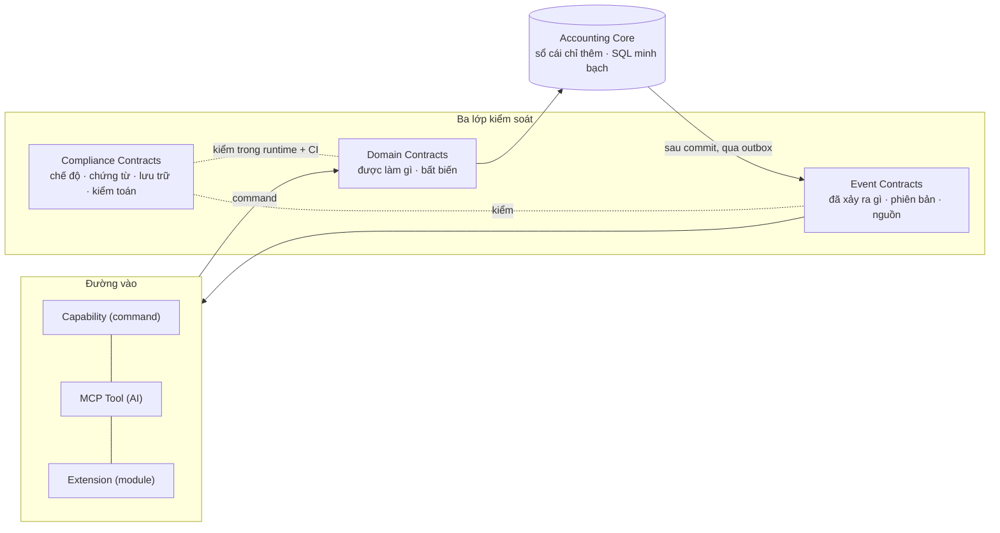

# Bản công bố kiến trúc open-ketoan framework

> **Phiên bản:** 1.1 · 2026-10-30
> **Thiết kế kiến trúc:** **Johnny Chu – Chu Hoàng Anh.** Quyền tác giả đối với kiến trúc open-ketoan framework (nền tảng lấy Accounting Core ổn định, module mở rộng) và bộ tài liệu này thuộc về tác giả, theo công bố của chủ dự án.
> **Mã nguồn:** giấy phép sử dụng mã nguồn công bố riêng ở tệp `LICENSE`.
>
> Đây là văn bản **công bố** cho cộng đồng: kiến trúc gồm những lớp nào, luật nào bắt buộc, việc nào thuộc giai đoạn nào. Mọi đóng góp (người hay AI) phải tuân theo. Luật chi tiết ở [00-CANON.md](00-CANON.md); quy trình đóng góp ở [CONTRIBUTING.md](../CONTRIBUTING.md).

## 0. Tuyên bố tối thượng

> **Mục tiêu: SQL minh bạch, Accounting Core ổn định, cộng đồng tự do vibe-code phần mở rộng mà không làm mất tính toàn vẹn của dữ liệu kế toán.**
>
> **Cộng đồng được tự do phát triển module, nhưng không được tự do thay đổi sự thật kế toán.**
>
> — Johnny Chu – Chu Hoàng Anh

Mọi luật, hợp đồng, check trong repo là cách thực thi câu trên:
- **mọi kênh:** giao diện, API, POS, WordPress, Bizcity Cell, Claude / ChatGPT qua MCP;
- **mọi module:** bán hàng, mua hàng, kho, thuế, nhân sự, sản xuất, dự án, CRM, trợ lý AI.

Tất cả chạm tiền qua **một luồng** và quy về ba lớp kiểm soát (§2). Module mở rộng được vô hạn. Lõi kế toán chỉ đổi theo quy trình Kernel (K0–K3), không bao giờ vì tiện cho một module.

## 1. Bảy nguyên tắc kiến trúc (khoá vào Standard)

Bảy nguyên tắc do Johnny Chu – Chu Hoàng Anh yêu cầu, khoá trong `bizcity-standard.json#principles`. Mỗi nguyên tắc **phải** có cách thực thi trong runtime hoặc CI (AP-7). Nguyên tắc chỉ có trên giấy là nợ.

| Mã | Nguyên tắc | Nghĩa | Thực thi bằng |
|---|---|---|---|
| **AP-1** | **Core owns accounting truth** | Chỉ Accounting Core được quyết định việc ghi sổ chính thức | một cửa ghi (STD-DOM-5): SC-KERNEL-1..3, SC-MOD-2; vai trò CSDL `ketoan_app` (DG-SEC-1); trigger sổ |
| **AP-2** | **Commands request, Events report** | Command (action) **yêu cầu** hành động, có thể bị từ chối; Event **phản ánh** việc đã xảy ra, không được dùng để ra lệnh ghi sổ | `defineAction` (lệnh, có quyền, idempotency); `bizcity_event@1` (sự kiện sau commit, R-OUTBOX); SC-EVT-1 |
| **AP-3** | **Contracts before code** | Module khai và tuân hợp đồng trước khi tích hợp | manifest `bizcity.module.json` (SC-CON-2); `defineAction` từ chối khai thiếu; `selfcheck --module` |
| **AP-4** | **Immutable posted history** | Không sửa âm thầm lịch sử hạch toán đã ghi; sửa sai bằng nghiệp vụ điều chỉnh hợp lệ (đảo + ghi mới) | trigger chỉ thêm (DG-DB-2); DG-LEDGER-3; bằng chứng chuỗi băm (DG-EVD-1) |
| **AP-5** | **Version everything** | Phiên bản schema, domain contract, chính sách kế toán, nguồn phát phải truy nguyên được | migration khoá checksum (SC-DATA-2); `bizcity_*@N`; sự việc có `version`; sự kiện có `version` + `source`; chính sách kế toán có phiên bản (STD-CMP-9 — **chưa đủ**) |
| **AP-6** | **Events are replayable, consumers are idempotent** | Có cơ chế phát lại sự kiện, xử lý trùng an toàn; không giả định broker bảo đảm exactly-once end-to-end | R-OUTBOX-3..7; consumer khoá `(consumer, event_id)` — **chưa có code** (G2-05) |
| **AP-7** | **Compliance is enforced, not documented only** | Bất biến được kiểm trong runtime và CI, không chỉ viết trong tài liệu | ma trận tuân thủ tính tự động trên bảng điểm ([compliance-matrix.json](standard/compliance-matrix.json)); `assertLedgerInvariants` sau mọi tệp test; tự chẩn đoán chặn khoá kỳ |

## 2. Ba lớp kiểm soát: điều gì là đúng

| Lớp | Quy định | Hợp đồng | Bản máy đọc / thực thi | Ai được đổi |
|---|---|---|---|---|
| **Domain Contracts** | Một nghiệp vụ **được phép làm gì**, điều kiện thực hiện, những **bất biến** không được vi phạm (loại chứng từ, trạng thái, định khoản, đảo bút toán, kho, công nợ) | [`bizcity_domain@1`](contracts/BIZCITY-DOMAIN-v1.md) (STD-DOM-1..22) | trigger CSDL; DG-LEDGER-*, DG-EVENT-*; `assertLedgerInvariants` | nhóm Lõi, mức K3 + ADR |
| **Event Contracts** | **Sự kiện** nào được phát, **phiên bản**, cấu trúc **payload**, **nguồn phát**, **ý nghĩa nghiệp vụ**; gửi ít nhất một lần, consumer idempotent | [`bizcity_event@1`](contracts/BIZCITY-EVENT-v1.md) + [R-OUTBOX](rules/RULE-INFRASTRUCTURE.md) | `coreEvents` trong `bizcity-standard.json`; manifest `events.emits / subscribes`; SC-EVT-1 | thêm sự kiện: minor; đổi payload = `version` mới |
| **Compliance Contracts** | Yêu cầu tuân thủ **chế độ kế toán, chứng từ, sổ sách, chỉnh sửa, lưu trữ, kiểm toán** | [`bizcity_compliance@1`](contracts/BIZCITY-COMPLIANCE-v1.md) (STD-CMP-1..9) + ma trận pháp lý | [compliance-matrix.json](standard/compliance-matrix.json) → mục "Ma trận tuân thủ" trên bảng điểm; SC-CMP-1 | nới / bỏ yêu cầu: ADR + chủ dự án |

### 2.0 Ba đường vào: ai gọi Core bằng gì

Ba đường vào đều phải đi qua ba lớp kiểm soát ở trên.

| Đường vào | Nói gì | Hợp đồng | Công bố máy đọc ở | Kiểm bằng | Ai được đổi |
|---|---|---|---|---|---|
| **Capability Contract** (command) | Mỗi năng lực công bố: **input schema, output schema, quyền, tác dụng phụ, idempotency, loại bằng chứng trả về**, mã lỗi, chạy thử | [`bizcity_action@1`](contracts/BIZCITY-ACTION-v1.md) + [`bizcity_errors@1`](contracts/BIZCITY-ERRORS-v1.md) | `GET /api/v1/system/capabilities` (`actions[]`: `inputSchema`, `outputSchema`, `permission`, `sideEffects`, `idempotency`, `evidence`) | `defineAction` từ chối khai thiếu lúc nạp; `test/actions.test.ts`; SC-ERR-1 | thêm: minor; đổi phá vỡ: major |
| **MCP Tool Contract** | Công cụ cho AI: tên ổn định, mô tả cho LLM. Ghi sổ cần **quyền cụ thể + xem trước + người dùng xác nhận**, chờ duyệt khi cần | [`bizcity_mcp@1`](contracts/BIZCITY-MCP-v1.md) | `POST /mcp` → `tools/list` | `test/mcp.test.ts` (CONF-MCP-1, -3, -4) | thêm công cụ: minor; đổi input / output = công cụ mới |
| **Extension Contract** | Cộng đồng thêm module bán hàng, kho, thuế, CRM, trợ lý AI **mà không sửa ledger engine**: slot giao diện, hook, gọi action, nghe sự kiện | [`bizcity_extension@1`](contracts/BIZCITY-EXTENSION-v1.md) + [`bizcity_module@1`](contracts/BIZCITY-MODULE-v1.md) | manifest `bizcity.module.json`; `extensionPoints` | SC-MOD-1..3, SC-CON-2, SC-LAYER-2 | người phụ trách module |

### 2.1 Bộ công cụ kế toán chuẩn cho AI (MCP Tool Contract)

Tên dạng `<miền>.<thực thể>.<động từ>` (STD-MCP-1). Miền của Core kế toán là `accounting`.

| Công cụ | Làm gì | Quyền | Xác nhận / duyệt | Trạng thái |
|---|---|---|---|---|
| `accounting.balance.get` | Số dư tài khoản tại một ngày, đọc thẳng sổ (R-CACHE-2) | `reports:read` | không (đọc) | **có** |
| `accounting.report.trial_balance` · `accounting.cash.balances` · `accounting.debts.partner_balances` | Cân đối phát sinh, tiền, công nợ | `reports:read` | không | **có** |
| `accounting.document.create_draft` | Lập chứng từ nháp (bán, mua, thu, chi) → sự việc `pending` ở ACC14, kế toán duyệt mới vào sổ | `documents:write` | **luôn** xem trước + xác nhận | chưa (G2-04) |
| `accounting.journal.post` | Đề xuất phiếu kế toán theo lý do (không số tài khoản) → `pending`, người có quyền duyệt | `documents:write` + duyệt | **luôn** xác nhận; không AI tự duyệt (STD-MCP-6) | chưa (G2-04, cần `docType` phiếu tay — [API.md §6](../packages/module-sdk/API.md)) |
| `accounting.entry.reverse` | Đề xuất huỷ / đảo một chứng từ đã ghi → yêu cầu huỷ chờ duyệt | `documents:write` + duyệt | **luôn** xác nhận + lý do; `destructiveHint` | chưa (G2-04) |

AI **không bao giờ**: duyệt chứng từ, khoá / mở kỳ, đổi cấu hình định khoản, xoá (STD-MCP-6).

## 3. Một lệnh ghi qua API công khai: Core làm gì

Mọi lệnh ghi đi cùng một trình tự, dù đến từ kênh hay module nào. Trình tự đó: kiểm quyền, nhận mã chứng từ, xác minh điều kiện ghi sổ, ghi trong một giao dịch, trả kết quả kèm bằng chứng.

| # | Bước | Đồng bộ? | Ở đâu | Lỗi chuẩn |
|---|---|---|---|---|
| 1 | Xác thực (phiên JWT, khoá API, khoá Cell / MCP) qua HTTPS | đồng bộ | `core/auth.ts` | `UNAUTHORIZED` |
| 2 | Quyền = quyền người dùng ∩ phạm vi khoá ∩ `expose.ai` (nếu AI); quyền theo trạng thái chứng từ, theo chủ chứng từ | đồng bộ | runtime action + handler | `FORBIDDEN` |
| 3 | Kiểm input bằng zod | đồng bộ | runtime | `VALIDATION_ERROR` |
| 4 | **Nhận mã chứng từ**: `docKey` + `version` (cửa nạp sổ), hoặc `Idempotency-Key` (action). Gửi lặp thì trả kết quả cũ | đồng bộ | cửa nạp sổ / `action_requests` | `CONFLICT`, `IDEMPOTENCY_CONFLICT` |
| 5 | **Xác minh điều kiện ghi sổ**: kỳ còn mở, danh mục có thật, cấu hình định khoản đủ, Nợ = Có, phiên bản hợp lệ | đồng bộ | Kernel | `PERIOD_LOCKED`, `POSTING_FAILED`, `UNBALANCED_ENTRY` |
| 6 | **Một giao dịch PostgreSQL**: chứng từ + bút toán + sổ phụ + bằng chứng (chuỗi băm) + outbox | đồng bộ | Kernel + Platform | rollback toàn bộ |
| 7 | Commit, rồi mới trả kết quả kèm **biên nhận bằng chứng** (`meta.receipt`) và `requestId` | đồng bộ | runtime | — |
| 8 | Gửi sự kiện từ outbox (Cell, webhook, NATS nếu bật) | **bất đồng bộ**, sau phản hồi | worker outbox (R-OUTBOX) | thử lại, dead-letter |

### 3.1 Mô hình 10 bước tham chiếu → open-ketoan

Mô hình "10 bước" (Client → Kong → Keycloak → handler → Redis → Prisma → PostgreSQL → response → NATS → trả về) hữu ích để **giới thiệu**. Nhưng nó **không phải một pipeline cứng**:
- Keycloak chủ yếu nằm ở luồng cấp token;
- Prometheus thu số đo độc lập;
- Redis có thể bỏ qua;
- NATS là việc bất đồng bộ sau commit.

| Bước tham chiếu | open-ketoan | Bắt buộc? | Ghi chú kỹ thuật |
|---|---|---|---|
| 1. Client gửi HTTPS kèm JWT | có | **có** | TLS ở proxy phía trước (DEPLOY D-8); không lộ token trong log (R-OBS) |
| 2. Kong: định tuyến, rate limit | nginx + giới hạn tần suất trong runtime | không | Kong chỉ khi có nhiều dịch vụ (P2). Kong không tự xác thực token nếu chưa cấu hình plugin |
| 3. Keycloak cấp JWT | đăng nhập sẵn có; `adapters/oidc` tuỳ chọn | không | API tự kiểm chữ ký JWT (JWKS khi dùng OIDC), không hỏi Keycloak mỗi yêu cầu |
| 4. Handler: zod, vai trò, đơn vị | runtime action | **có** | kiểm cả quyền theo đối tượng và theo trạng thái chứng từ |
| 5. Redis trước CSDL | đệm trong tiến trình; `adapters/redis` khi nhiều máy | không | chỉ cho danh mục / cấu hình, có huỷ đệm; **không** cho số dư (R-CACHE-1, -2) |
| 6. ORM gọi PostgreSQL | Kysely + SQL migration (không Prisma — ADR-0007) | **có** (PostgreSQL) | ORM không quyết định tính đúng kế toán: trigger + Domain Contract quyết định |
| 7. PostgreSQL giao dịch ACID | có | **có** | chứng từ, bút toán, sổ phụ, bằng chứng, outbox trong **một** giao dịch |
| 8. Dựng phản hồi | có | **có** | không trả "đã ghi sổ" trước khi commit (R-OUTBOX-2) |
| 9. Phát sự kiện NATS | outbox; `adapters/nats` khi nhiều consumer (P2) | không | dùng transactional outbox để không mất sự kiện |
| 10. Trả JSON | `{ ok, data, meta: { requestId, receipt } }` | **có** | sự kiện có thể xử lý xong sau khi đã trả phản hồi |

### 3.2 Nghiệp vụ nào đồng bộ, nghiệp vụ nào theo sự kiện

Nguyên tắc AP-2: ghi sổ là **lệnh đồng bộ** trong giao dịch ACID. Sự kiện chỉ dùng cho việc **được phép trễ** và **không quyết định** sự thật kế toán.

| Nghiệp vụ | Cơ chế | Vì sao | Ở open-ketoan |
|---|---|---|---|
| Ghi sổ kế toán | Giao dịch ACID | Phải nhất quán tức thời | cửa nạp sổ + `ledgerService` trong một giao dịch |
| Cân đối Nợ / Có | Domain validation **+** ràng buộc CSDL | Không chấp nhận bút toán mất cân đối | `validateLines()` + trigger `assert_entry_balanced` (R-DB-18) |
| Khoá kỳ | Giao dịch + Period Lock | Không để ghi sổ trái quy tắc | kiểm khoá trong giao dịch ghi; chặn khoá khi sổ lệch (STD-CMP-4) |
| Điều chỉnh chứng từ | Command + chứng từ điều chỉnh | Giữ dấu vết, cơ sở pháp lý | phiên bản mới → đảo + ghi mới (STD-DOM-11) |
| Đồng bộ CRM | Event-driven | Chấp nhận xử lý trễ | sự kiện `bizcity.masterdata.*` qua outbox |
| Gửi thông báo | Event-driven | Không ảnh hưởng việc ghi sổ | `notify.inapp`; Cell / Zalo qua sự kiện |
| Cập nhật dashboard | Event-driven hoặc đọc CSDL | Tuỳ yêu cầu độ mới; **số dư luôn đọc thẳng sổ** (R-CACHE-2) | `ledger.query`, `accounting.balance.get` |
| AI Agent xử lý nghiệp vụ | MCP / Command Contract | AI không được tự xác nhận kết quả kế toán | `POST /mcp`: xem trước + người dùng xác nhận + chờ duyệt (STD-MCP-4, -6) |
| Module cộng đồng | Contract + đăng ký nghe sự kiện | Không cần truy cập CSDL lõi | `@bizcity/module-sdk`, `bizcity_extension@1`, `events.subscribe` |

## 4. Mức ưu tiên hạ tầng

| Hạng mục | Ưu tiên | Quyết định | open-ketoan hôm nay |
|---|---|---|---|
| Bất biến kế toán + ACID | P0 | Bắt buộc | **có**: Domain Contract, trigger, kiểm sau mọi tệp test |
| Cô lập đơn vị + Audit Ledger | P0 | Bắt buộc | **một phần**: `tenant_id` mọi truy vấn, bằng chứng chuỗi băm có; RLS chưa (G1-05) |
| Contract + SDK + MCP | P0 | Lợi thế chiến lược | **một phần**: 4 lớp hợp đồng, MCP có; SDK là bản nháp (G1-10) |
| Sao lưu, PITR, kiểm khôi phục | P0 | Bắt buộc | **một phần**: sao lưu + kiểm khôi phục có; PITR chưa (G1-08) |
| Prometheus + Grafana | P1 | Nên triển khai sớm | **có**: `infrastructure/monitoring/` |
| Transactional outbox | P1 | Cần có trước khi tích hợp sự kiện | chưa (G2-05) |
| Redis | P1 | Khi đo được nhu cầu | chưa, luật R-CACHE có (G2-06) |
| NATS JetStream | P2 | Khi có nhiều consumer / module | chưa (G3-03) |
| Kong + Keycloak | P2 | Khi quản trị API và danh tính phức tạp | chưa (G3-08) |
| Kubernetes | P3 | Khi có nhu cầu scale / HA thực tế | để sau (G3-09) |

### 4.1 Ma trận tuân thủ bắt buộc

Chín yêu cầu của [`bizcity_compliance@1` §2](contracts/BIZCITY-COMPLIANCE-v1.md). Trạng thái **tính tự động** mỗi lần chạy `node tests/conformance/selfcheck.mjs`, ở mục "Ma trận tuân thủ" của bảng điểm (AP-7). Bảng dưới là ảnh chụp ngày 2026-10-30, chạy kèm CSDL; điểm tổng **59%**.

| Mã | Yêu cầu | Rủi ro nếu thiết kế sai | Quy tắc Bizcity bắt buộc | Trạng thái |
|---|---|---|---|---|
| C-1 | Chứng từ hợp lệ | Sự kiện tạo giao dịch không có chứng từ | Bút toán phải có nguồn chứng từ và căn cứ hạch toán | ◐ một phần (nợ A-01 một cửa ghi) |
| C-2 | Ghi sổ chính xác | Hai consumer ghi trùng nghiệp vụ | Idempotency và uniqueness tại CSDL | ✔ đạt |
| C-3 | Sửa chữa sổ | Consumer cập nhật trực tiếp bút toán cũ | Chứng từ điều chỉnh, giữ dấu vết | ✔ đạt |
| C-4 | Khoá kỳ kế toán | Sự kiện đến chậm ghi vào kỳ đã khoá | Period Lock Gate | ✔ đạt |
| C-5 | Nhất quán dữ liệu | Sự kiện phát ra khi giao dịch chưa commit | Transactional Outbox | ✘ thiếu (G2-05) |
| C-6 | Lưu trữ | Message hết hạn, mất lịch sử nghiệp vụ | Lưu sổ / chứng từ / bằng chứng riêng theo thời hạn áp dụng | ◐ một phần (thiếu PITR, xác nhận thời hạn) |
| C-7 | Phân quyền | Module tự ghi vào bảng ledger | Chỉ Accounting Core có quyền ghi sổ | ◐ một phần (nợ A-17, A-01) |
| C-8 | Kiểm toán | Không rõ sự kiện do ai tạo | Actor, source, correlation, evidence, version | ◐ một phần (thiếu `correlation_id`) |
| C-9 | Thay đổi chế độ kế toán | Áp dụng quy tắc mới vào chứng từ cũ | Phiên bản chính sách và ngày hiệu lực | ✘ thiếu (G2-09) |

## 5. Luật bắt buộc cho người đóng góp

| Nhóm | Luật | Ở đâu |
|---|---|---|
| Bốn câu không thương lượng | không sự việc thì không bút toán · sổ chỉ thêm · một cửa vào sổ · không số tài khoản trong code định khoản | [AGENTS.md](../AGENTS.md), STD-DOM-1, -2, -5, -16 |
| Domain | không phá bất biến STD-DOM-1..22; đổi = K3 + ADR | [BIZCITY-DOMAIN-v1](contracts/BIZCITY-DOMAIN-v1.md) |
| Capability | thao tác ghi mới viết bằng `defineAction`, khai đủ quyền, `sideEffects`, idempotency; không route Fastify tay | [BIZCITY-ACTION-v1](contracts/BIZCITY-ACTION-v1.md) |
| AI | ghi qua AI chỉ tạo nháp / chờ duyệt, luôn xem trước + xác nhận | [BIZCITY-MCP-v1](contracts/BIZCITY-MCP-v1.md) STD-MCP-4, -6 |
| Extension | module không import module khác, không ghi bảng nhân, không sửa Kernel | [RULE-MODULE-BOUNDARY](rules/RULE-MODULE-BOUNDARY.md), SC-LAYER-2 |
| Cache | không cache dữ liệu sổ; đọc nhất quán sau khi ghi | [RULE-INFRASTRUCTURE §1](rules/RULE-INFRASTRUCTURE.md) |
| Sự kiện | outbox cùng giao dịch; consumer idempotent | [RULE-INFRASTRUCTURE §2](rules/RULE-INFRASTRUCTURE.md) |
| Sao lưu | kiểm khôi phục trước khi tin bản sao lưu | [RULE-INFRASTRUCTURE §3](rules/RULE-INFRASTRUCTURE.md) |
| Lỗi, quan sát | mã lỗi trong danh mục; `requestId`; không dữ liệu cá nhân trong log | [BIZCITY-ERRORS-v1](contracts/BIZCITY-ERRORS-v1.md), [OBSERVABILITY](ops/OBSERVABILITY.md) |
| Bằng chứng tự động | PR chạy `selfcheck`, `kiem-chuan`, typecheck, test PostgreSQL thật | [CONTRIBUTING §5](../CONTRIBUTING.md) |
| Nguyên tắc | 7 nguyên tắc AP-1..AP-7 (§1); nguyên tắc nào chưa có cách thực thi là nợ | `bizcity-standard.json#principles` |
| CSDL | SQL là nguồn sự thật; migration đã phát hành bất biến, kiểm trên CSDL sạch + nâng cấp; migration do AI sinh không chạy production khi chưa kiểm + duyệt | [RULE-DATABASE](rules/RULE-DATABASE.md) R-DB-14..19 |

## 6. Checklist chuẩn hoá theo giai đoạn (nhận việc)

**Nhận việc:**
1. Mở issue theo mẫu [Nhận việc](../.github/ISSUE_TEMPLATE/nhan-viec.yml), ghi mã việc (vd `G1-05`).
2. Nhóm Lõi gán người.
3. PR ghi mã việc trong tiêu đề.

Trạng thái chính thức tính tự động bằng bảng điểm lộ trình (`node tests/conformance/selfcheck.mjs`, [roadmap.json](standard/roadmap.json)). Cột "Trạng thái" dưới đây chụp ngày 2026-10-30.

**có** = đủ tiêu chí · **một phần** = có nền, còn việc · **chưa** = mở cho người nhận.

### Giai đoạn 1: Lõi kế toán chạy thật, an toàn

| Mã | Việc | Xong khi | Trạng thái | PHASES | Người nhận |
|---|---|---|---|---|---|
| G1-01 | PostgreSQL 16 + Docker Compose, migration SQL đánh số, **Kysely** | `docker compose up` chạy đủ; SC-DATA-* đạt | **có** | 0.3 | — |
| G1-02 | Accounting Ledger: giao dịch ACID, chỉ thêm, Nợ = Có, trigger bảo vệ | DG-LEDGER-1..4, DG-DB-2 đạt | **có** | — | — |
| G1-03 | Đảo bút toán + phiên bản sự việc | STD-DOM-4, -11 có test | **có** | — | — |
| G1-04 | Idempotency: `docKey` + `version`; `Idempotency-Key` cho action | CONF-RUN-4 đạt | **có** | 2.5 | — |
| G1-05 | Cô lập đơn vị: `tenant_id` + **RLS** + test đơn vị A không đọc được đơn vị B | DG-PLAN-5 thành kiểm thật | **một phần** (thiếu RLS) | 2.4 | _mở_ |
| G1-06 | RBAC: vai trò, quyền, khoá API có phạm vi; registry quyền mở theo module | `permissions.module` available | **một phần** | 3.x | _mở_ |
| G1-07 | Audit Ledger: bằng chứng chỉ thêm, chuỗi băm, biên nhận | DG-EVD-1, SC-EVD-2 đạt | **có** | 2.6 | — |
| G1-08 | Sao lưu + **PITR** (WAL archiving: wal-g / pgBackRest ở `infrastructure/backup/`) + kiểm khôi phục | R-BAK-1..3; diễn tập PITR có biên bản | **một phần** (thiếu PITR) | — | _mở_ |
| G1-09 | Health (L0 / L1 / L3), `/metrics` | `/health/ready`, `/system/diagnostics`, `/metrics` có test | **có** | 2.10, 2.13 | — |
| G1-10 | SDK TypeScript `@bizcity/module-sdk` | `packages/module-sdk/package.json`; ca chuẩn hợp đồng chạy bằng SDK | **một phần** (bản nháp API) | 1.5, 3.1 | _mở_ |
| G1-11 | Contract tests: bộ kiểm chuẩn SC-* / DG-*, tự kiểm, bảng điểm | `selfcheck --strict` đạt trong CI | **có** | 0.5 | — |
| G1-12 | Cell 1API: khoá `biz-…`, kết nối bốn bước, PKCE | đường `/api/v1/cell/mcp` chạy với Hub | **chưa** (cần Hub) | 5.3 | _mở_ |
| G1-13 | **Kiểm migration**: khoá checksum khi phát hành; thử trên CSDL sạch **và** nâng cấp từ bản phát hành trước có dữ liệu sổ | SC-DATA-2; job CI `test` + `migrate-upgrade`; `scripts/kiem-nang-cap.sh` đạt | **có** (mốc bắt đầu từ tag v* đầu tiên) | — | — |

> **Đã chốt (2026-10-30, Johnny Chu):** **không dùng Prisma**. Giữ Kysely + SQL migration ([ADR-0007](adr/ADR-0007-goi-chia-se-va-ha-tang.md) chấp nhận; R-DB-14: SQL là nguồn sự thật của schema). Trigger chỉ thêm, cân Nợ = Có, chuỗi băm, RLS cần kiểm soát SQL trực tiếp.

### Giai đoạn 2: Hợp đồng, AI, sự kiện, giám sát

| Mã | Việc | Xong khi | Trạng thái | PHASES | Người nhận |
|---|---|---|---|---|---|
| G2-01 | Domain Contract | `bizcity_domain@1` công bố, mỗi bất biến có cách bảo vệ | **có** | — | — |
| G2-02 | Capability Contract | `/system/capabilities` công bố schema, quyền, `sideEffects`, idempotency, bằng chứng; `defineAction` chặn khai thiếu | **có** | 2.5 | — |
| G2-03 | Extension Contract chạy thật: slot, hook, `ctx.actions.call` | ca chuẩn hợp đồng dùng slot + hook | **một phần** (có tài liệu) | 3.x | _mở_ |
| G2-04 | MCP Server kế toán đủ bộ: `accounting.document.create_draft`, `accounting.journal.post`, `accounting.entry.reverse` | 3 công cụ ghi có xem trước + duyệt; CONF-MCP-5 | **một phần** (đọc + khung xác nhận có) | 2.11, 2.12 | _mở_ |
| G2-05 | **Transactional outbox + worker** | R-OUTBOX-1..5 có test; `events.outbox` available | **chưa** | 3.x | _mở_ |
| G2-06 | Đệm cho Accounting Core có huỷ theo phiên bản cấu hình; `adapters/redis` | R-CACHE-3..6 có test; chạy đúng khi tắt Redis | **chưa** | 5.9 | _mở_ |
| G2-07 | Prometheus + Grafana + cảnh báo cơ bản | `infrastructure/monitoring/` chạy với API thật | **có** (cấu hình đã kiểm) | 2.13 | — |
| G2-08 | Mã lỗi chuẩn + quan sát (request id, log, số đo) | SC-ERR-1, `test/observability.test.ts` | **có** | 2.13 | — |
| G2-09 | **Chính sách kế toán có phiên bản + ngày hiệu lực** (`posting.policy-version`): `policy_version`, `effective_from`, `posting_log.policy_version` | C-9 của ma trận tuân thủ đạt ([COMPLIANCE §4](contracts/BIZCITY-COMPLIANCE-v1.md)) | **chưa** | 3.x | _mở_ |
| G2-10 | Ba lớp kiểm soát + ma trận tuân thủ tính tự động | `bizcity_compliance@1`, SC-CMP-1, mục ma trận trên bảng điểm | **có** | — | — |

### Giai đoạn 3: Hệ sinh thái

| Mã | Việc | Xong khi | Trạng thái | PHASES | Người nhận |
|---|---|---|---|---|---|
| G3-01 | Registry module + skills (cài module, gói định khoản, kỹ năng AI có chữ ký) | cài một module từ registry bằng một lệnh | **chưa** | 5.8 | _mở_ |
| G3-02 | Developer CLI: `bizcity module new / check`, `bizcity init --preset` | scaffold module chạy bộ kiểm đạt ngay | **chưa** | 4.1, 4.2 | _mở_ |
| G3-03 | NATS JetStream cho tích hợp liên module (`adapters/nats` chuyển tiếp outbox) | 2 consumer ngoài tiến trình nhận sự kiện, không mất khi NATS tạm ngừng | **chưa** (sau G2-05) | 5.9 | _mở_ |
| G3-04 | Bizcity Cell API key + dịch vụ AI (đọc hoá đơn, gợi ý lý do định khoản) | `ai.ocr-invoice`, `posting.reason-suggest` available | **chưa** | 5.3, 5.8 | _mở_ |
| G3-05 | Benchmark tải | 30.000 chứng từ / ngày, p95 ghi sổ < 1 giây, có báo cáo | **chưa** | 5.5 | _mở_ |
| G3-06 | Kiểm thử cô lập đơn vị | thử tấn công chéo đơn vị qua API, MCP, RLS: không lọt | **chưa** (sau G1-05) | — | _mở_ |
| G3-07 | Diễn tập phục hồi dữ liệu | PITR tới một thời điểm, đo RTO / RPO thật, có biên bản | **chưa** (sau G1-08) | — | _mở_ |
| G3-08 | Kong + Keycloak (`adapters/oidc`), khi cần | đăng nhập OIDC; JWKS; không phụ thuộc khi tắt | **chưa** (P2) | 5.9 | _mở_ |
| G3-09 | Kubernetes / Helm, khi cần | chart `infrastructure/helm/`; 2 bản API chạy đúng | **để sau** (P3) | — | _mở_ |

## 7. Thay đổi bản công bố

Bản công bố đổi theo phiên bản (1.0, 1.1…). Thêm việc / cập nhật trạng thái là sửa thường. Đổi lớp hợp đồng, bỏ luật bắt buộc, hoặc đổi mức ưu tiên P0 cần ADR và chủ dự án duyệt.
