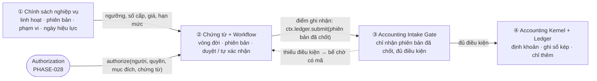
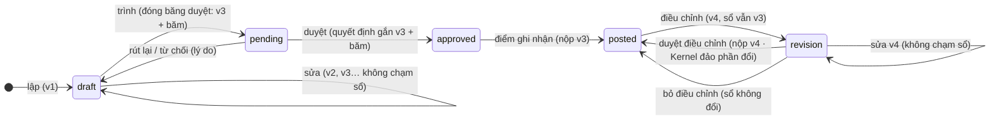
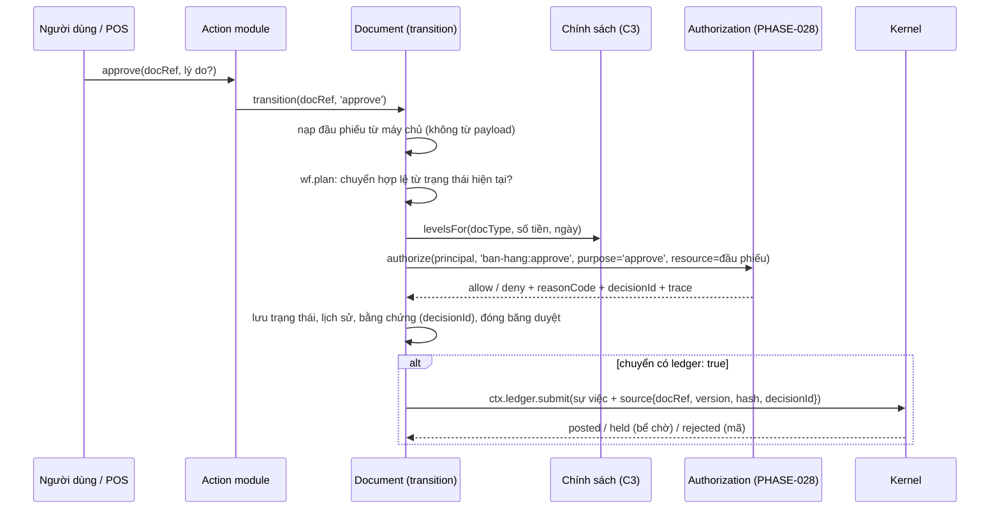

# Lõi bất biến, nghiệp vụ linh hoạt — kiến trúc và hướng dẫn dev
<!-- [2026-11-06 03:51 PM Johnny Chu - Chu Hoàng Anh] PHASE-030 — bản kiến trúc ADR-0029: bốn tầng, ba chủ sở hữu (Document / Authorization / Kernel), điểm ghi nhận, hai lần đóng băng, cổng nhận sự việc, cầu nối Workflow ↔ PHASE-028, hiện trạng, hướng dẫn dev -->

> © 2026 Johnny Chu (Chu Hoàng Anh) / BizCity — kiến trúc Bizcity Core Framework.
> **Tôn chỉ:** CANON §0.9 · **Quyết định:** [ADR-0029](../adr/ADR-0029-loi-bat-bien-nghiep-vu-linh-hoat.md) · **Luật:** [R-WF](../rules/RULE-WORKFLOW.md) (R-WF-3, -4, -13..16) · **Hợp đồng:** [`bizcity_document@1`](../contracts/BIZCITY-DOCUMENT-v1.md), [`bizcity_authorization@1`](../contracts/BIZCITY-AUTHORIZATION-v1.md), [`bizcity_ledger_intake@1`](../contracts/BIZCITY-LEDGER-INTAKE-v1.md)
> **Rà hiện trạng mã:** [PHASE-030 · 19](../phases/PHASE-030-THU-VIEN-NGHIEP-VU-ERP-VN/19-RA-SOAT-DUYET-VA-GHI-SO.md) · **Chuẩn chứng từ chi tiết:** [PHASE-030 · 16](../phases/PHASE-030-THU-VIEN-NGHIEP-VU-ERP-VN/16-CHUAN-CHUNG-TU-DUNG-CHUNG.md)

**Linh hoạt trước khi ghi sổ. Chặt chẽ tại thời điểm ghi sổ. Bất biến đối với lịch sử đã xác lập.**

Tài liệu này dành cho người dựng module (bán hàng, kho, lương, POS…) và người giữ Core. Đọc §1–§3 để hiểu ai sở hữu gì. Đọc §8 để biết khai báo gì và **không** viết gì.

## 1. Bốn tầng



| Tầng | Được làm | Không được làm |
|---|---|---|
| ① Chính sách | đổi bất cứ lúc nào bằng phiên bản mới có ngày hiệu lực; khác nhau theo khách, NCC, chi nhánh, chương trình | sửa đè phiên bản đã dùng; viết hằng trong mã |
| ② Chứng từ | sửa nhiều lần (mỗi lần một phiên bản), trình, duyệt, từ chối, rút lại, điều chỉnh sau ghi nhận | tự ghi sổ; đổi trạng thái ngoài chuyển đã khai; tự quyết ai được duyệt |
| ③ Cổng | nhận, từ chối có mã, đưa vào bể chờ | đoán, bỏ qua im lặng, sửa nội dung thay người dùng |
| ④ Kernel | định khoản, ghi, đảo phần đổi, khoá kỳ | sửa / xoá bút toán đã ghi |

## 2. Ba chủ sở hữu

> Document Contract sở hữu **trạng thái và lịch sử** chứng từ. Authorization Contract sở hữu **quyền thực hiện hành động**. Accounting Kernel sở hữu **quyết định và việc ghi sổ**.

| Mối quan tâm | Chủ | Module làm gì | Ai được đọc |
|---|---|---|---|
| Trạng thái, chuyển hợp lệ | Document (`documents.workflow`) | khai `<loại>.workflow.yaml` | mọi người |
| Phiên bản, băm nội dung, lịch sử | Document (`document_versions`) | không làm gì (nền tự lưu khi nội dung đổi) | mọi người |
| Liên kết nguồn / thanh toán / thay thế | Document (`document_links`) | gọi `ctx.documents.link` khi lập từ chứng từ khác | mọi người |
| Chữ ký theo vai | Document (`document_signatures`) | đặt vai, chọn ai ký vai nào | mọi người |
| Số cấp duyệt, ngưỡng | Chính sách (C3) | khai khoá chính sách trong manifest | Document |
| **Ai được làm chuyển này trên chứng từ này** | **Authorization** (`authorize`, PHASE-028) | khai quyền trong manifest; **không** viết `if role` | Document |
| Tách nhiệm (người lập ≠ người duyệt) | Workflow `sod` hôm nay → Authorization khi có điều kiện SoD | khai `sod: true` | Document |
| Điểm ghi nhận kế toán | Document (`ledger: true` trên chuyển) | chọn chuyển nào là điểm ghi nhận | Kernel |
| Dựng sự việc (docType, reasonCode, dòng) | module (hàm thuần) | `ledger.build(doc)` không số tài khoản | Kernel |
| Nhận sự việc, định khoản, ghi, đảo | **Kernel** | không làm gì | — |
| Kỳ khoá, khoá theo ngày | Kernel + Platform | không làm gì (nền kiểm `doc_date`) | — |

Không chủ nào làm thay chủ khác. Hai lỗi hay gặp:
- module tự quyết "duyệt xong thì ghi sổ";
- Kernel phải đoán chứng từ đã duyệt chưa.

Cả hai đều do thiếu ranh giới này.

## 3. Điểm ghi nhận kế toán (duyệt ≠ ghi sổ)

Mỗi loại chứng từ khai **một** (hoặc vài) chuyển mang `ledger: true`. Đó là thời điểm nghiệp vụ đủ điều kiện thành sự việc kế toán.

| Loại chứng từ | Điểm ghi nhận | Vì sao |
|---|---|---|
| Báo giá, đơn đặt mua / bán, yêu cầu mua | **không bao giờ** | chưa có sự việc kinh tế |
| Phiếu nhập mua | `approve` | hàng đã về, giá đã chốt |
| Đề nghị thanh toán | `pay` (không phải `approve`) | duyệt chỉ là cho phép chi; sự việc là lúc tiền đi |
| Hoá đơn bán | `issue` / `post` | hoá đơn phát hành mới có doanh thu |
| POS (giao dịch lớn) | `confirm` tự động (`system:pos`) | không ai duyệt từng bill; chính sách + quyền đã duyệt trước |
| Chuyển kho có hàng đi đường | `ship` (phần xuất) + `receive` (phần nhận) | hai sự việc, hai thời điểm |
| Phiếu kiểm kê | `approve` chênh lệch | đếm xong chưa phải sự việc |
| Bảng lương | `approve` (ghi chi phí, phải trả); `pay` (chi) | hai sự việc |
| Phiếu kế toán thủ công | `approve` (theo chính sách, có thể tự duyệt dưới ngưỡng) | kế toán là người lập và người chịu trách nhiệm |

Luật: R-WF-3. Trước điểm ghi nhận, chứng từ **không bao giờ** có bút toán.

## 4. Sửa chứng từ: trước và sau điểm ghi nhận



| Tình huống | Đường đúng | Bút toán |
|---|---|---|
| Sửa nháp nhiều lần | phiên bản mới mỗi lần lưu | 0 |
| Sửa khi đang chờ duyệt | rút về nháp hoặc sửa thành phiên bản mới → **phải trình lại** (Approval Freeze) | 0 |
| Duyệt rồi nhưng chưa tới điểm ghi nhận (vd đề nghị thanh toán chưa chi) | bản mới → duyệt lại theo chính sách | 0 |
| Đã ghi nhận, sửa một lần hoặc nhiều lần | bản điều chỉnh, duyệt điều chỉnh một lần | đảo **phần đổi** + ghi phần mới, **một lần** |
| Đã ghi nhận, huỷ hẳn | huỷ có lý do → yêu cầu huỷ | đảo toàn bộ, một lần |

Bỏ "bỏ duyệt → sửa → duyệt lại" cho chứng từ đã ghi nhận: đường đó đảo toàn bộ hai lần dù chỉ sửa một dòng ghi chú ([19 §2](../phases/PHASE-030-THU-VIEN-NGHIEP-VU-ERP-VN/19-RA-SOAT-DUYET-VA-GHI-SO.md)).

## 5. Hai lần đóng băng

| | Approval Freeze (R-WF-13) | Accounting Freeze (R-WF-14) |
|---|---|---|
| Khi nào | lúc trình và lúc mỗi cấp duyệt | lúc tới điểm ghi nhận |
| Đóng băng gì | phiên bản `n` + băm nội dung `h` (`document_versions`); quyết định duyệt (`decisionId`) và chữ ký gắn `n` | sự việc nộp sổ mang `source = { docRef, version: n, contentHash: h, approval: decisionId }` |
| Nội dung đổi sau đó | phiên bản `n+1`, quyết định và chữ ký cũ không hiệu lực cho `n+1`, phải trình / duyệt lại | chỉ qua bản điều chỉnh (§4) |
| Dùng năng lực nào (đã có) | `ctx.documents.saveVersion` (băm chuẩn hoá), `document_signatures` (gắn phiên bản, `valid` tự tính), `audit_logs` | `ctx.ledger.submit`, `accounting_event_versions`, `posting_log` (`policy_version`), `document_links` role `ledger` |
| Mới cần thêm | `transition()` tự gọi `saveVersion` và ghi `decisionId` | trường `source` trong `bizcity_ledger_intake@1` (thêm, tuỳ chọn → bắt buộc cho loại module) |

## 6. Cổng nhận sự việc (Accounting Intake Gate)

Kernel chỉ nhận một phiên bản khi đủ bốn điều kiện. Thiếu điều kiện nào thì sự việc vào bể chờ có mã (R-INTAKE), không mất, không đoán.

| # | Điều kiện | Kiểm bằng | Hôm nay |
|---|---|---|---|
| G1 | Chứng từ nguồn đang ở chuyển `ledger: true` của loại đó | Document trả trạng thái của `source.docRef` @ `source.version` | ☐ Kernel không biết chứng từ nguồn |
| G2 | `source.contentHash` = băm phiên bản đã đóng băng duyệt | so `document_versions.content_hash` | ☐ |
| G3 | Chính sách định khoản / hồ sơ kế toán có phiên bản tại ngày chứng từ | `selectPolicy(asOf)`, `profileAt(asOf)` | ✅ |
| G4 | Kỳ mở, ngày không bị khoá | `period_locks`, `dataLock` | ✅ |
| G5 | **Cùng số phiên bản mà khác nội dung → từ chối có mã**; `force` ghi đè phải lưu bản cũ | so băm payload | ☐ hôm nay bỏ qua im lặng (`document.service.ts:397-399`); `force` không lưu bản cũ |

Đã tốt, giữ nguyên:
- nộp phiên bản mới thì Kernel **chỉ đảo bút toán đổi** (băm nội dung / băm thân, `posting.service.ts:168-183`);
- phiên bản đang chờ (ACC14) bị thay bằng bản mới thì không đảo gì;
- phiên bản chỉ tăng.

## 7. Cầu nối Workflow ↔ Authorization (PHASE-028)

Hôm nay hai bên **chưa nối**:
- `core/workflow.ts` chỉ hỏi `auth.permissions.has(p)` và tự kiểm `sod` bằng `createdBy === actor.id`;
- engine `authorize` / `explain` của PHASE-028 đã merge nhưng chưa ai gọi.

Thiết kế:



Ánh xạ đầu phiếu → `AuthzResourceContext` (`packages/platform/src/core/authz/types.ts:134-146`):

| `AuthzResourceContext` | Lấy từ | Hôm nay `WorkflowDoc` có? |
|---|---|---|
| `type`, `id` | `docRef` | ☐ |
| `branchId`, `warehouseId`, `orgPath` | đầu phiếu | ☐ — **bắt buộc nạp**: thiếu thì engine coi chứng từ thuộc mọi phạm vi (D-AUTH-04), người duyệt kho K1 duyệt được cả K2 |
| `createdBy`, `createdAt` | đầu phiếu | ✅ `createdBy` |
| `docDate`, `status`, `amount` | đầu phiếu | ✅ `status`; ☐ còn lại |
| (đề xuất) `version` | `document_versions` | ☐ |

Chia việc theo chủ:

| Phần | Chủ | Việc |
|---|---|---|
| Quyền, vai trò, phạm vi, điều kiện | PHASE-028 | `authorize()` trên tài nguyên chứng từ thực; điều kiện SoD (`not_creator`, `not_previous_approver`) để D-AUTH-04 "SoD thắng" chạy được; `creator: 'branch'` thi hành thật; nối `runAction` (bước 4 ADR-0027) |
| Phiên bản, Workflow, chữ ký, lịch sử | Document Contract (PHASE-029 E4 / PHASE-030 DOC-030-*) | `transition()` nạp đầu phiếu, gọi `authorize` với `purpose`, ghi `decisionId`; `WorkflowActor.can` → `decide` |
| Ngưỡng, số cấp | Chính sách (PHASE-029 E2 + PHASE-030 16 §5) | `levelsFor(doc, at)` |
| Ghi sổ | Kernel | cổng G1–G5 |
| Bằng chứng | Conformance | golden T030-AUTH-*, T030-DOC-* |

## 8. Hướng dẫn cho dev

### 8.1 Khai báo — đủ để có luồng chặt chẽ

Hai khoá dưới đây là **đề xuất**, runtime `core/workflow.ts` chưa nhận:
- `policy:` (R-WF-11) — trong lúc chờ, dùng `levels:` + `levelsRequired` như `payment-request.workflow.yaml` hiện nay;
- `by: system` (R-WF-16) — runtime hôm nay chỉ có `by: event` và cũng đang từ chối khoá đó.

Mọi khoá khác đã chạy.

```yaml
# modules/quy/api/documents/payment-request.workflow.yaml — duyệt hai cấp theo chính sách, ghi sổ lúc CHI
type: quy.payment_request
states:
  draft:     { group: draft }
  submitted: { group: pending }
  approved1: { group: pending }
  approved:  { group: approved }
  paid:      { group: done }
  cancelled: { group: cancelled }
transitions:
  submit:  { from: [draft], to: submitted, permission: "quy:write" }
  approve: { policy: quy.de_nghi_tt.duyet, permission: "quy:approve", sod: true }   # số cấp từ chính sách
  reject:  { from: [submitted, approved1], to: draft, permission: "quy:approve", requires: [reason] }
  pay:     { from: [approved], to: paid, permission: "quy:pay", ledger: true }        # ĐIỂM GHI NHẬN
  cancel:  { from: [draft, submitted, approved1, approved], to: cancelled, permission: "quy:approve", requires: [reason] }
```

```yaml
# modules/pos/api/documents/pos-order.workflow.yaml — tự xác nhận, không bước duyệt tay
type: pos.order
states:
  open:      { group: draft }
  confirmed: { group: done }
  voided:    { group: cancelled }
transitions:
  confirm: { from: [open], to: confirmed, by: system, policy: pos.tu_xac_nhan, ledger: true }   # R-WF-16
  void:    { from: [confirmed], to: voided, permission: "pos:void", requires: [reason], ledger: true }
```

```json
// bizcity.module.json — quyền và chính sách, không có logic duyệt
"permissions": [
  { "key": "quy:write", "label": "Lập đề nghị thanh toán" },
  { "key": "quy:approve", "label": "Duyệt đề nghị thanh toán", "risk": "high" },
  { "key": "quy:pay", "label": "Chi tiền theo đề nghị", "risk": "high" }
],
"settings": [ { "key": "quy.de_nghi_tt.duyet", "kind": "policy" } ]
```

### 8.2 Không viết

| Không viết | Vì nền đã làm / sẽ làm |
|---|---|
| `if (user.role === 'chief_accountant')`, `has_group(...)` | Authorization quyết (R-WF-15) |
| `if (amount > 50_000_000) levels = 2` | chính sách `policy:` (R-WF-11) |
| `UPDATE … SET status = 'approved'` | chỉ qua chuyển khai trong YAML (R-WF-1) |
| `postDocumentIn` / `submitDocumentIn` / `voucherService` trong module | `ctx.ledger.submit` ở chuyển `ledger: true` (STD-030-1) |
| "bỏ duyệt → sửa → duyệt lại" cho chứng từ đã ghi nhận | bản điều chỉnh (R-WF-4) |
| tự lưu ảnh chụp / lịch sử / cột `approved_by` riêng | `document_versions`, lịch sử trạng thái, bằng chứng |
| gửi lại cùng `version` với nội dung khác | tăng phiên bản; cổng sẽ từ chối (G5) |

### 8.3 Trước khi mở PR

1. Mỗi loại chứng từ có YAML; điểm ghi nhận khai rõ (hoặc ghi "không bao giờ").
2. Không chuyển nào ngoài điểm ghi nhận gọi sổ.
3. Golden của module xanh, cùng các ca chung T030-DOC-* và T030-AUTH-* ([60](../phases/PHASE-030-THU-VIEN-NGHIEP-VU-ERP-VN/60-GOLDEN-TESTS.md)).
4. `assertLedgerInvariants` xanh; đếm bút toán đảo đúng như bảng §4.

## 9. Hiện trạng ngắn (2026-11-06)

| | Có | Thiếu |
|---|---|---|
| Document | YAML, `plan` / `allowed`, `levels`, `sod`, `owner`, `requires`; `saveVersion` + băm; chữ ký gắn phiên bản; lịch sử Kernel | `transition()` chung; tự `saveVersion`; nạp đầu phiếu; module chưa ai dùng `saveVersion` / `document_links` |
| Authorization | engine thuần `authorize` / `explain` / `scopeOf` (W3 đợt 1, đã merge) | kho vai trò (W1 / W2 đang làm); nối `runAction`; điều kiện SoD; thi hành `creator: 'branch'` |
| Kernel | một cửa, phiên bản, đảo phần đổi, giữ chờ không đảo, khoá kỳ | G1, G2, G5 |
| Mua hàng (đóng băng, ADR-0024) | duyệt = ghi sổ (đúng cho phiếu nhập) | sửa phiếu đã duyệt phải bỏ duyệt → đảo toàn bộ hai lần; phiếu chi đổi số mới mỗi vòng |
| Đề nghị thanh toán | ghi sổ lúc chi (đúng), hai cấp | không đường "bỏ chi" |

Chi tiết từng dòng và tệp: [PHASE-030 · 19](../phases/PHASE-030-THU-VIEN-NGHIEP-VU-ERP-VN/19-RA-SOAT-DUYET-VA-GHI-SO.md).
