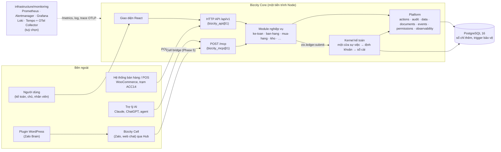
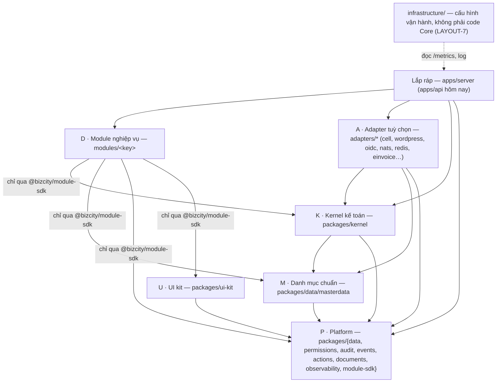
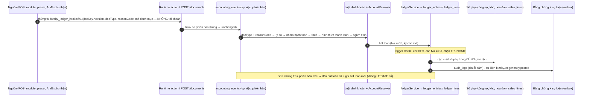
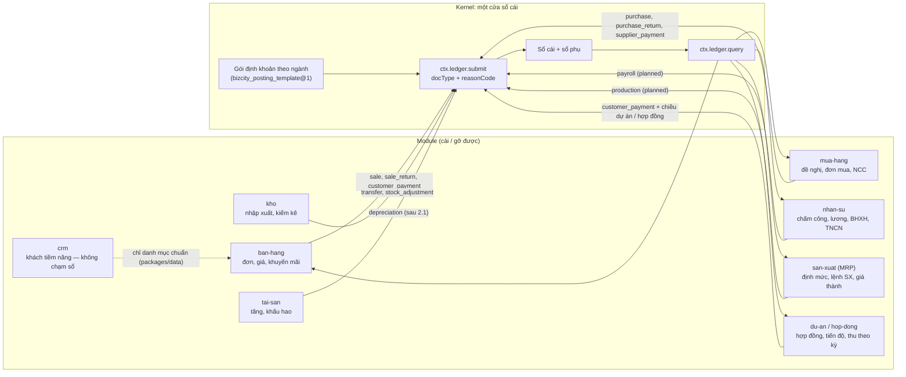
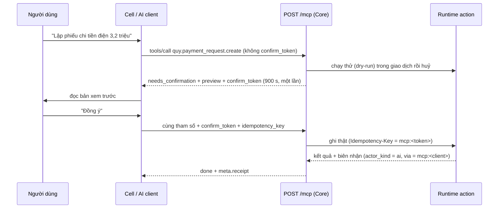
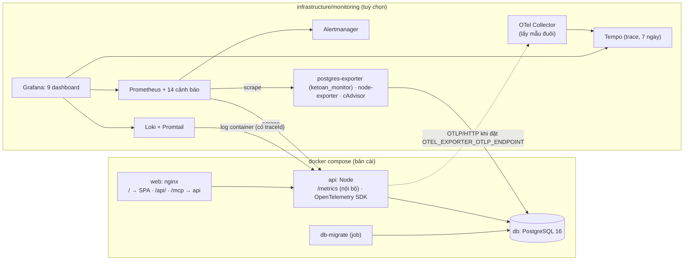
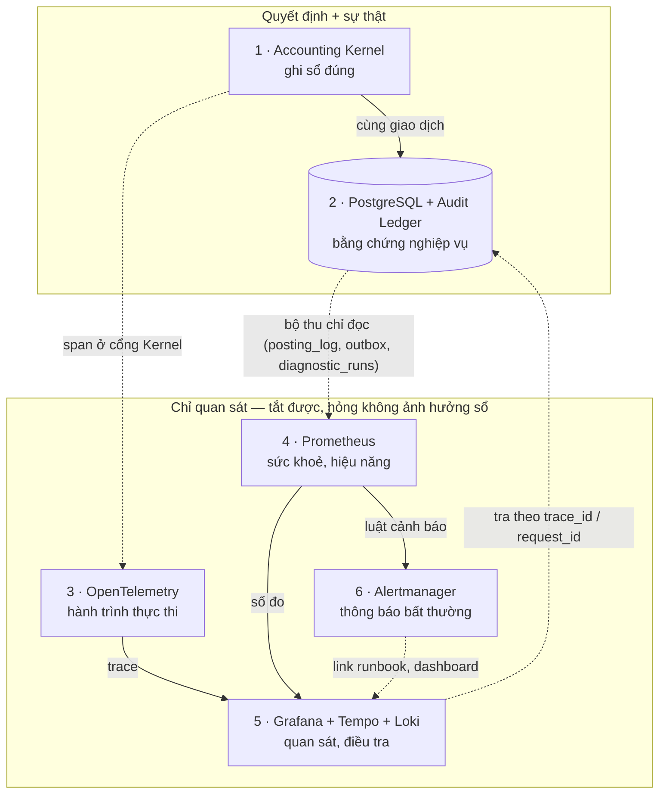
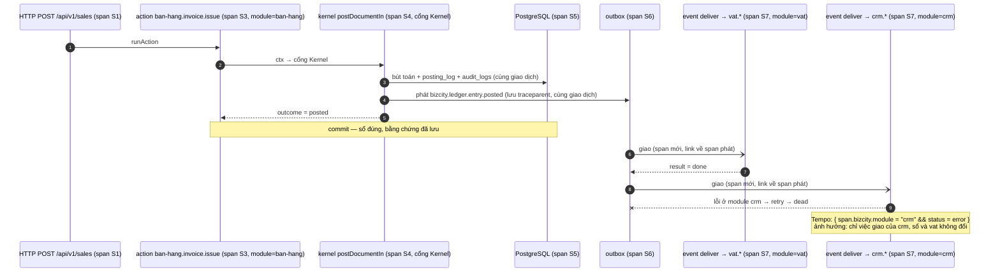

# Kiến trúc Bizcity Core (open-ketoan): sổ cái là lõi
<!-- [2026-10-30 12:10 PM Johnny Chu - Chu Hoàng Anh] ADR-0007 — chuẩn hoá mã lỗi, quan sát, bộ giám sát, cài nhanh, kiến trúc, đóng góp. -->
<!-- [2026-10-30 07:06 PM Johnny Chu - Chu Hoàng Anh] PHASE-004 — một cửa ghi sổ: eventStore cho phiếu tay, kết chuyển, khấu hao, giá vốn. -->
<!-- [2026-11-01 03:01 PM Johnny Chu - Chu Hoàng Anh] ADR-0010 — OpenTelemetry từ lõi: sáu lớp bảo đảm, span chỉ ở khớp nối Platform + cổng Kernel, thuộc tính theo danh sách cho phép, Tempo -->

> **Đọc cùng:** [TARGET-LAYOUT](../standard/TARGET-LAYOUT.md) (cây thư mục, luật phụ thuộc) · [REUSE-MAP](../standard/REUSE-MAP.md) (code hiện tại về đâu) · [ADR](../adr/README.md) (vì sao) · [PHASES](../standard/PHASES.md) (lộ trình)
> Sơ đồ viết bằng Mermaid: GitHub hiển thị trực tiếp. Đổi kiến trúc thì sửa sơ đồ trong cùng PR (CANON §5).

## 1. Bối cảnh hệ thống

## 2. Các lớp và chiều phụ thuộc

Luật đo bằng check **SC-LAYER-2** (mốc [docs/audits/deps-2026-10-30.md](../audits/deps-2026-10-30.md)). Mỗi tệp `apps/api/src` có nhãn `@bizcity-layer` (R-BOUND-10).

## 3. Một chứng từ đi vào sổ (Kernel)

Bốn câu không thương lượng ([AGENTS.md](../../AGENTS.md)):
1. Không sự việc thì không bút toán.
2. Sổ chỉ thêm.
3. Một cửa vào sổ.
4. Không viết số tài khoản trong code định khoản.

## 4. Module tương lai phát triển trên Kernel thế nào

Mọi module nghiệp vụ, từ bán hàng tới sản xuất, đi **một khuôn**:

1. Dữ liệu riêng ở bảng `mod_<key>.*`.
2. Danh mục dùng chung (khách, mặt hàng, chi nhánh, nhân viên) ở `packages/data`.
3. Khi có **tiền** thì nộp sự việc `docType` + `reasonCode` vào Kernel. Kernel định khoản theo gói định khoản của ngành.
4. Đọc số liệu kế toán qua `ctx.ledger.query`, không JOIN bảng sổ.

| Module | Nộp vào sổ (`docType`) | Kernel cần có | Gói định khoản | Trạng thái |
|---|---|---|---|---|
| `ban-hang` | `sale`, `sale_return`, `customer_payment` | có sẵn; `sales_lines` là projection của Kernel (ADR-0004) | thương mại, dịch vụ | đang chạy (phân hệ) |
| `mua-hang` | `purchase`, `purchase_return`, `supplier_payment` | có sẵn | thương mại | đang chạy; gỡ nợ A-17 |
| `kho` | `transfer`, `stock_adjustment` | giá vốn ở Kernel (sổ phụ kho) | mọi ngành có hàng | đang chạy |
| `hop-dong` / `du-an` | `customer_payment`, `supplier_payment` + chiều `contract` / `project` | `ledger.query` theo chiều phân tích | dịch vụ, xây dựng | ca chuẩn ([GOLDEN-CASE](../standard/GOLDEN-CASE-HOP-DONG.md)) |
| `tai-san` | khấu hao | khấu hao đi một cửa qua `eventStore` (PHASES 2.1, xong 2026-10-30) | mọi ngành | đang chạy |
| `nhan-su` (lương) | `payroll` | năng lực `ledger.doctype.payroll` (planned): lương, BHXH, TNCN theo lý do | HRM | đề xuất |
| `san-xuat` | `production` (xuất NVL 621, nhân công 622, SXC 627, nhập thành phẩm) | `ledger.doctype.production` + giá thành dở dang ở sổ phụ kho | sản xuất | đề xuất |
| `xuat-nhap-khau` | như mua / bán, có ngoại tệ | `ledger.fx` (planned): tỉ giá, chênh lệch | XNK | đề xuất |
| `crm` | — (không chạm sổ) | chỉ `packages/data` (ADR-0005) | — | đề xuất |

**Thêm một loại nghiệp vụ có tiền mới** (ví dụ lương):
1. Đề xuất năng lực `ledger.doctype.<x>` theo [VERSIONING §5](../standard/VERSIONING.md).
2. Kernel thêm khuôn sự việc + luật định khoản (mức K1, RULE-KERNEL).
3. Gói định khoản của ngành thêm lý do.
4. Module nộp `docType` mới.

Module **không bao giờ** tự ghi bút toán hay viết số tài khoản.

## 5. AI ghi sổ an toàn (MCP, xác nhận trước khi ghi)

## 6. Triển khai và quan sát

Chi tiết: [OBSERVABILITY.md](../ops/OBSERVABILITY.md), [DEPLOY.md](../ops/DEPLOY.md), [infrastructure/monitoring/README.md](../../infrastructure/monitoring/README.md).

## 7. Sáu lớp bảo đảm ([ADR-0010](../adr/ADR-0010-opentelemetry-tu-loi.md))

Mỗi lớp trả lời đúng một câu hỏi. Chỉ hai lớp đầu **quyết định và lưu sự thật**; bốn lớp sau **chỉ quan sát**. Hỏng lớp quan sát không bao giờ làm hỏng hay làm chậm việc ghi sổ.

| # | Lớp | Bảo đảm | Vai trò |
|---|---|---|---|
| 1 | **Accounting Kernel** | Ghi sổ **đúng**: một cửa sự việc, Nợ = Có, kỳ khoá, sổ chỉ thêm, định khoản tất định | quyết định |
| 2 | **PostgreSQL + Audit Ledger** | Lưu **bằng chứng nghiệp vụ**: bút toán, `posting_log`, `audit_logs` chuỗi băm, `diagnostic_runs`; trigger chặn sửa / xoá | sự thật, giữ ≥ 10 năm |
| 3 | **OpenTelemetry** | Theo dõi **hành trình thực thi**: yêu cầu đi qua module, action, cổng Kernel, CSDL, subscriber nào; chậm / hỏng ở bước nào | quan sát |
| 4 | **Prometheus** | Đo **sức khoẻ và hiệu năng**: tốc độ, độ trễ, lỗi, ghi sổ đã commit, outbox, pool, đối soát | quan sát (tổng hợp) |
| 5 | **Grafana + Tempo + Loki** | **Quan sát, điều tra lỗi**: dashboard → trace → log của đúng yêu cầu, nối bằng `traceId` | điều tra |
| 6 | **Alertmanager** | **Thông báo khi bất thường**: định tuyến theo mức / nhóm, ức chế, im lặng khi bảo trì | báo, không bao giờ sửa dữ liệu |

Hai luật không được quên:
- **Span không chứng minh việc đã ghi.** Giao dịch bọc ngoài có thể rollback. Chứng minh sổ đã commit chỉ bằng lớp 2 (`posting_log`, `ledger_entries`, `audit_logs`).
- **Không số đo, span hay cảnh báo nào được đọc ngược** vào định khoản, khoá kỳ hay quyền (R-KER-7, AP-1).

## 8. Module cộng đồng lỗi: tìm ra chỗ lỗi mà không sửa Kernel

Cộng đồng viết module VAT, công nợ phải thu / phải trả, CRM, kho, agent AI trên cùng Core. Không module nào tự viết mã truy vết. Span đặt sẵn ở **khớp nối** mà mọi module bắt buộc đi qua:

| Khớp nối | Span | Khoanh vùng bằng |
|---|---|---|
| HTTP / MCP vào | `HTTP {method} {route}` · `mcp tools/call {tool}` | route mẫu, tên công cụ |
| Runtime action (`runAction`) | `action {action.id}` | **`bizcity.module`** = tiền tố của `action.id` |
| Cổng Kernel (`kernel/public.ts`, bọc một lần — K1) | `kernel postDocumentIn` · `kernel eventStore.*` · `kernel ledgerQuery` | `bizcity.kernel.outcome`, `bizcity.error.code` |
| CSDL | `db {operation} {table}` | không có câu SQL, không tham số |
| Outbox phát / giao | `event publish {type}` → link → `event deliver {type} → {consumer}` | **`bizcity.module`** của subscriber, `bizcity.delivery.result` |
| Gọi ra ngoài | `HTTP {method}` client | chuyển tiếp `traceparent` |

Ví dụ minh hoạ (tên action và module là ví dụ): một hoá đơn bán hàng, hai subscriber của hai module cộng đồng, một subscriber lỗi.

Từ một cảnh báo (`OutboxDeadLetter`) người vận hành đi:
1. dashboard 07;
2. trace của việc giao `crm.*` (module, bước, mã lỗi);
3. span link về phiếu bán hàng gốc;
4. log theo `traceId`;
5. bằng chứng theo `request_id`.

Sổ không phải đụng tới. Ranh giới đã có: một cửa vào sổ, mỗi action một giao dịch, outbox giao riêng từng subscriber. OpenTelemetry chỉ làm các ranh giới đó **nhìn thấy được**.

Module muốn thấy bước riêng (vd "tính thuế") dùng `ctx.trace.step(name, fn)` của `@bizcity/module-sdk`. Module **không** import `@opentelemetry/*` trực tiếp (check SC-OBS-2), và mọi thuộc tính đi qua danh sách cho phép: không số tiền, MST, tên, payload (ADR-0010 §4).
