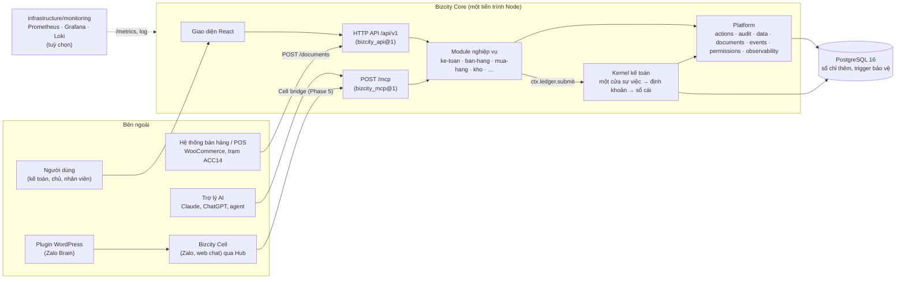
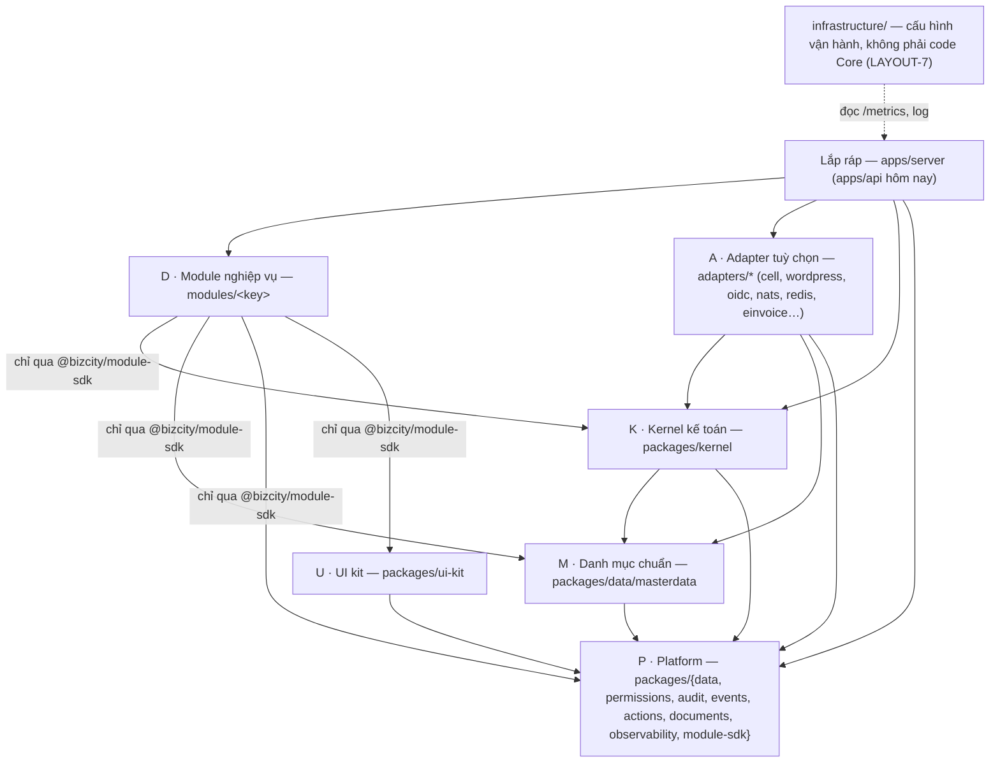
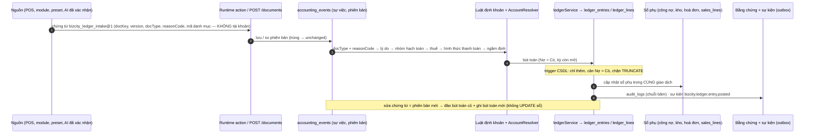
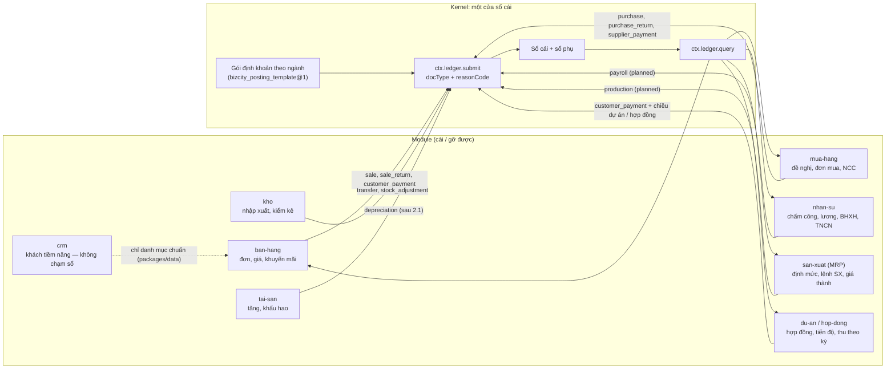
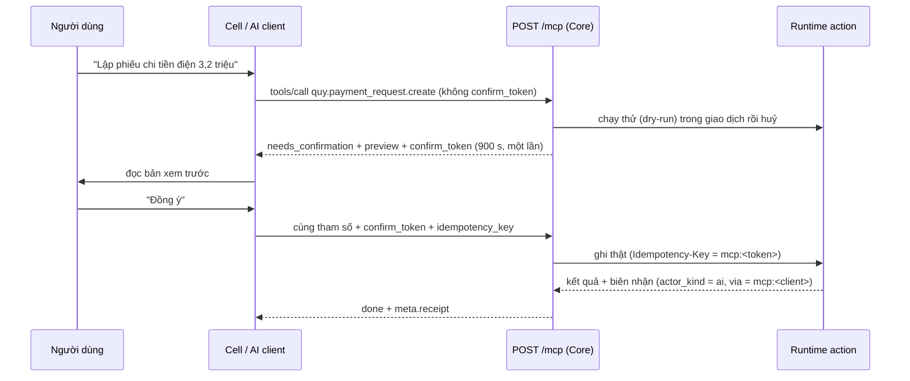
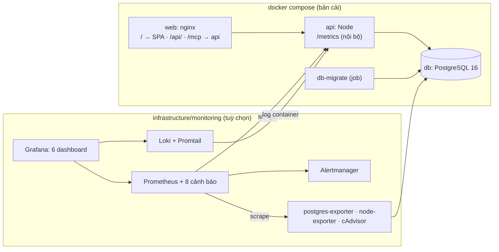

# Kiến trúc Bizcity Core (open-ketoan): sổ cái là lõi

> **Đọc cùng:** [TARGET-LAYOUT](../standard/TARGET-LAYOUT.md) (cây thư mục, luật phụ thuộc) · [REUSE-MAP](../standard/REUSE-MAP.md) (code hiện tại về đâu) · [ADR](../adr/README.md) (vì sao) · [PHASES](../standard/PHASES.md) (lộ trình)
> Sơ đồ viết bằng Mermaid: GitHub hiển thị trực tiếp. Đổi kiến trúc thì sửa sơ đồ trong cùng PR (CANON §5).

## 1. Bối cảnh hệ thống

## 2. Các lớp và chiều phụ thuộc

Luật đo bằng check **SC-LAYER-2** (mốc [docs/audits/deps-2026-10-30.md](../audits/deps-2026-10-30.md)). Mỗi tệp `apps/api/src` có nhãn `@bizcity-layer` (R-BOUND-10).

## 3. Một chứng từ đi vào sổ (Kernel)

Bốn câu không thương lượng ([AGENTS.md](../../AGENTS.md)):
1. Không sự việc thì không bút toán.
2. Sổ chỉ thêm.
3. Một cửa vào sổ.
4. Không viết số tài khoản trong code định khoản.

## 4. Module tương lai phát triển trên Kernel thế nào

Mọi module nghiệp vụ, từ bán hàng tới sản xuất, đi **một khuôn**:

1. Dữ liệu riêng ở bảng `mod_<key>.*`.
2. Danh mục dùng chung (khách, mặt hàng, chi nhánh, nhân viên) ở `packages/data`.
3. Khi có **tiền** thì nộp sự việc `docType` + `reasonCode` vào Kernel. Kernel định khoản theo gói định khoản của ngành.
4. Đọc số liệu kế toán qua `ctx.ledger.query`, không JOIN bảng sổ.

| Module | Nộp vào sổ (`docType`) | Kernel cần có | Gói định khoản | Trạng thái |
|---|---|---|---|---|
| `ban-hang` | `sale`, `sale_return`, `customer_payment` | có sẵn; `sales_lines` là projection của Kernel (ADR-0004) | thương mại, dịch vụ | đang chạy (phân hệ) |
| `mua-hang` | `purchase`, `purchase_return`, `supplier_payment` | có sẵn | thương mại | đang chạy; gỡ nợ A-17 |
| `kho` | `transfer`, `stock_adjustment` | giá vốn ở Kernel (sổ phụ kho) | mọi ngành có hàng | đang chạy |
| `hop-dong` / `du-an` | `customer_payment`, `supplier_payment` + chiều `contract` / `project` | `ledger.query` theo chiều phân tích | dịch vụ, xây dựng | ca chuẩn ([GOLDEN-CASE](../standard/GOLDEN-CASE-HOP-DONG.md)) |
| `tai-san` | khấu hao | `eventStore.commit()` (PHASES 2.1) để khấu hao đi một cửa | mọi ngành | đang chạy, nợ A-01 |
| `nhan-su` (lương) | `payroll` | năng lực `ledger.doctype.payroll` (planned): lương, BHXH, TNCN theo lý do | HRM | đề xuất |
| `san-xuat` | `production` (xuất NVL 621, nhân công 622, SXC 627, nhập thành phẩm) | `ledger.doctype.production` + giá thành dở dang ở sổ phụ kho | sản xuất | đề xuất |
| `xuat-nhap-khau` | như mua / bán, có ngoại tệ | `ledger.fx` (planned): tỉ giá, chênh lệch | XNK | đề xuất |
| `crm` | — (không chạm sổ) | chỉ `packages/data` (ADR-0005) | — | đề xuất |

**Thêm một loại nghiệp vụ có tiền mới** (ví dụ lương):
1. Đề xuất năng lực `ledger.doctype.<x>` theo [VERSIONING §5](../standard/VERSIONING.md).
2. Kernel thêm khuôn sự việc + luật định khoản (mức K1, RULE-KERNEL).
3. Gói định khoản của ngành thêm lý do.
4. Module nộp `docType` mới.

Module **không bao giờ** tự ghi bút toán hay viết số tài khoản.

## 5. AI ghi sổ an toàn (MCP, xác nhận trước khi ghi)

## 6. Triển khai và quan sát

Chi tiết: [OBSERVABILITY.md](../ops/OBSERVABILITY.md), [DEPLOY.md](../ops/DEPLOY.md), [infrastructure/monitoring/README.md](../../infrastructure/monitoring/README.md).
