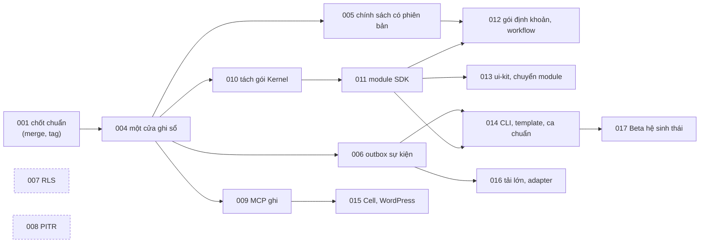

# Đánh giá 2026-10-30: codebase đáp ứng bao nhiêu % kiến trúc công bố

> Theo yêu cầu của chủ dự án (Johnny Chu – Chu Hoàng Anh): "rà soát lại kiến trúc và checklist đã làm đến đâu, code base đáp ứng bao nhiêu % so với kiến trúc".
> Số đo chạy ngày 2026-10-30 trên nhánh `feat/phase-0-tiep`, CSDL `ketoan_test` (đủ migration 0001–0037): `node tests/conformance/selfcheck.mjs` với lane diagnostics.
> Kế hoạch làm tiếp chia theo thư mục phase: [docs/phases/](../phases/README.md).

## Trả lời ngắn

**Khoảng 50% kiến trúc đã công bố** (checklist G1–G3 của [Bản công bố §6](../CONG-BO-KIEN-TRUC.md), tính **có** = 1, **một phần** = ½).

- **Lõi kế toán (G1): 77%.** Phần "sổ đúng" gần như đủ: bất biến sổ cái, đảo bút toán, khoá kỳ, idempotency, bằng chứng chuỗi băm, tự chẩn đoán đều có và có test.
- **Hợp đồng, AI, sự kiện, giám sát (G2): 60%.** Action runtime, MCP đọc, mã lỗi, giám sát có. Còn thiếu outbox sự kiện, chính sách kế toán có phiên bản, MCP ghi.
- **Hệ sinh thái (G3): 0%.** Registry, CLI, NATS, benchmark, diễn tập PITR đều chưa.

Nói cách khác: **sổ đã đúng, nhưng chưa thành framework.** Phần cấu trúc gồm tách gói Kernel, SDK, sự kiện và module cộng đồng mới khoảng một phần ba.

## 1. Năm thước đo

| Thước đo | Đo gì | Kết quả | Nguồn |
|---|---|---|---|
| Checklist công bố G1–G3 | 32 việc của bản công bố kiến trúc | **50%** (G1 77% · G2 60% · G3 0%) | [CONG-BO §6](../CONG-BO-KIEN-TRUC.md) |
| Lộ trình Phase 0–5 | 59 việc, mỗi việc xong khi tín hiệu máy đạt | **33%** (P0 73 · P1 60 · P2 50 · P3 13 · P4 17 · P5 0) | [roadmap.json](../standard/roadmap.json) |
| Ma trận tuân thủ C-1..C-9 | 9 yêu cầu bắt buộc | **59%**: 3 đạt, 4 một phần, 2 thiếu (C-5 outbox, C-9 chính sách có phiên bản) | [compliance-matrix.json](../standard/compliance-matrix.json) |
| Nguyên tắc AP-1..AP-7 | nguyên tắc có check thực thi | **6/7**: AP-6 (sự kiện phát lại được) là nợ | `bizcity-standard.json#principles`, SC-CMP-2 |
| Năng lực Standard v1 | năng lực `available` / tổng | **11/41** (27%); điểm sẵn sàng 21,3 | [bizcity-standard.json](../standard/bizcity-standard.json) |

Chất lượng code hiện có (không phải độ phủ kiến trúc):
- **Tuân chuẩn:** 95,9 điểm (A).
- **Tự chẩn đoán trên CSDL:** 93,6 điểm (B).
- **vitest:** 709/709 xanh, sau mọi tệp test đều tự kiểm bất biến sổ.

## 2. Theo lớp kiến trúc

| Lớp | Đáp ứng | Đã có | Còn thiếu | Phase |
|---|---|---|---|---|
| **Kernel: sổ đúng** | cao | Chỉ thêm, Nợ = Có, trigger; DG-LEDGER-1..4 đạt trên 9.725 bút toán; C-2, C-3, C-4 đạt 100% | 4 dịch vụ nội bộ gọi thẳng `ledgerService` (A-01); sự việc nội bộ thiếu `posted_version` (DG-EVENT-4 36,5%) | 004 |
| **Kernel: chính sách** | thấp | Cấu hình định khoản, `AccountResolver`, gói định khoản đúng khuôn | Phiên bản + ngày hiệu lực (C-9 = 0%) | 005 |
| **Kernel: cấu trúc** | thấp | Nhãn lớp 100%, đồ thị phụ thuộc mốc | Chưa tách `packages/kernel`; 22 cạnh ngược lớp | 010 |
| **Platform: action, bằng chứng, chẩn đoán** | cao | `defineAction`, idempotency, dry-run, chuỗi băm, L1 / L3, `/capabilities` | Tách gói; màn lịch sử chẩn đoán | 003 ✅, 010 |
| **Platform: AI (MCP)** | trung bình | 4 công cụ đọc, khung `confirm_token` | Công cụ ghi; khoá `mcp_…` riêng | 009 |
| **Platform: sự kiện** | không có | Hợp đồng `bizcity_event@1`, luật R-OUTBOX | Outbox, subscriber, đồng hồ; còn `setTimeout` | 006 |
| **Data: cô lập đơn vị** | trung bình | Lọc `tenant_id` mọi truy vấn; vai trò `ketoan_app` không BYPASSRLS | RLS, `ctx.data.tx`, kiểm tấn công chéo | 007 |
| **Vận hành** | trung bình | Sao lưu + kiểm khôi phục, `/metrics`, Grafana, kiểm nâng cấp migration | PITR, diễn tập RTO / RPO | 008 |
| **Module / SDK** | thấp | Bản nháp API SDK, ca mẫu, bộ kiểm `--module` | SDK, manifest (0/9 phân hệ), quyền theo module; 14 chỗ module ghi bảng lõi | 011–013 |
| **Công cụ cộng đồng** | thấp | AGENTS.md, 1 preset | CLI, starter template, ca chuẩn 3/3 | 014 |
| **Hệ sinh thái** | không có | Thiết kế Cell, WordPress, marketplace | Mọi adapter, registry, Beta | 015–017 |

Thước đo lộ trình theo mảng có ghi **Kernel sổ cái 38%**. Con số này đo **việc tái cấu trúc** Kernel (một cửa, tách gói, partition), không đo độ đúng của sổ. Độ đúng của sổ đọc ở dòng "Kernel: sổ đúng".

## 3. Phát hiện cần xử lý

| # | Phát hiện | Mức | Xử lý |
|---|---|---|---|
| A-1 | CSDL dev `ketoan` trong Docker mới ở migration `0029`, nên chạy tự chẩn đoán trên dev ra **KHÔNG ĐẠT giả** (8 migration chưa áp, thiếu trigger bằng chứng) | vận hành | `docker compose up -d --build` (PHASE-001 S001-11) |
| A-2 | Mọi commit trước `ccfc341`, kể cả `main`, không cài sạch được | phát hành | merge nhánh, gắn tag `v0.2.0` (PHASE-001) |
| A-3 | `ketoan_test`: DG-EVENT-2 có 200 sự việc posted chưa thấy bút toán hiệu lực của đúng phiên bản; DG-EVENT-4 có 191 sự việc nội bộ thiếu `posted_version` | toàn vẹn | phân loại ở PHASE-004 W0 |
| A-4 | Hai lộ trình chồng nhau (PHASES 0–5 và checklist G1–G3), 3 việc G chưa có mã lộ trình | quản trị | đã thêm 2.14 (G2-09), 2.15 (G1-08, G3-07), 2.16 (G2-04); gom vào 17 thư mục phase; SC-PHASE-1 bảo đảm mỗi mã việc thuộc đúng một phase |
| A-5 | 14 GitHub Action chưa ghim theo SHA (SC-SEC-4, cảnh báo) | chuỗi cung ứng | ghim trước bản phát hành đầu |
| A-6 | 3 việc tay chờ chủ: merge, bật Private Vulnerability Reporting, bản cài thật dùng `ketoan_app` | quản trị | PHASE-001 |

## 4. Đường găng

PHASE-007 và 008 (nét đứt) không phụ thuộc phase nào, làm song song được bất cứ lúc nào.

**Đề xuất làm kế tiếp: PHASE-004.** Phase này chặn bốn phase sau, và gỡ nợ ở hai dòng tuân thủ (C-1, C-7).
