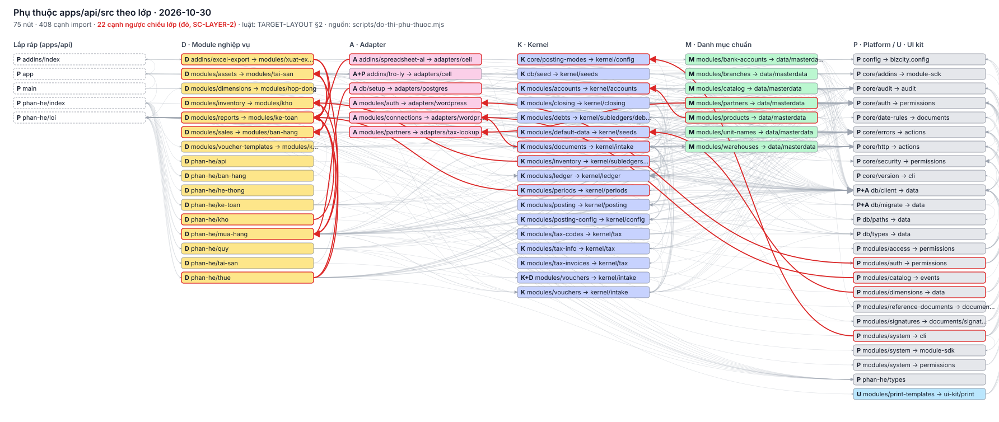

# Đồ thị phụ thuộc apps/api/src — mốc 2026-10-30

> PHASES 1.4. Sinh bởi `node scripts/do-thi-phu-thuoc.mjs --date 2026-10-30` từ bảng lớp [`tests/conformance/lib/layers.mjs`](../../tests/conformance/lib/layers.mjs) (chép [REUSE-MAP §3](../standard/REUSE-MAP.md)) và luật chiều [TARGET-LAYOUT §2](../standard/TARGET-LAYOUT.md#2-luật-phụ-thuộc-tier-0-với-kernel-tier-1-còn-lại). Không sửa tay — chạy lại script. Cạnh ngược chiều là phát hiện của check **SC-LAYER-2** (ratchet: cạnh có trong mốc này nằm ở `baseline.json`, cạnh mới là đỏ).

**75** nút · **408** cạnh · **22** cạnh ngược chiều lớp.

## 1. Luật chiều đang đo

| Lớp nguồn | Được import | Căn cứ |
|---|---|---|
| **K** Kernel | K, P, M | Kernel dùng mọi gói Platform |
| **P** Platform | P, M | LAYOUT-1: Platform không biết Kernel |
| **M** Danh mục chuẩn | M, P | ADR-0005: danh mục chuẩn ở packages/data |
| **D** Module nghiệp vụ | D, K, P, M, U | LAYOUT-2; D → D chỉ trong cùng module |
| **A** Adapter | A, K, P, M | LAYOUT-4: Kernel / module chạy được khi gỡ adapter |
| **U** UI kit | U, P | ui-kit chỉ dựa Platform |
| lắp ráp (`apps/api`) | mọi lớp | LAYOUT-6 |

## 2. Ma trận import (số câu import, `đúng / ngược`)

| nguồn \ đích | A | A+P | D | K | K+D | M | P | P+A | U |
|---|---|---|---|---|---|---|---|---|---|
| **lắp ráp** | 2 | 1 | 13 | 9 |  | 7 | 23 | 3 | 1 |
| **A** |  |  | 0 / **2** | 2 |  | 1 | 18 | 6 |  |
| **A+P** |  |  |  | 1 |  |  | 5 | 1 |  |
| **D** |  |  | 5 / **15** | 20 | 2 | 6 | 106 | 42 |  |
| **K** | 0 / **1** |  | 0 / **2** | 47 |  | 3 | 74 | 34 |  |
| **K+D** |  |  |  | 1 |  |  | 2 |  |  |
| **M** | 0 / **1** |  |  | 0 / **1** |  | 1 | 33 | 16 |  |
| **P** | 0 / **2** |  |  | 0 / **2** |  | 1 | 48 | 14 |  |
| **P+A** |  |  |  |  |  |  | 3 | 1 |  |
| **U** |  |  |  |  |  |  | 4 | 1 |  |

## 3. Cạnh ngược chiều lớp (nợ cần gỡ)

| # | Nguồn | Đích | Số import | Ví dụ | Hướng gỡ |
|---|---|---|---|---|---|
| 1 | D `addins/excel-export → modules/xuat-excel` | D `modules/reports → modules/ke-toan` | 2 | [addins/excel-export/index.ts:18](../../apps/api/src/addins/excel-export/index.ts#L18) | module dùng chung → đưa phần chung về Kernel `ledger.query` hoặc khai `includes` (R-BOUND-4) |
| 2 | D `addins/excel-export → modules/xuat-excel` | D `modules/sales → modules/ban-hang` | 2 | [addins/excel-export/index.ts:20](../../apps/api/src/addins/excel-export/index.ts#L20) | module dùng chung → đưa phần chung về Kernel `ledger.query` hoặc khai `includes` (R-BOUND-4) |
| 3 | A `addins/spreadsheet-ai → adapters/cell` | D `modules/reports → modules/ke-toan` | 1 | [addins/spreadsheet-ai/index.ts:16](../../apps/api/src/addins/spreadsheet-ai/index.ts#L16) | adapter gọi module → module đăng ký qua extension point (Phase 3) |
| 4 | A `db/setup → adapters/postgres` | D `phan-he/mua-hang` | 1 | [db/setup.ts:11](../../apps/api/src/db/setup.ts#L11) | adapter gọi module → module đăng ký qua extension point (Phase 3) |
| 5 | P `modules/auth → permissions` | A `modules/auth → adapters/wordpress` | 1 | [modules/auth/auth.routes.ts:15](../../apps/api/src/modules/auth/auth.routes.ts#L15) | đảo phụ thuộc: adapter đăng ký vào cổng Platform / sự kiện (LAYOUT-4) |
| 6 | P `modules/catalog → events` | A `modules/connections → adapters/wordpress` | 1 | [modules/catalog/catalog-notify.ts:14](../../apps/api/src/modules/catalog/catalog-notify.ts#L14) | đảo phụ thuộc: adapter đăng ký vào cổng Platform / sự kiện (LAYOUT-4) |
| 7 | P `modules/dimensions → data` | K `modules/default-data → kernel/seeds` | 1 | [modules/dimensions/dimension.routes.ts:19](../../apps/api/src/modules/dimensions/dimension.routes.ts#L19) | Platform / danh mục không import Kernel: Kernel đăng ký vào Platform (ADR-0005) |
| 8 | K `modules/documents → kernel/intake` | A `modules/connections → adapters/wordpress` | 1 | [modules/documents/document.service.ts:47](../../apps/api/src/modules/documents/document.service.ts#L47) | đảo phụ thuộc: adapter đăng ký vào cổng Platform / sự kiện (LAYOUT-4) |
| 9 | K `modules/inventory → kernel/subledgers/inventory` | D `modules/inventory → modules/kho` | 1 | [modules/inventory/inventory.routes.ts:18](../../apps/api/src/modules/inventory/inventory.routes.ts#L18) | Kernel / Platform không biết module: chuyển route / hàm sang module, hoặc registry |
| 10 | M `modules/partners → data/masterdata` | A `modules/partners → adapters/tax-lookup` | 1 | [modules/partners/partner.routes.ts:31](../../apps/api/src/modules/partners/partner.routes.ts#L31) | đảo phụ thuộc: adapter đăng ký vào cổng Platform / sự kiện (LAYOUT-4) |
| 11 | K `modules/periods → kernel/periods` | D `modules/reports → modules/ke-toan` | 1 | [modules/periods/period.routes.ts:25](../../apps/api/src/modules/periods/period.routes.ts#L25) | Kernel / Platform không biết module: chuyển route / hàm sang module, hoặc registry |
| 12 | M `modules/products → data/masterdata` | K `modules/accounts → kernel/accounts` | 1 | [modules/products/product.routes.ts:23](../../apps/api/src/modules/products/product.routes.ts#L23) | Platform / danh mục không import Kernel: Kernel đăng ký vào Platform (ADR-0005) |
| 13 | D `modules/reports → modules/ke-toan` | D `modules/assets → modules/tai-san` | 1 | [modules/reports/report.service.ts:20](../../apps/api/src/modules/reports/report.service.ts#L20) | module dùng chung → đưa phần chung về Kernel `ledger.query` hoặc khai `includes` (R-BOUND-4) |
| 14 | D `modules/reports → modules/ke-toan` | D `modules/inventory → modules/kho` | 1 | [modules/reports/goods-reports.ts:24](../../apps/api/src/modules/reports/goods-reports.ts#L24) | module dùng chung → đưa phần chung về Kernel `ledger.query` hoặc khai `includes` (R-BOUND-4) |
| 15 | D `modules/reports → modules/ke-toan` | D `modules/sales → modules/ban-hang` | 2 | [modules/reports/goods-reports.ts:22](../../apps/api/src/modules/reports/goods-reports.ts#L22) | module dùng chung → đưa phần chung về Kernel `ledger.query` hoặc khai `includes` (R-BOUND-4) |
| 16 | D `modules/sales → modules/ban-hang` | D `modules/reports → modules/ke-toan` | 1 | [modules/sales/sales-report.service.ts:16](../../apps/api/src/modules/sales/sales-report.service.ts#L16) | module dùng chung → đưa phần chung về Kernel `ledger.query` hoặc khai `includes` (R-BOUND-4) |
| 17 | P `modules/system → cli` | K `core/posting-modes → kernel/config` | 1 | [modules/system/system.routes.ts:26](../../apps/api/src/modules/system/system.routes.ts#L26) | Platform / danh mục không import Kernel: Kernel đăng ký vào Platform (ADR-0005) |
| 18 | D `phan-he/kho` | D `modules/reports → modules/ke-toan` | 1 | [phan-he/kho/index.ts:6](../../apps/api/src/phan-he/kho/index.ts#L6) | module dùng chung → đưa phần chung về Kernel `ledger.query` hoặc khai `includes` (R-BOUND-4) |
| 19 | D `phan-he/mua-hang` | D `modules/inventory → modules/kho` | 1 | [phan-he/mua-hang/bao-cao-kho.ts:21](../../apps/api/src/phan-he/mua-hang/bao-cao-kho.ts#L21) | module dùng chung → đưa phần chung về Kernel `ledger.query` hoặc khai `includes` (R-BOUND-4) |
| 20 | D `phan-he/mua-hang` | D `modules/reports → modules/ke-toan` | 1 | [phan-he/mua-hang/index.ts:6](../../apps/api/src/phan-he/mua-hang/index.ts#L6) | module dùng chung → đưa phần chung về Kernel `ledger.query` hoặc khai `includes` (R-BOUND-4) |
| 21 | D `phan-he/thue` | D `modules/assets → modules/tai-san` | 1 | [phan-he/thue/statements/notes.service.ts:16](../../apps/api/src/phan-he/thue/statements/notes.service.ts#L16) | module dùng chung → đưa phần chung về Kernel `ledger.query` hoặc khai `includes` (R-BOUND-4) |
| 22 | D `phan-he/thue` | D `modules/reports → modules/ke-toan` | 2 | [phan-he/thue/statements/cit-return.service.ts:24](../../apps/api/src/phan-he/thue/statements/cit-return.service.ts#L24) | module dùng chung → đưa phần chung về Kernel `ledger.query` hoặc khai `includes` (R-BOUND-4) |

## 4. Nút

| Lớp | Nút | Đích | Tệp | Import ra | Được import |
|---|---|---|---|---|---|
| D | `addins/excel-export` | modules/xuat-excel | 1 | 4 | 1 |
| P | `addins/index` | apps/api | 1 | 4 | 1 |
| A | `addins/spreadsheet-ai` | adapters/cell | 1 | 4 | 1 |
| A+P | `addins/tro-ly` | adapters/cell | 2 | 6 | 1 |
| P | `app` | apps/api | 1 | 8 | 1 |
| P | `config` | bizcity.config | 1 | 0 | 10 |
| P | `core/addins` | module-sdk | 1 | 1 | 5 |
| P | `core/audit` | audit | 1 | 1 | 32 |
| P | `core/auth` | permissions | 1 | 3 | 45 |
| P | `core/date-rules` | documents | 1 | 3 | 4 |
| P | `core/errors` | actions | 1 | 0 | 44 |
| P | `core/http` | actions | 1 | 1 | 40 |
| K | `core/posting-modes` | kernel/config | 1 | 1 | 2 |
| P | `core/security` | permissions | 3 | 2 | 5 |
| P | `core/version` | cli | 1 | 0 | 1 |
| P+A | `db/client` | data | 1 | 2 | 54 |
| P+A | `db/migrate` | data | 1 | 2 | 3 |
| P | `db/paths` | data | 1 | 0 | 4 |
| K | `db/seed` | kernel/seeds | 1 | 4 | 1 |
| A | `db/setup` | adapters/postgres | 1 | 4 | 0 |
| P | `db/types` | data | 1 | 0 | 9 |
| P | `main` | apps/api | 1 | 4 | 0 |
| P | `modules/access` | permissions | 4 | 6 | 1 |
| K | `modules/accounts` | kernel/accounts | 4 | 6 | 7 |
| D | `modules/assets` | modules/tai-san | 4 | 10 | 3 |
| A | `modules/auth` | adapters/wordpress | 1 | 6 | 1 |
| P | `modules/auth` | permissions | 4 | 7 | 2 |
| M | `modules/bank-accounts` | data/masterdata | 1 | 5 | 1 |
| M | `modules/branches` | data/masterdata | 5 | 5 | 1 |
| M | `modules/catalog` | data/masterdata | 4 | 5 | 2 |
| P | `modules/catalog` | events | 1 | 2 | 1 |
| K | `modules/closing` | kernel/closing | 2 | 9 | 3 |
| A | `modules/connections` | adapters/wordpress | 3 | 7 | 3 |
| K | `modules/debts` | kernel/subledgers/debts | 2 | 5 | 5 |
| K | `modules/default-data` | kernel/seeds | 2 | 6 | 3 |
| D | `modules/dimensions` | modules/hop-dong | 1 | 5 | 1 |
| P | `modules/dimensions` | data | 1 | 6 | 1 |
| K | `modules/documents` | kernel/intake | 4 | 18 | 10 |
| D | `modules/inventory` | modules/kho | 1 | 4 | 3 |
| K | `modules/inventory` | kernel/subledgers/inventory | 3 | 12 | 3 |
| K | `modules/ledger` | kernel/ledger | 5 | 8 | 7 |
| A | `modules/partners` | adapters/tax-lookup | 1 | 4 | 1 |
| M | `modules/partners` | data/masterdata | 3 | 6 | 7 |
| K | `modules/periods` | kernel/periods | 2 | 7 | 2 |
| K | `modules/posting-config` | kernel/config | 3 | 7 | 5 |
| K | `modules/posting` | kernel/posting | 8 | 5 | 2 |
| U | `modules/print-templates` | ui-kit/print | 1 | 5 | 1 |
| M | `modules/products` | data/masterdata | 1 | 7 | 1 |
| P | `modules/reference-documents` | documents/links | 1 | 6 | 1 |
| D | `modules/reports` | modules/ke-toan | 13 | 9 | 9 |
| D | `modules/sales` | modules/ban-hang | 3 | 5 | 3 |
| P | `modules/signatures` | documents/signatures | 1 | 5 | 2 |
| P | `modules/system` | cli | 1 | 10 | 1 |
| P | `modules/system` | module-sdk | 2 | 1 | 2 |
| P | `modules/system` | permissions | 1 | 3 | 1 |
| K | `modules/tax-codes` | kernel/tax | 1 | 6 | 1 |
| K | `modules/tax-info` | kernel/tax | 3 | 6 | 3 |
| K | `modules/tax-invoices` | kernel/tax | 1 | 2 | 1 |
| M | `modules/unit-names` | data/masterdata | 1 | 5 | 1 |
| D | `modules/voucher-templates` | modules/ke-toan | 1 | 6 | 1 |
| K+D | `modules/vouchers` | kernel/intake | 1 | 3 | 2 |
| K | `modules/vouchers` | kernel/intake | 1 | 12 | 5 |
| M | `modules/warehouses` | data/masterdata | 2 | 5 | 4 |
| D | `phan-he/api` | modules/api | 1 | 1 | 1 |
| D | `phan-he/ban-hang` | modules/ban-hang | 1 | 3 | 1 |
| D | `phan-he/he-thong` | modules/he-thong | 1 | 1 | 1 |
| P | `phan-he/index` | apps/api | 1 | 11 | 1 |
| D | `phan-he/ke-toan` | modules/ke-toan | 2 | 10 | 1 |
| D | `phan-he/kho` | modules/kho | 1 | 4 | 1 |
| P | `phan-he/loi` | apps/api | 1 | 29 | 8 |
| D | `phan-he/mua-hang` | modules/mua-hang | 18 | 17 | 2 |
| D | `phan-he/quy` | modules/quy | 2 | 9 | 1 |
| D | `phan-he/tai-san` | modules/tai-san | 1 | 3 | 1 |
| D | `phan-he/thue` | modules/thue | 7 | 9 | 1 |
| P | `phan-he/types` | module-sdk | 1 | 0 | 11 |
