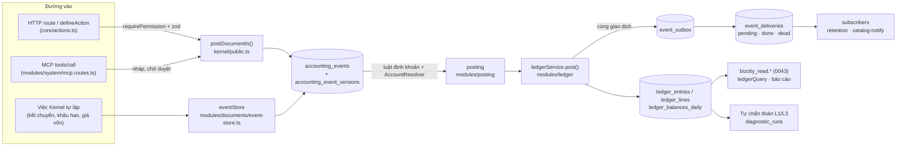
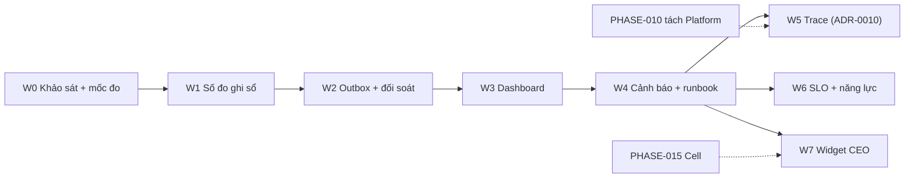

# PHASE-018 · 10 — Hiện trạng đọc mã (khảo sát W0)
<!-- [2026-10-31 11:40 PM Johnny Chu - Chu Hoàng Anh] PHASE-018 — khảo sát repo cho giám sát: có / kế hoạch / chưa có, luồng thật, bảo mật, khoảng trống P0–P2. -->

> Tương đương `00-REPO-AUDIT.md` của bản giao việc. Chụp ngày **2026-10-31** trên nhánh `feat/phase-0-tiep` (commit `6b3c7da`). Mỗi kết luận có `tệp:dòng` hoặc lệnh kiểm; thứ gì không tìm thấy thì ghi **chưa có**, không suy đoán.
> © 2026 Johnny Chu (Chu Hoàng Anh) / BizCity — kiến trúc Bizcity Core Framework.

## 1. Nền tảng chạy

| Hạng mục | Hiện trạng | Bằng chứng |
|---|---|---|
| Monorepo | npm workspaces: `apps/api`, `apps/web`, `packages/contracts`, `packages/module-sdk` | `package.json` |
| API | Fastify + `fastify-type-provider-zod`, Node 22 (image `node:22-alpine`) | `docker/api.Dockerfile`, `apps/api/src/app.ts` |
| CSDL | PostgreSQL 16, Kysely + SQL migration (42 tệp, số tới `0043`; `db:migrate` báo "Đã áp 42 migration"), không Prisma | `docker-compose.yml:21`, `db/migrations/`, R-DB-14 |
| Log | pino JSON, trường chuẩn + `tenant`, `actor`, `actorKind` gắn sau xác thực | `apps/api/src/core/observability.ts:27-29`, `docs/ops/OBSERVABILITY.md` §2 |
| Truy vết | `X-Request-Id`, nhận / trả `traceparent` (W3C), chưa có SDK OpenTelemetry | `docs/ops/OBSERVABILITY.md` §1; `git grep opentelemetry` = 0 |
| CI | `.github/workflows/ci.yml`, `conformance.yml` | `.github/workflows/` |

## 2. Thành phần: có / kế hoạch / chưa có

| Thành phần | Trạng thái | Bằng chứng |
|---|---|---|
| PostgreSQL | **có** | `docker-compose.yml` |
| Outbox sự kiện (thay hàng đợi) | **có** — `event_outbox`, `event_deliveries` (`pending` / `done` / `dead`), `event_consumptions` | `db/migrations/0039_su_kien_mien.sql:12,32,36,47`, `apps/api/src/core/events.ts` |
| Subscriber đăng ký | **có** — `retentionSubscriber`, `catalogNotifySubscriber` | `apps/api/src/app.ts:88` |
| Idempotency action | **có** — `action_requests` | `db/migrations/0035_action_requests.sql:11` |
| Tự chẩn đoán (đối soát sổ) | **có** — L1 / L3, `diagnostic_runs`, khoá kỳ chặn khi sổ lỗi | `db/migrations/0034_chan_doan.sql:9`, `apps/api/src/modules/system/diagnostics.ts`, `docs/ops/DIAGNOSTICS.md` |
| Health / readiness | **có** — hai route tách | `apps/api/src/modules/system/system.routes.ts:141,151` |
| `/metrics` | **có** — nội bộ, `METRICS_TOKEN` tuỳ chọn | `apps/api/src/modules/system/metrics.routes.ts:26-39` |
| Prometheus / Alertmanager / Grafana / Loki / Promtail | **có** (bộ tuỳ chọn) | `infrastructure/monitoring/docker-compose.monitoring.yml:28-172` |
| postgres-exporter / node-exporter / cAdvisor | **có** (tuỳ chọn; cAdvisor, node-exporter phụ thuộc Linux / WSL2) | như trên |
| Redis | **chưa có** — chỉ nhắc ở tài liệu (`adapters/redis` theo R-CACHE-6 là kế hoạch) | `git grep -i redis apps/api/src` = 0 |
| NATS JetStream | **chưa có** — ADR-0007 G-1 chọn outbox trong PostgreSQL | `infrastructure/monitoring/README.md:186-200` |
| Keycloak / Kong / gateway | **chưa có** | `git grep -i keycloak\|kong` = 0 |
| Posting worker / hàng đợi ghi sổ | **chưa có, và đúng thiết kế** — ghi sổ là lệnh đồng bộ trong giao dịch ACID (AP-2) | `docs/CONG-BO-KIEN-TRUC.md` §3.2 |
| Cell integration | **kế hoạch** — PHASE-015 chưa code; mã chỉ có loại tác nhân / kênh | `docs/phases/PHASE-015-CELL-WORDPRESS/README.md` |
| OpenTelemetry SDK, Tempo | **chưa có** | `git grep -i opentelemetry\|tempo` = 0 |

## 3. Luồng thật (chỉ tên có trong mã)

Ghi chú: mọi bước từ `postDocumentIn()` tới `event_outbox` nằm **trong một giao dịch**. Không có hàng đợi hay worker ở giữa, nên "độ trễ ghi sổ" là độ trễ của chính lời gọi, còn "tồn đọng" chỉ có ở hai chỗ: sự việc `pending` / `error` (`bizcity_ledger_events`) và việc giao sự kiện `pending` / `dead` (chưa có số đo).

## 4. Số đo, dashboard, cảnh báo đang có

**13 số đo** `bizcity_*` (bảng §3 `docs/ops/OBSERVABILITY.md`, định nghĩa `apps/api/src/core/metrics.ts:68-80`): build, HTTP (3), CSDL (3), action, MCP, sự việc theo trạng thái, tuổi sự việc chờ lâu nhất, bút toán 24 giờ, lỗi tự chẩn đoán. Nhãn đều có tập giá trị giới hạn: `route` lấy **mẫu route** (`req.routeOptions.url`, `observability.ts:33`), không lấy URL thật.

**6 dashboard** (`infrastructure/monitoring/grafana/dashboards/`, tự nạp qua provisioning):

| Tệp | Tên | Panel | uid |
|---|---|---|---|
| 01-tong-quan.json | Tổng quan | 14 | `bizcity-tong-quan` |
| 02-api.json | API theo route | 15 | `bizcity-api` |
| 03-postgresql.json | CSDL PostgreSQL | 18 | `bizcity-postgresql` |
| 04-so-cai-su-viec.json | Sổ cái & sự việc | 18 | `bizcity-so-cai` |
| 05-nghiep-vu-kpi.json | KPI nghiệp vụ | 17 | `bizcity-kpi` |
| 06-nhat-ky-canh-bao.json | Nhật ký & cảnh báo | 8 | `bizcity-nhat-ky` |

**8 cảnh báo** (`infrastructure/monitoring/prometheus/alerts.yml`): `HighErrorRate` (critical, 5m), `HighLatency` (warning, 10m), `ApiDown` (critical, 2m), `HighMemory` (warning), `PostgreSQLDown` (critical, 1m), `DiskUsage` (warning), `LedgerIntegrityError` (critical, 0m — lỗi tự chẩn đoán L3), `PostingBacklog` (warning, 30m). Alertmanager mặc định **không gửi đi đâu** (`alertmanager/alertmanager.yml:5`).

## 5. Bảo mật và cô lập đơn vị

| Hạng mục | Hiện trạng | Đánh giá |
|---|---|---|
| Cổng giám sát | Prometheus, Alertmanager, Grafana bind `127.0.0.1` | đạt (`docker-compose.monitoring.yml:45,65,94`) |
| `/metrics` | không qua nginx; `METRICS_TOKEN` so khớp hằng thời gian | đạt (R-OBS-3); **chưa bắt buộc** token khi cổng API mở ra ngoài |
| Grafana | tắt đăng ký, tắt ẩn danh; **mật khẩu admin có giá trị dự phòng** `doi-mat-khau-ngay` khi quên đặt biến | **rủi ro P0** trên máy chủ thật → đổi sang biến bắt buộc `${GRAFANA_ADMIN_PASSWORD:?…}` |
| Nhãn số đo | không `tenant` / ID (R-OBS-4) | đạt |
| Nhãn Loki | `level`, `errCode`, `evt`, **`tenant`** | **rủi ro P1**: tài liệu repo tự ghi "hàng trăm+ đơn vị thì bỏ nhãn này" (`README.md` §9); mục tiêu 500 cửa hàng (Q018-5) |
| Nội dung log | có `tenant`, `actor` trong dòng JSON; trường cấm theo R-OBS-2 | đạt nếu Grafana chỉ cấp cho vai trò Ops; người dùng đơn vị **không** được vào Grafana |
| Exporter CSDL | khuyến nghị vai trò chỉ đọc `ketoan_monitor`, chưa bắt buộc | **P1** — bắt buộc trên máy chủ thật |
| Kênh cảnh báo | dùng `url_file` / bí mật dạng tệp, không ghi thẳng | đạt |

## 6. Mốc đo (baseline) — chưa đo

Bản giao việc yêu cầu mốc throughput, p50/p95/p99, kết nối CSDL, bộ nhớ / CPU, 5xx, lỗi ghi sổ. **Chưa có số đo thật** — không ghi số giả. Cách đo ở W0 (ca T018-1):

1. Bật bộ giám sát: `docker compose -f docker-compose.yml -f infrastructure/monitoring/docker-compose.monitoring.yml up -d`.
2. Nạp dữ liệu demo (seed) + kịch bản tải cố định (đọc báo cáo, ghi phiếu) trong 15 phút.
3. Lấy từ Prometheus: `histogram_quantile(0.95, sum by (le, route) (rate(bizcity_http_request_duration_seconds_bucket[5m])))`, `bizcity_db_pool_connections`, `process_resident_memory_bytes`, tỉ lệ `status=~"5.."`.
4. Mốc R-KER-9 (a)–(d) cho đường ghi sổ — chuẩn bị cho phép đo chi phí của W1.
5. Ghi máy, cấu hình, lệnh, kết quả vào `evidence/W0-<ngày>.md`.

## 7. Khoảng trống

| Mức | Khoảng trống | Đợt |
|---|---|---|
| **P0** | Mật khẩu Grafana có giá trị dự phòng → bắt buộc đặt | W1 |
| **P0** | Chưa có mốc đo → không đặt được ngưỡng cảnh báo có căn cứ | W0 |
| **P1** | Không có số đo ghi sổ (lượt, từ chối nghiệp vụ vs lỗi kỹ thuật, thời gian) ngoài đường HTTP | W1 |
| **P1** | Không có số đo outbox (chờ, tuổi, chết, lượt giao) — `dead` chỉ thấy qua tự chẩn đoán | W2 |
| **P1** | Không có mốc "lần đối soát thành công gần nhất" → không cảnh báo được đối soát quá hạn | W2 |
| **P1** | Không có số đo idempotency (gửi lặp được trả lại, xung đột) | W2 |
| **P1** | Nhãn `tenant` trên Loki không chịu được hàng trăm đơn vị | W3 |
| **P1** | Chưa có dashboard Đường sự kiện, Đa đơn vị, Toàn vẹn sổ; chưa có runbook cho cảnh báo critical | W3, W4 |
| **P1** | Exporter CSDL chưa bắt buộc vai trò chỉ đọc | W1 |
| **P2** | Chưa có trace OTel / Tempo, chưa nối cảnh báo → trace | W5 |
| **P2** | Chưa có SLO, đo tải, kịch bản sập, lint cấu hình giám sát trong CI | W6 |
| **P3** | Chưa có widget CEO / API tóm tắt sức khoẻ cho người quản trị | W7 |

## 8. Phụ thuộc giữa các đợt

