# PHASE-018 · 20 — Kiến trúc giám sát Bizcity Core Framework
<!-- [2026-10-31 11:40 PM Johnny Chu - Chu Hoàng Anh] PHASE-018 — kiến trúc giám sát: cổng quan sát Kernel, danh mục số đo + ngân sách nhãn, 9 dashboard, cảnh báo + runbook, cô lập đơn vị, triển khai / quay lui, ma trận test. -->

> © 2026 Johnny Chu (Chu Hoàng Anh) / BizCity — kiến trúc Bizcity Core Framework, thiết kế bởi Johnny Chu – Chu Hoàng Anh. Tài liệu này là **thiết kế đề xuất** (D018-*, chờ duyệt). Số liệu và ngưỡng là mục tiêu ban đầu, chỉnh lại sau mốc đo W0.
> Gộp các tệp `01-ARCHITECTURE-ADR` … `07-TEST-AND-ACCEPTANCE` của bản giao việc (ánh xạ: [00-MASTER-PLAN §2](00-MASTER-PLAN.md)).

## 1. Kiến trúc

### 1.1 Nguyên tắc

| # | Nguyên tắc | Luật gốc |
|---|---|---|
| O-1 | **Quan sát, không quyết định.** Không số đo nào được đọc ngược vào định khoản, khoá kỳ, hay quyền | AP-1, R-KER-7 |
| O-2 | **Kernel không phụ thuộc Platform để đo.** Platform cấp cổng, Kernel gọi sau khi giao dịch xong; không đăng ký thì không đo, không lỗi | D018-3, SC-LAYER-2 |
| O-3 | **Hỏng giám sát không hỏng ghi sổ.** Mọi lời gọi quan sát bọc `try/catch`; bộ thu (collector) có trần thời gian | D018-4 |
| O-4 | **Nhãn có ngân sách.** Mỗi số đo khai tập giá trị nhãn và số chuỗi tối đa (§2.3); vượt ngân sách là lỗi review | R-OBS-4 |
| O-5 | **Chi tiết ở nguồn có quyền, tổng hợp ở Prometheus.** Sai lệch đối soát nằm ở `diagnostic_runs`; ID nằm ở log / trace; Prometheus chỉ có đếm, trạng thái, mốc thời gian | AP-1, O-1 |
| O-6 | **Mỗi số đo một bảng.** Code + bảng §3 `OBSERVABILITY.md` + dashboard + cảnh báo đổi cùng PR | R-OBS-6 |

### 1.2 Sơ đồ thành phần

```mermaid
flowchart TB
  subgraph APP["apps/api (một tiến trình)"]
    direction TB
    subgraph K["Kernel (modules/documents, posting, ledger, periods)"]
      PDI["postDocumentIn() · eventStore"]
      LS["ledgerService.post()"]
    end
    subgraph P["Platform (core/)"]
      REG["Sổ số đo<br/>core/metrics.ts"]
      COL["Bộ thu định kỳ<br/>registerCollector · readWithTimeout"]
      HOOK["onResponse hook<br/>core/observability.ts"]
      ACT["runAction<br/>core/actions.ts"]
      DISP["Outbox dispatcher<br/>core/events.ts"]
      HS["health · ready · summary (W7)"]
    end
    PDI -->|cùng giao dịch| PL[("posting_log")]
    HOOK --> REG
    ACT -->|gửi lặp| REG
    DISP -->|lượt giao| REG
    COL -->|giao dịch chỉ đọc, statement_timeout 5 s| DB
    COL -->|đọc từ mốc id| PL
    COL --> REG
    REG --> MET["GET /metrics<br/>METRICS_TOKEN"]
  end
  DB[("PostgreSQL 16<br/>accounting_events · ledger_* · event_outbox<br/>event_deliveries · diagnostic_runs · action_requests")]
  K --> DB
  subgraph MON["infrastructure/monitoring (tuỳ chọn, 127.0.0.1)"]
    PROM["Prometheus"] --> AM["Alertmanager"]
    PROM --> GRAF["Grafana · 9 dashboard"]
    LOKI["Loki"] --> GRAF
    PT["Promtail"] --> LOKI
    PGX["postgres-exporter<br/>ketoan_monitor (chỉ đọc)"] --> PROM
    TEMPO["Tempo + OTel Collector<br/>(W5, ADR-0010)"]:::opt --> GRAF
  end
  MET -->|scrape 15 s| PROM
  APP -->|pino JSON stdout| PT
  APP -.->|OTLP, tuỳ chọn| TEMPO
  PGX --> DB
  AM -->|url_file / email| CH["Kênh cảnh báo (Q018-4)"]
  HS --> CEO["Widget CEO trong app / Cell (W7)"]
  classDef opt stroke-dasharray: 5 5
```

### 1.3 Số đo ghi sổ: đọc `posting_log`, không chạm đường ghi sổ (W1 — đã làm, sửa D018-3)

**Bản đề xuất** (cổng `registerPostingObserver`, Kernel gọi sau commit) **bị bỏ khi làm**, vì đọc mã cho thấy:

- `postDocumentIn(trx, …)` chạy **trong giao dịch của bên gọi** (18+ chỗ gọi, nhiều chủ giao dịch; `runAction` dry-run thì rollback). Bên trong hàm không biết giao dịch có commit không → đếm ở đó sẽ đếm thừa phần bị huỷ.
- Kernel đã được phép import `core/metrics.ts` (`modules/ledger/ledger.metrics.ts:9`) — không cần cổng.

**Đã làm** (`apps/api/src/modules/documents/posting.metrics.ts`): bộ thu đọc `posting_log` — nhật ký ghi **cùng giao dịch** với bút toán — từ mốc `id` lần trước:

- Chỉ đếm phần **đã commit**; mọi đường vào (HTTP, MCP, việc Kernel tự lập, trạm ACC14) như nhau; đường ghi sổ **không phải làm thêm gì** → Kernel giữ nguyên hành vi (**K0**), D018-4 (chi phí trên đường ghi sổ) không còn đối tượng.
- Bỏ dòng mới hơn 60 giây: giao dịch mở trước mốc mà commit muộn hơn 60 giây sẽ bị bỏ sót (bất thường; `HighLatency` báo). Test: `giam-sat.test.ts` "dòng mới hơn độ trễ chưa được đếm".
- Lần đầu sau khi khởi động: đặt mốc ở cuối bảng, không đếm lịch sử.
- Lỗi định khoản (`action = 'error'`): mã lỗi lấy từ `accounting_events.error_code`, phân loại theo D018-5 (`category` ledger / input / state / auth → `rejected`; còn lại / mã lạ → `error`).
- Mọi máy API đọc cùng bảng → cùng số; dashboard / cảnh báo gộp bằng `max without (instance)`, không `sum`.
- **Không** có `bizcity_posting_duration_seconds`: thời gian ghi sổ đã có ở `bizcity_http_request_duration_seconds{route="/api/v1/documents…"}` và mốc R-KER-9; đo riêng phải chạm đường ghi sổ.

### 1.4 Bộ thu định kỳ (W2 — đã làm)

Số đo trạng thái (outbox, mốc tự chẩn đoán, đơn vị theo dải) lấy bằng câu đếm qua `registerCollector`, chạy khi Prometheus đọc `/metrics`:

- Mỗi bộ thu chạy trong **giao dịch chỉ đọc có `statement_timeout` 5 s** (`readWithTimeout`, `db/client.ts`): câu quá giờ bị PostgreSQL huỷ, kết nối trả về pool. Bản đầu dùng hẹn giờ trong tiến trình — **SC-EVT-1 chặn** (không hẹn giờ ngoài `core/events.ts`), nên chuyển trần thời gian về CSDL; cách này còn dừng hẳn câu chậm.
- Lỗi / quá giờ: giữ giá trị cũ, tăng `bizcity_collector_errors_total{collector}` → cảnh báo `MetricsCollectorFailing`.
- Không đặt `bizcity.tenant_id` (yêu cầu `/metrics` không có đơn vị) → RLS cho thấy mọi đơn vị (`0041`), kết quả **chỉ là số đếm**.
- Chu kỳ: `ledger`, `postings`, `outbox`, `diagnostics` 60 s; `tenants` 15 phút (đếm 24 giờ `posting_log`, mốc 24 giờ tìm nhị phân trên khoá chính vì không có chỉ mục `created_at` riêng).
- Không cache dữ liệu sổ cho người dùng (R-CACHE-1): giá trị bộ thu chỉ phục vụ giám sát.

## 2. Danh mục số đo

### 2.1 Đang có (giữ nguyên, không đổi tên)

13 số đo ở bảng §3 [`docs/ops/OBSERVABILITY.md`](../../ops/OBSERVABILITY.md). Đổi tên sẽ làm vỡ dashboard và cảnh báo đang chạy, nên **không** đổi sang `openketoan_*` (D018-2).

### 2.2 Đã thêm (W1–W3, 2026-11-01)

Bảng chuẩn (nguồn duy nhất, R-OBS-6): §3 [`docs/ops/OBSERVABILITY.md`](../../ops/OBSERVABILITY.md). Tóm tắt:

| Số đo | Loại | Nhãn (tập giá trị) | Cập nhật ở | Đợt |
|---|---|---|---|---|
| `bizcity_postings_total` | counter | `doc_type` (18 + `other`), `action` (receive · post · repost · error · cancel · cancel_request · unpost) | bộ thu `posting_log` | W1 |
| `bizcity_posting_failures_total` | counter | `code` (mã `bizcity_errors@1` hoặc `OTHER`), `kind` (rejected · error) | bộ thu `posting_log` | W1 |
| `bizcity_db_pool_max` | gauge | — | `/metrics` | W1 |
| `bizcity_outbox_deliveries` | gauge | `status` (pending · dead) | bộ thu outbox | W2 |
| `bizcity_outbox_oldest_pending_seconds` | gauge | — | bộ thu outbox | W2 |
| `bizcity_outbox_attempts_total` | counter | `consumer` (subscriber đăng ký), `result` (done · duplicate · retry · dead) | `dispatchOnce` | W2 |
| `bizcity_idempotency_requests_total` | counter | `result` (new · replayed · conflict) | `runAction` | W2 |
| `bizcity_diagnostics_last_run_timestamp_seconds` | gauge | `layer` (L1 · L3) | bộ thu `diagnostic_runs` | W2 |
| `bizcity_diagnostics_last_success_timestamp_seconds` | gauge | `layer` | bộ thu `diagnostic_runs` | W2 |
| `bizcity_diagnostics_checks` | gauge | `layer`, `result` (pass · empty · info · warn · error — đúng `summary` của lượt) | bộ thu `diagnostic_runs` | W2 |
| `bizcity_tenants` | gauge | `band` (idle 0 · small 1–100 · medium 101–1000 · large > 1000 dòng `posting_log` / 24 giờ) | bộ thu 15 phút | W3 |
| `bizcity_tenants_with_backlog` | gauge | — | bộ thu 15 phút | W3 |
| `bizcity_collector_errors_total` | counter | `collector` (ledger · postings · outbox · tenants · diagnostics) | `collect()` | W2 |

Khác bản đề xuất: `op` / `result` → `action` của `posting_log` (sự thật đã ghi); `bizcity_posting_rejections_total` → `bizcity_posting_failures_total{code, kind}` (một số đo cho cả từ chối lẫn lỗi kỹ thuật); bỏ `bizcity_posting_duration_seconds` (§1.3). Bản giao việc nêu `unbalanced_posting_rejections_total`, `closed_period_rejections_total`: ở đây là `bizcity_posting_failures_total{code="UNBALANCED_ENTRY"}` / `{code="PERIOD_LOCKED"}`.

### 2.3 Ngân sách nhãn

| Số đo | Chuỗi tối đa | Cách tính |
|---|---|---|
| `bizcity_postings_total` | 133 | 19 loại × 7 hành động |
| `bizcity_posting_failures_total` | 30 | 15 mã (14 + `OTHER`) × 2 loại |
| outbox (3 số đo) | ≤ 11 | 2 + 1 + 2 subscriber × 4 kết quả |
| gửi lặp | 3 | |
| tự chẩn đoán (3 số đo mới) | 14 | 2 × 5 + 2 + 2 |
| đơn vị (2 số đo) | 5 | 4 dải + 1 |
| pool, bộ thu | 6 | 1 + 5 |
| **Tổng thêm** | **≈ 202** | thấp hơn nhiều so với HTTP (`route` × `method` × `status`) |

Luật review: số đo mới khai ngân sách ở bảng này; nhãn có giá trị do người dùng / dữ liệu sinh ra là **chặn** — luật dò `H-METRIC-LABEL` ([RULE-REVIEW §4](../../rules/RULE-REVIEW.md), `scripts/ra-soat-dong-gop.mjs`) + test ngân sách nhãn trên văn bản `/metrics` (`apps/api/test/giam-sat.test.ts`).

## 3. Đặc tả dashboard

### 3.1 Luật chung (mọi dashboard)

- Hàng đầu là **dải KPI** (stat), bên dưới là xu hướng; chọn nhanh 1h · 24h · 7d.
- Mỗi panel có mô tả: số đo nguồn, đơn vị, ý nghĩa, **link runbook** nếu gắn cảnh báo.
- **"Không có dữ liệu" khác 0.** Chỉ dùng `or vector(0)` khi 0 có nghĩa thật; panel thiếu dữ liệu phải hiện "Chưa thu" kèm gợi ý kiểm job.
- Chú thích (annotation) mỗi lần đổi bản lấy từ `changes(bizcity_build_info[5m]) > 0`.
- Đơn vị ghi rõ (giây, req/s, %); múi giờ `Asia/Ho_Chi_Minh` (`GF_DATE_FORMATS_DEFAULT_TIMEZONE`).
- Giao diện sáng / tối theo cài đặt người xem của Grafana.
- JSON nằm trong `infrastructure/monitoring/grafana/dashboards/`, tự nạp, không sửa tay trên giao diện.

### 3.2 Chín dashboard đích

| # | Tên | Hiện trạng | Việc |
|---|---|---|---|
| 01 | Tổng quan | có | thêm dải KPI chuẩn (bản mẫu tab "Tổng quan Ops") + ô "lỗi kỹ thuật ghi sổ" |
| 02 | API theo route | có | giữ |
| 03 | CSDL PostgreSQL | có | thêm bão hoà pool (`bizcity_db_pool_connections` / `bizcity_db_pool_max`) |
| 04 | Sổ cái & sự việc | có | thêm lượt ghi sổ, **từ chối nghiệp vụ vs lỗi kỹ thuật**, p50/p95/p99 ghi sổ (tab "Kernel kế toán") |
| 05 | KPI nghiệp vụ | có | giữ; đếm theo đơn vị từ Loki đổi sang `bizcity_tenants{band}` khi bỏ nhãn `tenant` Loki |
| 06 | Nhật ký & cảnh báo | có | thêm link từ cảnh báo sang runbook |
| **07** | **Đường sự kiện** | mới | outbox chờ / chết, tuổi chờ lâu nhất, lượt giao theo subscriber, idempotency gửi lặp / xung đột, sự việc theo trạng thái |
| **08** | **Đa đơn vị** | mới | đơn vị theo dải tải, số đơn vị tồn đọng; **không** liệt kê đơn vị — drill-down qua API có phân quyền (W7) |
| **09** | **Toàn vẹn sổ** | mới | mốc tự chẩn đoán gần nhất / thành công gần nhất, kiểm theo kết quả, trạng thái `LedgerIntegrityError`, từ chối theo mã (kỳ khoá, không cân…), bút toán 24 giờ |

Bản mẫu trực quan của các dashboard đích: [mockups/dashboard.html](mockups/dashboard.html).

## 4. Cảnh báo và runbook

### 4.1 Cảnh báo đã thêm (W4, 2026-11-01) — ngưỡng chỉnh sau mốc đo trên máy chủ thật

Biểu thức đầy đủ: nhóm `bizcity-pipeline` trong [`alerts.yml`](../../../infrastructure/monitoring/prometheus/alerts.yml); test bắn / hết bắn: `alerts.test.yml` (`promtool test rules` — ĐẠT).

| Cảnh báo | Mức | Điều kiện | `for` | Bản giao việc |
|---|---|---|---|---|
| `PostingRejectionSpike` | warning, `team="ke-toan"` (**không** gọi trực) | từ chối nghiệp vụ > 30% lượt định khoản (`bizcity_posting_failures_total{kind="rejected"}` / `bizcity_postings_total{action=~"post|repost|error"}`) | 15m | tách từ chối nghiệp vụ khỏi sự cố |
| `OutboxDeadLetter` | warning | `max(bizcity_outbox_deliveries{status="dead"}) > 0` | 0m | DLQ |
| `OutboxBacklog` | warning | `max(bizcity_outbox_oldest_pending_seconds) > 300` | 5m | event oldest age > 5 phút |
| `ReconciliationStale` | warning | `time() - max(bizcity_diagnostics_last_run_timestamp_seconds{layer="L3"}) > 26*3600` | 30m | đối soát quá hạn (Q018-3) |
| `DbPoolSaturation` | warning | dùng / trần > 0,8 theo `instance`, hoặc có yêu cầu chờ kết nối | 5m | DB connection > 80% |
| `MetricsCollectorFailing` | warning | `increase(bizcity_collector_errors_total[15m]) > 3` | 0m | số đo cũ / không dữ liệu |

Bỏ `PostingTechnicalErrors` của bản đề xuất: lỗi kỹ thuật trên đường ghi sổ (không phải `AppError`) không vào `posting_log` mà thành 5xx → đã có `HighErrorRate` (critical); lỗi kỹ thuật có mã (`kind="error"`) hiện ở bảng 09.

Ánh xạ cảnh báo critical của bản giao việc vào cảnh báo **đã có**: "Kernel unavailable > 1 phút" → `ApiDown` (2m) + `PostgreSQLDown` (1m); "reconciliation mismatch > 0" và "bất biến Nợ/Có" → `LedgerIntegrityError` (lỗi tự chẩn đoán L3, 0m). Bất biến Nợ = Có được **trigger CSDL chặn trước khi commit** (R-LEDGER-5), nên giám sát chỉ thấy lượt bị từ chối (`code="UNBALANCED_ENTRY"`), không có trạng thái "đã ghi mà lệch".

Định tuyến: critical → người trực; warning → kênh vận hành trong giờ; `PostingRejectionSpike` → kế toán. Gom nhóm theo `alertname`, ức chế warning khi `ApiDown` / `PostgreSQLDown` đang bắn; khung bảo trì bằng silence; không dữ liệu → `MetricsCollectorFailing`, không im lặng.

### 4.2 Khuôn runbook (mỗi cảnh báo critical một mục — `docs/ops/RUNBOOK-CANH-BAO.md`)

| Phần | Nội dung |
|---|---|
| Triệu chứng | người dùng thấy gì |
| Xác nhận | PromQL, dashboard + panel, truy vấn Loki theo `errCode` |
| Khoanh vùng | dịch vụ / route / `doc_type`; tra đơn vị trong Loki hoặc `diagnostic_runs` (có quyền) |
| Bước an toàn | dừng nguồn gửi, chuyển chế độ chỉ đọc, khôi phục dịch vụ |
| **Không được làm** | tự đảo bút toán, mở khoá kỳ, chạy lại sự kiện hàng loạt, xoá / sửa `ledger_*`, tắt trigger (R-REV-11) — sửa sổ chỉ bằng bút toán đảo có người duyệt (R-KER-4) |
| Leo thang | ai, khi nào; `sev1` = sai sổ / mất / lộ dữ liệu |
| Hậu kiểm | postmortem, test tái hiện, luật dò mới nếu lặp lại (R-REV-10) |

Tự động hoá cảnh báo **chỉ báo**, không bao giờ sửa dữ liệu kế toán.

## 5. Bảo mật và cô lập đơn vị

| Lớp | Luật |
|---|---|
| Số đo | không nhãn ID (R-OBS-4); số đơn vị chỉ dạng dải (D018-6) |
| Log | ID nằm trong dòng JSON, không làm nhãn Loki; **bỏ nhãn `tenant` Loki** khi số đơn vị > 100 (cấu hình, mặc định tắt trên máy chủ thật) |
| Trace (W5) | thuộc tính được phép: route, action id, `doc_type`, kết quả, mã lỗi, mã đơn vị; cấm: tham số SQL, payload chứng từ, header xác thực, tên / MST / số tiền |
| Grafana | chỉ vai trò Ops (Viewer / Editor nội bộ); **người dùng đơn vị không vào Grafana**; mật khẩu admin là biến bắt buộc (P0) |
| Exporter | `ketoan_monitor` chỉ đọc, bắt buộc trên máy chủ thật |
| Cổng | Prometheus / Alertmanager / Grafana bind `127.0.0.1`; ra ngoài chỉ qua proxy có TLS + đăng nhập |
| Widget CEO (W7) | API backend kiểm quyền theo đơn vị (RLS + `requirePermission`); không nhúng thông tin đăng nhập Grafana vào trình duyệt; trả `asOf` + `stale` |
| Drill-down liên đơn vị | cần vai trò vận hành liên đơn vị — **chưa có** trong mô hình quyền; cần ADR trước khi làm (Q018-6) |

## 6. Triển khai và quay lui

| Đợt | Bật | Quay lui |
|---|---|---|
| W1 | bộ thu `posting_log` + mật khẩu Grafana bắt buộc | gỡ `registerCollector('postings', …)` ở `app.ts`; không đổi dữ liệu, đường ghi sổ không đổi. Mật khẩu: không quay lui (P0) |
| W2 | bộ thu outbox / tự chẩn đoán, bộ đếm gửi lặp / lượt giao | gỡ đăng ký bộ thu; không migration |
| W3 | dashboard JSON | revert commit; Grafana tự nạp lại |
| W4 | luật cảnh báo + định tuyến | revert `alerts.yml` / `alertmanager.yml`, `POST /-/reload` |
| W5 | OTel (tuỳ chọn, cờ `OTEL_EXPORTER_OTLP_ENDPOINT`) | bỏ biến → không xuất trace |
| W7 | API tóm tắt sức khoẻ + widget | ẩn widget; API chỉ đọc, gỡ không ảnh hưởng ghi sổ |

Không đợt nào cần migration đổi bảng sổ. Nếu W2 cần chỉ mục cho truy vấn đếm, đó là migration **chỉ thêm** có ước tính thời gian (R-DB-13).

## 7. Ma trận test (bản giao việc §10 → repo)

| Ca | Kỳ vọng | Test đã có | Thêm ở đợt |
|---|---|---|---|
| Nợ ≠ Có | không commit (trigger); lỗi có mã `UNBALANCED_ENTRY` → `kind="rejected"` | `observability.test.ts`, `ledger-flow.test.ts`; phân loại: `giam-sat.test.ts` | ✅ W1 |
| Gửi lặp cùng khoá | không ghi đôi; `idempotency_requests{result="replayed"}` +1, khác nội dung → `conflict` +1 | `actions.test.ts`; `giam-sat.test.ts` | ✅ W2 |
| Kỳ đã khoá | từ chối hợp lệ (`PERIOD_LOCKED` → `rejected`); **không** bắn cảnh báo sự cố | `period-locks.test.ts`; chạy thật 2026-11-01: 18 phiếu kỳ khoá → `rejected`, `PostingRejectionSpike` không bắn (9% < 30%) | ✅ W1, W4 |
| Chỉ đếm phần đã commit | dòng mới hơn độ trễ chưa đếm; lần sau mới đếm | `giam-sat.test.ts` | ✅ W1 |
| Mất kết nối CSDL | `/health/ready` báo chưa sẵn sàng; `PostgreSQLDown` | `system.routes.ts:151` | W6 |
| Subscriber dừng | `outbox_deliveries{status="pending"}` + tuổi tăng; `OutboxBacklog` | `events.test.ts`; `giam-sat.test.ts`; chạy thật: `OutboxBacklog` + `OutboxDeadLetter` bắn | ✅ W2, W4 |
| Prometheus / Grafana tắt | ghi sổ vẫn chạy | cấu trúc: không có lời gọi nào từ đường ghi sổ sang giám sát | W6 (diễn tập) |
| Bộ thu chậm / lỗi | `/metrics` không treo, ghi sổ không ảnh hưởng | `giam-sat.test.ts`: `statement_timeout` huỷ câu chậm, giao dịch bộ thu chỉ đọc | ✅ W1 |
| Đơn vị A hỏi dữ liệu đơn vị B | bị từ chối; không lộ qua nhãn / log / dashboard | `tenant-isolation.test.ts` | W7 |
| Ngân sách nhãn | không nhãn theo ID | `giam-sat.test.ts` (quét văn bản `/metrics`) + `H-METRIC-LABEL` | ✅ W1 |
| Sai lệch đối soát | chi tiết ở `diagnostic_runs`, số đo tổng hợp, `LedgerIntegrityError` | `diagnostics.test.ts`; `giam-sat.test.ts` (mốc + kết quả kiểm) | ✅ W2 |
| Số đo cũ / không dữ liệu | giao diện không nhầm 0 với "chưa thu" | ảnh chụp 09: "Đối soát L1 gần nhất" = "Chưa thu"; ô đếm dùng `or vector(0)` chỉ khi 0 có nghĩa thật | ✅ W3 |
| Luật cảnh báo | bắn / hết bắn đúng | `alerts.test.yml` — `promtool test rules` ĐẠT | ✅ W4 (chưa đưa vào CI) |
