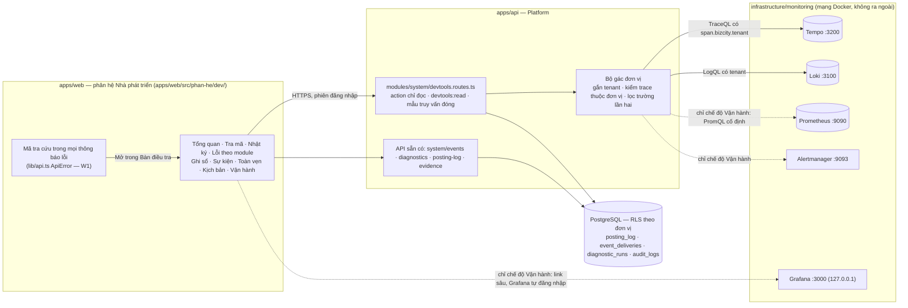

# PHASE-019 · 20 — Kiến trúc Bàn điều tra cho nhà phát triển
<!-- [2026-11-01 07:47 PM Johnny Chu - Chu Hoàng Anh] PHASE-019 — Bàn điều tra cho nhà phát triển: sổ tay điều tra lỗi theo tình huống + thiết kế UI/UX dev trên Prometheus, Loki, Tempo, Grafana, Alertmanager -->

> © 2026 Johnny Chu (Chu Hoàng Anh) / BizCity — kiến trúc Bizcity Core Framework. Chủ đã duyệt D019-1..3 (2026-11-01); D019-4..7 theo đề xuất ([00-MASTER-PLAN §4](00-MASTER-PLAN.md)).

## 1. Kiến trúc

### 1.1 Nguyên tắc

| # | Nguyên tắc | Vì sao |
|---|---|---|
| N1 | Trình duyệt **không bao giờ** nói chuyện trực tiếp với Grafana / Tempo / Loki / Prometheus / Alertmanager | bộ giám sát nhìn mọi đơn vị, không có khái niệm quyền theo đơn vị |
| N2 | Mỗi màn = một **mẫu truy vấn đóng** trong API trung gian; bộ lọc đơn vị do máy chủ gắn | người dùng không viết được truy vấn vượt đơn vị, không viết được truy vấn làm sập Loki |
| N3 | Trả **câu trả lời**, không trả dữ liệu thô: "lỗi nằm ở bước `vat.tinh-thue`, Kernel không được gọi, sổ không đổi" trước, cây span sau | dev mới (vd Thủy) không phải đọc 34 span mới hiểu |
| N4 | Mỗi màn có **lối thoát**: sang màn khác cùng mã (trace ↔ log ↔ bằng chứng ↔ chứng từ), sang Grafana ở chế độ Vận hành | điều tra là đi theo sợi chỉ, không phải đọc từng bảng |
| N5 | Bộ giám sát tắt → phần cần nó báo "chưa bật" kèm cách bật; phần đọc CSDL vẫn chạy | ADR-0007 G-5 |
| N6 | Chỉ đọc. Thao tác ghi duy nhất được link tới là action sẵn có, đủ quyền, có bằng chứng | AP-1, R-OBS-8 |

### 1.2 Sơ đồ thành phần



Đường nét đứt chỉ có ở chế độ Vận hành (Q019-2).

### 1.3 Hai chế độ

| | Chế độ **Đơn vị** (mặc định) | Chế độ **Vận hành** |
|---|---|---|
| Ai | người có `devtools:read`: `owner` hoặc vai trò `developer` (Q019-1, chủ chọn b) | `owner` + `DEVTOOLS_OPS=true` + bản cài **đúng một** đơn vị (Q019-2, chủ chốt 2026-11-01 — không có ngoại lệ cho môi trường thử); sau này: vai trò vận hành (Q018-6) <!-- [2026-11-01 09:28 PM Johnny Chu - Chu Hoàng Anh] PHASE-019 — chủ chốt Q019-1 (b), Q019-2 chỉ bản cài một đơn vị. --> |
| Thấy | trace / log / ghi sổ / sự kiện / tự chẩn đoán **của đơn vị trong phiên** | thêm: sức khoẻ toàn hệ (Prometheus), cảnh báo (Alertmanager), `err.stack`, link Grafana |
| Không thấy | đơn vị khác; số đo toàn hệ; ngăn xếp lỗi | — (vẫn không có nút ghi) |
| Dải màu đầu trang | trung tính, ghi "Đơn vị: <tên>" | dải vàng "Chế độ Vận hành — đang xem toàn hệ thống" |

## 2. API trung gian (W2, W5)

Tất cả là action trong `modules/system/devtools.routes.ts`: `effect: 'read'`, `idempotency: 'none'`, `expose.mcp: false`, `ai: 'deny'`, quyền `devtools:read` (riêng `ops/*`: kiểm thêm điều kiện chế độ Vận hành).

### 2.1 Danh sách

| Action | HTTP | Nguồn | Đợt |
|---|---|---|---|
| `core.devtools.status` | `GET /api/v1/system/devtools/status` | cấu hình — nguồn nào đã bật, chế độ hiện tại, link Grafana (chỉ Vận hành) | W2 |
| `core.devtools.trace` | `GET /api/v1/system/devtools/traces/:traceId` | Tempo `GET /api/traces/{id}` → kiểm đơn vị (§3.2) → cây span đã lọc + **tóm tắt** (§2.3) | W2 |
| `core.devtools.request` | `GET /api/v1/system/devtools/requests/:requestId` | Loki: dòng log của `reqId` trong đơn vị → `traceId` → như trên; trace bị bỏ thì trả riêng dòng log | W2 |
| `core.devtools.evidence` | `GET /api/v1/system/devtools/evidence?traceId=&requestId=` | `audit_logs` (RLS) theo `trace_id` / `request_id` — chỉ cột mô tả (`action`, `object_type`, `object_id`, `actor`, `result_code`, `created_at`), **không** `before_data` / `after_data` | W2 |
| `core.devtools.logs` | `GET /api/v1/system/devtools/logs?from&to&level&errCode&evt&route&limit` | Loki `query_range` theo mẫu §3.1 | W3 |
| `core.devtools.traces` | `GET /api/v1/system/devtools/traces?from&to&outcome&module&action&minDurationMs&limit` | Tempo `search` theo mẫu §3.1 | W3 |
| `core.devtools.summary` | `GET /api/v1/system/devtools/summary?window=1h\|24h` | CSDL (posting_log, event_deliveries, diagnostic_runs, accounting_events) + Loki đếm theo `errCode` + Tempo đếm trace lỗi / chậm | W3 |
| `core.devtools.module-errors` | `GET /api/v1/system/devtools/module-errors?window` | Tempo search `outcome=error` của đơn vị, gom theo `bizcity.module` → `bizcity.action.id` / `bizcity.step` | W4 |
| `core.devtools.ops.health` | `GET /api/v1/system/devtools/ops/health` | Prometheus — **danh sách PromQL cố định** (§3.1), không nhận tham số truy vấn | W5 |
| `core.devtools.ops.alerts` | `GET /api/v1/system/devtools/ops/alerts` | Alertmanager `GET /api/v2/alerts` → tên, mức, từ khi nào, link runbook | W5 |

Màn **Ghi sổ**, **Sự kiện**, **Toàn vẹn** dùng lại API sẵn có (`/api/v1/posting-log`, `/api/v1/system/events`, `/api/v1/system/diagnostics*`) — không viết lại.

### 2.2 Cấu hình (khoá mới, khai ở `config/env.ts` + `.env.example`; SC-CON-7)

| Biến | Mặc định | Ghi chú |
|---|---|---|
| `DEVTOOLS_TEMPO_URL` | rỗng (tắt) | bộ giám sát đặt `http://tempo:3200` |
| `DEVTOOLS_LOKI_URL` | rỗng | `http://loki:3100` |
| `DEVTOOLS_PROMETHEUS_URL` | rỗng | `http://prometheus:9090` — chỉ dùng ở chế độ Vận hành |
| `DEVTOOLS_ALERTMANAGER_URL` | rỗng | `http://alertmanager:9093` — chỉ Vận hành |
| `DEVTOOLS_GRAFANA_URL` | rỗng | địa chỉ người vận hành mở được (vd `http://127.0.0.1:3000`, hoặc proxy có TLS); **chỉ** dùng để dựng link, API không gọi Grafana |
| `DEVTOOLS_OPS` | `false` | Q019-2: chỉ có tác dụng khi bản cài có đúng một đơn vị (máy chủ đếm `tenants` lúc gọi `ops/*`); nhiều đơn vị → bỏ qua, ghi cảnh báo lúc khởi động |

Bộ giám sát (`docker-compose.monitoring.yml`) đặt bốn URL nội bộ cho dịch vụ `api`, như đã làm với `OTEL_EXPORTER_OTLP_ENDPOINT`.

### 2.3 Tóm tắt "chuyện gì đã xảy ra" (màn Tra mã)

Máy chủ dựng từ cây span, theo luật cố định (không AI, không đoán):

| Bước | Luật | Câu hiện |
|---|---|---|
| 1 | span gốc: `http.route`, `http.response.status_code`, `bizcity.outcome` | "`POST /api/v1/payment-requests/:id/pay` → 409, **bị từ chối đúng luật**" |
| 2 | span **sâu nhất đầu tiên** có `outcome ≠ ok` | "Dừng ở **action `quy.payment-request.pay`** (module `quy`), mã `CONFLICT`" |
| 3 | có span `bizcity.layer = K`? kết quả? | "**Kernel không được gọi — sổ không đổi.**" / "Kernel `voucherService.createIn` (`payment`) **đã chạy, ok**" / "Kernel **từ chối** (`PERIOD_LOCKED`)" |
| 4 | span con chiếm thời gian lớn nhất (thời gian tự thân) | "Chậm nhất: `db select ledger_entries` 640 ms (78% thời gian)" |
| 5 | có `event publish`? | "Phát 1 sự kiện `bizcity.ledger.entry.posted` → xem việc giao" |
| 6 | gợi ý tình huống | "Giống **TH-01** trong Sổ tay" (link màn Kịch bản) |

### 2.4 Hình dạng dữ liệu trả về (rút gọn)

```json
{ "ok": true, "data": {
  "traceId": "0904127dd2944f22c086c236c5ceb5af", "startedAt": "2026-11-01T12:37:44.600Z", "durationMs": 2.24,
  "summary": { "outcome": "rejected", "errorCode": "CONFLICT", "stoppedAt": { "spanId": "…", "name": "action quy.payment-request.pay", "module": "quy" },
               "kernel": "not-called", "slowest": { "name": "db select payment_requests", "selfMs": 1.1 }, "events": [], "playbook": "TH-01" },
  "spans": [ { "spanId": "…", "parentId": null, "name": "HTTP POST /api/v1/payment-requests/:id/pay", "kind": "server",
               "startMs": 0, "durationMs": 2.24, "outcome": "rejected", "attributes": { "http.route": "…", "bizcity.module": "quy" } } ],
  "links": { "logs": "/dev/nhat-ky?traceId=…", "evidence": "/dev/tra-ma?tab=bang-chung&traceId=…", "grafana": null } } }
```

`links.grafana` chỉ có giá trị ở chế độ Vận hành.

### 2.5 Đã làm (W2, 2026-11-01)
<!-- [2026-11-01 10:40 PM Johnny Chu - Chu Hoàng Anh] PHASE-019 — W2: ghi cách làm thật của API trung gian và điều đọc được từ Tempo / Loki thật. -->

| Tệp | Việc |
|---|---|
| `apps/api/src/modules/system/devtools.routes.ts` | 4 action `status`, `trace`, `request`, `evidence`; chế độ Vận hành (Q019-2: đếm bảng `tenants` — không có RLS — phải = 1); nhật ký truy cập `evt=bizcity.devtools.query` ở móc `onResponse` của riêng plugin này |
| `apps/api/src/modules/system/devtools.sources.ts` | gọi Tempo / Loki (`fetch`, chờ ≤ 5 giây; `ping` ≤ 2 giây), NOT_READY `{ backend, reason: off \| down \| bad-response }`, mẫu LogQL, `quote()` thoát ký tự, lọc trường log, giới hạn 30 / phút / người (bộ nhớ trong tiến trình) |
| `apps/api/src/modules/system/devtools.trace.ts` | hàm thuần: đọc OTLP JSON của Tempo, `ownsTrace` (D019-5), lọc thuộc tính bằng chính `TRACE_ATTRIBUTES`, tóm tắt §2.3 |
| `db/migrations/0050_vai_tro_nha_phat_trien.sql` | `users_role_check` thêm `developer` |

Đọc từ bản thật (Tempo 2.6.1, Loki 3.3.2 đang chạy, 2026-11-01):
- `GET /api/traces/{id}` trả `{ batches: [{ resource, scopeSpans: [{ spans }] }] }`; `traceId` / `spanId` **base64**; `intValue` là chuỗi. Bộ đọc đổi về hex, nhận cả khuôn `resourceSpans`.
- `bizcity.tenant` chỉ có trên span HTTP (sau xác thực) và span action — span CSDL không có. Trace của yêu cầu chưa đăng nhập (401) không có đơn vị → 404 với mọi người (đúng D019-5).
- **Tìm kiếm (`/api/search`) trả `traceID` bỏ số 0 đầu** (vd `904127dd…` 31 ký tự cho `0904127d…`) → W3 (`core.devtools.traces`) phải đệm trái đủ 32 ký tự.
- Loki: dòng là JSON của pino (`level` số, `time` ms); `reqId`, `traceId` lọc được trước `| json`; nhãn `tenant` còn thì `| json` tách thành `tenant_extracted` — bộ lọc `tenant="…"` sau `| json` vẫn khớp nhãn. API lọc lại theo trường `tenant` của từng dòng (không tin riêng bộ lọc của Loki).

Còn lại: `links.grafana` (chỉ chế độ Vận hành) dựng link Explore với trace id — kiểm trên Grafana 11.4 ở W5 trước khi bật.

### 2.6 Đã làm (W3, 2026-11-01)
<!-- [2026-11-01 11:30 PM Johnny Chu - Chu Hoàng Anh] PHASE-019 — W3: logs / traces / summary + phân hệ web dev; điều đo được khi chạy thật. -->

- API: `core.devtools.logs` (khung `1h | 6h | 24h`, đọc `backward` lấy dòng mới nhất), `core.devtools.traces` (`1h | 6h | 24h | 7d`, TraceQL `{ span.bizcity.tenant = … && … } | select(…)`, đệm traceID), `core.devtools.summary` (`1h | 24h`; Loki số đo theo `errCode` + yêu cầu > 1 s, Tempo trace khác ok, CSDL sự kiện + `diagnostic_runs` L3).
- Web: phân hệ `apps/web/src/phan-he/dev/` (DEV01 Tổng quan, DEV02 Tra mã, DEV03 Nhật ký); phía web luôn coi `dev` là bật (route API thuộc lõi), menu gắn `devtools:read`; khay Mã tra cứu có nút **Bàn điều tra**. Hướng dẫn trong app: `docs/huong-dan/ban-dieu-tra.md`.
- Đo khi chạy thật: `/ready` của Tempo / Loki trả 503 từng lúc ("waiting for 15s after being ready") dù truy vấn vẫn chạy → `ping` hỏi `/api/echo`, `/loki/api/v1/status/buildinfo`. Câu kết luận Tổng quan lấy thêm trace khác ok của Tempo khi log không ghi nhận (không nói "ổn" khi bảng dưới có lỗi).

## 3. Bảo mật và cô lập đơn vị

### 3.1 Mẫu truy vấn đóng

Mỗi mẫu là hằng trong mã, tham số đã qua Zod (khuôn chặt: `traceId` = 32 hex, `requestId` theo khuôn R-OBS-1, `module` / `errCode` / `evt` theo `[a-z0-9._-]{1,64}` hoặc danh mục đã biết, thời gian ISO trong khung cho phép). Giá trị chèn vào truy vấn được **thoát ký tự** theo cú pháp của từng ngôn ngữ; `tenant` lấy từ `ctx.tenant.id`.

| Màn | Mẫu |
|---|---|
| Nhật ký | `{service="api"} \| json \| tenant="${tenant}"` + bộ lọc tuỳ chọn `level`, `errCode`, `evt`, `route` (dùng nhãn `tenant` khi bản cài còn nhãn — nhanh hơn; phát hiện qua `status`) |
| Tra theo `requestId` | `{service="api"} \| reqId="${requestId}" \| json \| tenant="${tenant}"` |
| Danh sách trace | `{ span.bizcity.tenant = "${tenant}" && <bộ lọc: span.bizcity.outcome / span.bizcity.module / span.bizcity.action.id / duration> }` |
| Sức khoẻ toàn hệ (Vận hành) | danh sách PromQL cố định: tỉ lệ 5xx, p95, `up{job="api"}`, `pg_up`, bão hoà pool, outbox chờ / chết, tuổi chờ, `bizcity_diagnostics_errors`, mốc đối soát — đúng biểu thức của `alerts.yml` |

Giới hạn: log ≤ 24 giờ / lần, ≤ 200 dòng; trace ≤ 7 ngày, ≤ 50 trace; mỗi người ≤ 30 truy vấn / phút (`RATE_LIMITED`); thời hạn chờ nguồn 5 giây.

### 3.2 Trace thuộc đơn vị (D019-5)

```text
spans = tempo.getTrace(traceId)            # 404 từ Tempo → NOT_FOUND
tenants = { s.attributes["bizcity.tenant"] for s in spans if có }
if tenants == { ctx.tenant.id }: trả
else: NOT_FOUND                            # rỗng (yêu cầu chưa xác thực) hoặc có đơn vị khác — cùng một câu trả lời
```

Trace giao sự kiện (S7) là trace riêng, có `bizcity.tenant` của việc giao → kiểm như trên; **link** về span phát chỉ hiện khi trace phát cũng thuộc đơn vị.

### 3.3 Lọc trường lần hai

| Nguồn | Giữ | Bỏ |
|---|---|---|
| span | thuộc tính trong `TRACE_ATTRIBUTES` (dùng chung hằng của `core/tracing.ts` — không chép danh sách) | mọi thứ khác; `status.message`; sự kiện ngoại lệ chỉ giữ `exception.type` |
| log | `time`, `level`, `msg`, `reqId`, `traceId`, `route`, `method`, `status`, `ms`, `errCode`, `evt`, `module`, `action`, `docType`, `docKey`, `version`, `err.type` | mọi trường khác; `err.message`, `err.stack` chỉ ở chế độ Vận hành (D019-7) |
| bằng chứng | cột mô tả §2.1 | `before_data`, `after_data`, `input_hash`, `idempotency_key` |

### 3.4 Nhật ký truy cập

Mỗi lượt gọi API trung gian ghi `evt=bizcity.devtools.query` (`tenant`, `actor`, `action`, cỡ kết quả, ms). Không ghi tham số truy vấn tự do (không có), không ghi nội dung trả về.

### 3.5 Mối đe doạ đã xét

| Đe doạ | Chặn bằng |
|---|---|
| Dev đơn vị A đoán / lấy được `traceId` của đơn vị B | §3.2 → 404 giống hệt "không có" |
| Chèn truy vấn qua tham số (`"} or {`) | khuôn Zod chặt + thoát ký tự + test chèn (T019-6) |
| Truy vấn nặng làm sập Loki / Tempo | mẫu đóng, khung thời gian, `limit`, tần suất, thời hạn chờ |
| Lộ dữ liệu qua thông điệp lỗi CSDL / ngăn xếp | §3.3, D019-7 |
| Clickjacking / lộ phiên Grafana | không iframe; link sâu mở tab mới, Grafana tự đăng nhập riêng |
| AI dùng Bàn điều tra để dò dữ liệu | `ai: 'deny'`, `mcp: false`; không cấp cho khoá API |

## 4. Bản đồ màn và luồng UX

### 4.1 Vị trí trong app

- Phân hệ web mới **Nhà phát triển** (`key: 'dev'`, biểu tượng `Bug`, màu trung tính) trong thanh phân hệ; chỉ hiện khi có `devtools:read`. Tiền tố đường dẫn `/dev/…`.
- Nhóm menu `nha-phat-trien` (thêm vào `GROUP_ORDER` sau `tich-hop`).
- Phân hệ **API** (Thử API) giữ nguyên; màn Thử API thêm link "Mở trace của lần gọi này" khi phản hồi có `traceId`.

| Mã | Màn | Đường dẫn | Trả lời câu hỏi | Nguồn | Đợt |
|---|---|---|---|---|---|
| DV01 | **Tổng quan** | `/dev` | đơn vị mình hôm nay có gì bất thường? | `summary` | W3 |
| DV02 | **Tra mã** | `/dev/tra-ma` | yêu cầu này hỏng ở đâu, sổ có đổi không? | `trace`, `request`, `evidence` | W3 |
| DV03 | **Nhật ký** | `/dev/nhat-ky` | log của đơn vị theo mức / mã / sự việc | `logs` | W3 |
| DV04 | **Lỗi theo module** | `/dev/loi-theo-module` | module / action / bước nào đang lỗi nhiều nhất? | `module-errors` | W4 |
| DV05 | **Ghi sổ** | `/dev/ghi-so` | chứng từ nào bị từ chối / treo, vì sao? | `posting-log` (sẵn có) | W4 |
| DV06 | **Sự kiện** | `/dev/su-kien` | nơi nhận nào đang dồn / chết? | `system/events` (sẵn có) | W4 |
| DV07 | **Toàn vẹn** | `/dev/toan-ven` | tự chẩn đoán lần gần nhất nói gì? | `system/diagnostics*` (sẵn có) | W4 |
| DV08 | **Kịch bản** | `/dev/kich-ban` | gặp triệu chứng X thì làm gì? | Sổ tay (`import.meta.glob`) | W4 |
| DV09 | **Vận hành** | `/dev/van-hanh` | toàn hệ thống có khoẻ không, cảnh báo nào đang bắn? | `ops/health`, `ops/alerts` | W5 |

### 4.2 Luồng chính: từ thông báo lỗi đến chỗ hỏng (W1 + W3)

```mermaid
sequenceDiagram
  actor U as Người dùng
  actor D as Dev (Thủy)
  participant APP as App (màn bất kỳ)
  participant DV as Bàn điều tra — Tra mã
  participant API as API trung gian
  U->>APP: Lưu phiếu chi
  APP-->>U: Thông báo lỗi + Mã tra cứu (req-…, traceId) + [Chép] [Báo lỗi]
  U->>D: gửi mã (không gửi ảnh dữ liệu)
  D->>DV: dán mã
  DV->>API: GET devtools/traces/:traceId
  API-->>DV: tóm tắt + cây span (đã lọc, đúng đơn vị)
  DV-->>D: "Dừng ở step vat.tinh-thue (module vat), lỗi kỹ thuật; Kernel không được gọi — sổ không đổi. Giống TH-11"
  D->>DV: bấm "Log cùng trace" / "Bằng chứng"
```

Người dùng có `devtools:read` thấy thêm nút **Mở trong Bàn điều tra** ngay trong thông báo lỗi — một lần bấm.

### 4.3 Luật UX

| # | Luật |
|---|---|
| U1 | **Câu trả lời trước, dữ liệu sau.** Mỗi màn mở đầu bằng một dòng kết luận bằng tiếng Việt thường (vd "3 lỗi kỹ thuật trong 1 giờ qua, đều ở module `vat`"), rồi mới tới bảng / biểu đồ |
| U2 | **Hai màu kết quả, không lẫn:** `rejected` (từ chối đúng luật) màu cam + chữ "từ chối đúng luật"; `error` (lỗi kỹ thuật) màu đỏ + chữ "lỗi kỹ thuật". Không dùng chỉ màu để phân biệt (luôn có chữ / biểu tượng) |
| U3 | **Kernel luôn được gọi tên:** dòng "Sổ không đổi" / "Kernel đã ghi" / "Kernel từ chối" có ở mọi trace — đó là câu người kế toán hỏi đầu tiên |
| U4 | **Mã nào cũng bấm được, chép được:** `traceId`, `reqId`, `docKey`, mã lỗi, mã tình huống — bấm để lọc / mở, nút chép bên cạnh |
| U5 | **"Không có dữ liệu" khác 0:** nguồn chưa bật → thẻ xám "Chưa bật Tempo — xem Sổ tay §0.1"; có bật mà rỗng → "Không có trace nào khớp trong 1 giờ qua" |
| U6 | **Thời gian tương đối + tuyệt đối:** "3 phút trước (19:37:44)"; múi giờ `Asia/Ho_Chi_Minh` |
| U7 | **Link về Sổ tay** ở mọi kết luận có tình huống khớp (TH-xx) |
| U8 | **Không nút ghi.** Thao tác sửa (phát lại sự kiện, định khoản lại) là link sang màn sẵn có, nơi đã có quyền + bằng chứng |
| U9 | Bàn phím: `/` focus ô tra mã; `g t` sang Tra mã; `Esc` đóng chi tiết span. Bảng dùng `tableNav` sẵn có |
| U10 | Rộng điện thoại vẫn đọc được: cây span chuyển thành danh sách thụt lề, thanh thời gian thu gọn |

### 4.4 Mã tra cứu trong thông báo lỗi (W1)

| Thành phần | Hành vi |
|---|---|
| `ApiError` | thêm `requestId?`, `traceId?` lấy từ `json.error`; thân hỏng (504 proxy) → `requestId` từ header `X-Request-Id` |
| Thông báo lỗi | dòng nhỏ dưới câu lỗi: `Mã tra cứu: req-3acc… · 0904127d…` + nút **Chép** (chép cả hai mã + thời điểm + màn) |
| Nút **Báo lỗi** | dựng nội dung theo `bao-loi.yml`: phiên bản (`/system/health`), màn, thời điểm, `requestId`, `traceId`, mã lỗi — **không** thân yêu cầu, không dữ liệu trên màn; chép vào bộ nhớ tạm (Q019-5) |
| Nút **Mở trong Bàn điều tra** | chỉ khi có `devtools:read` và có `traceId` |

**Đã làm (W1, 2026-11-01)** — khác thiết kế ở hai chỗ: <!-- [2026-11-01 09:28 PM Johnny Chu - Chu Hoàng Anh] PHASE-019 — W1: ghi cách làm thật của mã tra cứu. -->
- **Khay chung thay cho dòng dưới từng thông báo.** App có 264 chỗ gọi `errorText()` ở 123 tệp, câu lỗi đã thành chuỗi trước khi hiện. Thay vì sửa từng chỗ, `lib/api.ts` ghi mọi lỗi API (trừ 401) vào kho trong bộ nhớ tab (`lib/maTraCuu.ts`, 5 lỗi gần nhất); khay `components/MaTraCuu.tsx` gắn một lần ở `AppLayout` (cả khi nhúng). Câu lỗi vẫn hiện ở màn như cũ.
- **Hàm đọc mã / dựng nội dung ở `@ketoan/contracts`** (`ma-tra-cuu.ts`), không DOM — web dùng, API kiểm (T019-1). Làm sạch: mã sai khuôn bị bỏ; đường dẫn bỏ query, đoạn không phải chữ thường thay `:x`; nội dung dùng **câu mặc định của danh mục lỗi** thay câu của máy chủ (câu máy chủ có thể nêu tên khách, số chứng từ).
- Chưa làm: nút **Mở trong Bàn điều tra** (cần phân hệ `dev`, W3); nút mở `BUG_REPORT_URL` (Q019-5, cần khoá cấu hình — làm cùng W2).

## 5. Test và bằng chứng

| Ca | Kỳ vọng | Ở đâu | Đợt |
|---|---|---|---|
| T019-1 | lỗi 409 trên web hiện đủ `requestId` + `traceId`; nội dung "Báo lỗi" không chứa số tiền / tên đối tượng đã nhập | test web | W1 |
| T019-2 | dev đơn vị A dán `traceId` của đơn vị B → 404 `NOT_FOUND`, giống hệt mã không tồn tại; trace yêu cầu chưa xác thực → 404 | `apps/api/test/ban-dieu-tra.test.ts` (Tempo / Loki giả bằng máy chủ HTTP cục bộ trong test) | W2 |
| T019-3 | `DEVTOOLS_TEMPO_URL` rỗng / Tempo không trả lời → `status` báo "chưa bật" / `NOT_READY` có `details.backend`, không 500; phần CSDL vẫn trả | cùng tệp | W2 |
| T019-4 | dán mã của ca TH-01 (chi lại phiếu đã chi) → tóm tắt "từ chối đúng luật, Kernel không được gọi, sổ không đổi" | cùng tệp + chạy thật với Tempo (evidence) | W3 |
| T019-5 | mỗi kịch bản TH-01…TH-14 mở đúng màn, bộ lọc điền sẵn | test web | W4 |
| T019-6 | tham số chèn (`"} or {`, `|~ ".*"`, `traceId` không phải hex) → `VALIDATION_ERROR`; không truy vấn nào rời mẫu | `ban-dieu-tra.test.ts` + SC-DEV-1 | W2, W5 |
| T019-7 | không trường ngoài danh sách §3.3 trong mọi phản hồi (dò số tiền, tên, `before_data`, `err.stack` ở chế độ Đơn vị) | `ban-dieu-tra.test.ts` | W2–W4 |
| T019-8 | người không có `devtools:read` không thấy phân hệ, gọi API → 403 | test web + API | W2 |

**SC-DEV-1** (W5, check tĩnh): mọi chuỗi mẫu TraceQL / LogQL trong `devtools.routes.ts` có `bizcity.tenant` / `tenant`; không chỗ nào nối chuỗi truy vấn từ tham số chưa qua hàm thoát; trình duyệt (`apps/web`) không chứa URL `:3100`, `:3200`, `:9090`, `:9093`.

## 6. Triển khai và quay lui

| Đợt | Bật | Quay lui |
|---|---|---|
| W1 | đổi `ApiError` + thông báo lỗi | revert commit web; API không đổi |
| W2–W4 | quyền `devtools:read`, API trung gian, phân hệ web; biến `DEVTOOLS_*` rỗng = tắt phần Tempo / Loki | bỏ biến → phần quan sát báo "chưa bật"; ẩn phân hệ bằng cách gỡ quyền; không migration |
| W5 | `DEVTOOLS_OPS=true` | đặt `false` |

Không đợt nào cần migration đổi bảng. Không đợt nào đụng Kernel hay đường ghi sổ.
