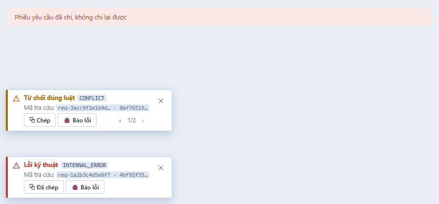

# PHASE-019 · Bằng chứng W1 — Mã tra cứu (2026-11-01)
<!-- [2026-11-01 10:20 PM Johnny Chu - Chu Hoàng Anh] PHASE-019 — W1: bằng chứng ca T019-1, khay Mã tra cứu. -->

> Nhánh `feat/phase-019-w1-ma-tra-cuu` (trên `docs/phase-019-ban-dieu-tra`). CSDL thử `ketoan_test`.

## Ca T019-1 — đạt

`apps/api/test/ma-tra-cuu.test.ts` — 4 ca, đạt:

| Ca | Kiểm |
|---|---|
| lỗi 409 thật (TH-01: chi lại phiếu đã chi, truy vết bật) | `docMaTuPhanHoi` giữ `requestId` = `error.requestId`, `traceId` = trace của yêu cầu; loại "từ chối đúng luật"; đường dẫn `POST /api/v1/payment-requests/:x/pay`. Nội dung **Chép** và **Báo lỗi** có đủ hai mã, **không** có số tiền (`7654321`), mã / tên đối tác, id phiếu, câu thông báo của máy chủ, token |
| mã sai khuôn | `requestId` có xuống dòng, `traceId` không phải hex, `details.reason` là câu chữ → bị bỏ; query (`?q=Nguyễn Văn A`) và mã đối tác trong đường dẫn không lọt vào nội dung |
| thân hỏng (proxy 504) | `requestId` lấy từ header `X-Request-Id`; loại "lỗi kỹ thuật" |
| làm sạch đường dẫn | uuid, số chứng từ → `:x`; bỏ query / hash |

Toàn bộ test API sau thay đổi: **112 tệp, 855 đạt, 1 bỏ qua** (`npx vitest run --root apps/api`, 976 giây). Typecheck `@ketoan/web`, `@ketoan/api` sạch; `vite build` đạt.

## Giao diện

Ảnh dựng từ `theme.css` thật và đúng khuôn HTML của `components/MaTraCuu.tsx` (số liệu giả). Hai loại có chữ, không chỉ màu (U2). Khay ở góc dưới trái, nằm trên thanh cửa sổ (`body.has-dock`), không chồng robot trợ lý ở góc phải; ẩn khi in.

## Chưa làm trong W1

- Nút **Mở trong Bàn điều tra** — cần phân hệ `dev` (W3).
- Nút mở `BUG_REPORT_URL` (Q019-5) — cần khoá cấu hình, làm cùng W2.
- Chụp màn thật với API đang chạy — làm cùng ca T019-4 (W3).
