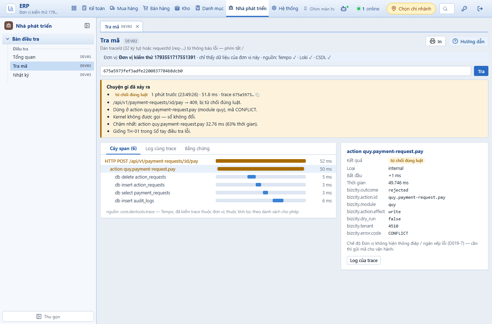
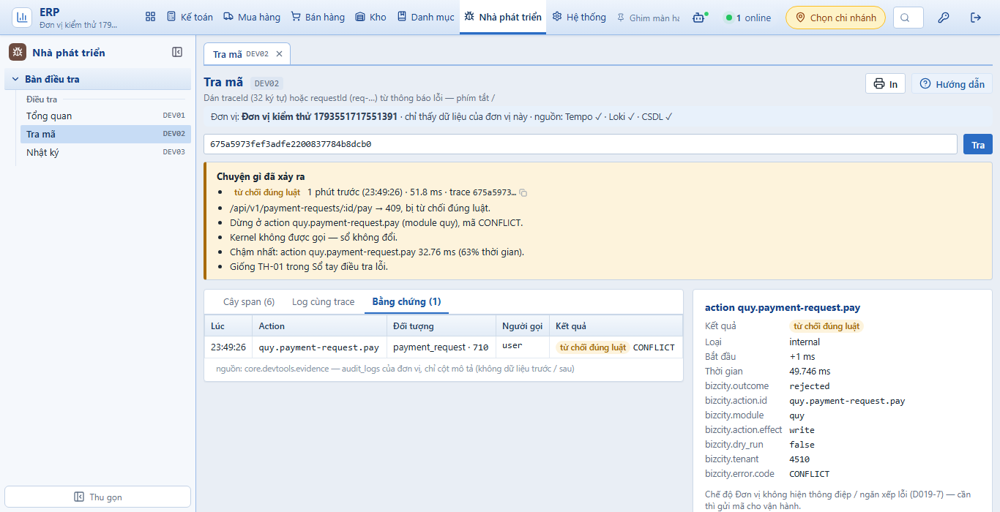
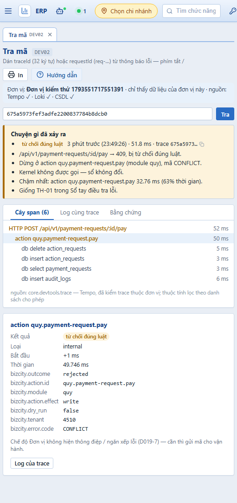
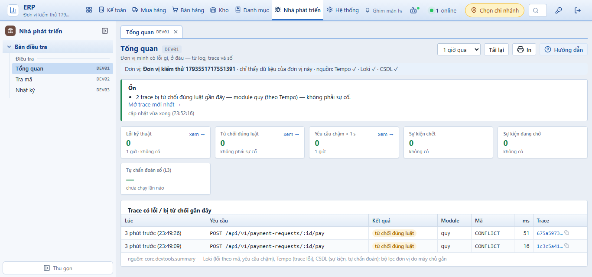

# PHASE-019 · Bằng chứng W3 — Tra mã, Nhật ký, Tổng quan (2026-11-01)
<!-- [2026-11-01 11:30 PM Johnny Chu - Chu Hoàng Anh] PHASE-019 — W3: bằng chứng ca T019-4 (chạy thật với Tempo) + màn DEV01–DEV03. -->

> Nhánh `feat/phase-019-w3-ban-dieu-tra-web` (từ `feat/phase-019-w2-api-trung-gian`). CSDL thử `ketoan_test`.

## Ca T019-4 — chạy thật với bộ giám sát — đạt

Cách dựng (không đổi stack giám sát của bản cài): API của nhánh chạy trên máy (cổng 4199, CSDL `ketoan_test`); ba container chuyển cổng tạm (`alpine/socat`, chỉ `127.0.0.1`) nối tới `otel-collector:4318`, `tempo:3200`, `loki:3100` trong mạng `ketoan_default`; xong thì xoá.

1. Đơn vị thử `4510`: tạo yêu cầu thanh toán → duyệt → chi (200) → **chi lại → 409 `CONFLICT`**, phản hồi có `requestId=req-eedc3867-46c9`, `traceId=675a5973fef3adfe2200837784b8dcb0`.
2. Collector (lấy mẫu đuôi) chuyển trace sang Tempo 2.6.1; `GET /api/v1/system/devtools/traces/675a5973…` trả 6 span và tóm tắt:
   - `/api/v1/payment-requests/:id/pay → 409, bị từ chối đúng luật.`
   - `Dừng ở action quy.payment-request.pay (module quy), mã CONFLICT.`
   - `Kernel không được gọi — sổ không đổi.`
   - `Chậm nhất: action quy.payment-request.pay 32.76 ms (63% thời gian).`
   - `Giống TH-01 trong Sổ tay điều tra lỗi.`
3. Trên web: dán mã vào **Tra mã** (hoặc bấm **Bàn điều tra** trên khay Mã tra cứu) → kết luận hiện ngay đầu màn — **1 lần bấm** (cổng ≤ 3).

Thẻ **Bằng chứng**: một bản ghi `quy.payment-request.pay` · `payment_request` · từ chối đúng luật `CONFLICT` — chỉ cột mô tả.

Khổ hẹp (520 px — Chrome headless không chụp hẹp hơn): một cột, cây span bỏ thanh thời gian (U10).

## Tổng quan — sửa sau khi chạy thật

Lần chụp đầu, khối kết luận ghi "Ổn — Không có lỗi trong 1 giờ qua" trong khi bảng ngay dưới có 2 trace bị từ chối: kết luận chỉ đếm lỗi từ **log** (Loki), mà log của API chạy trên máy không vào Loki. Bản thật cũng có thể lệch như vậy (log mất / chậm). Đã sửa: khi log không ghi nhận, kết luận dùng trace khác ok của Tempo ("2 trace bị từ chối đúng luật gần đây — module quy (theo Tempo) — không phải sự cố"); trace lỗi kỹ thuật → mức `bad`. Có ca kiểm riêng.

Ô "Từ chối đúng luật" / "Lỗi kỹ thuật" vẫn là số đếm từ log (đúng nhãn của ô); bảng trace và câu kết luận lấy thêm từ Tempo.

## Điều đo được ở bản thật, đã sửa

- `/ready` của Tempo / Loki trả **503 "waiting for 15s after being ready"** từng lúc (khoảng 15 giây) trong khi truy vấn vẫn chạy → ô nguồn sẽ báo nhầm "không trả lời". `ping` đổi sang `/api/echo` (Tempo) và `/loki/api/v1/status/buildinfo` (Loki).
- `select(...)` của TraceQL chạy đúng trên Tempo 2.6.1; truy vấn số đo `sum by (errCode) (count_over_time(… | json | __error__="" …))` chạy đúng trên Loki 3.3.2.

## Ca kiểm tự động — `apps/api/test/ban-dieu-tra.test.ts`, 14 ca đạt (10 của W2 + 4 của W3)

| Ca | Kiểm |
|---|---|
| logs | LogQL đúng mẫu (`level` ở bộ chọn luồng; `traceId`, `errCode`, `route` sau `| json`; đơn vị máy chủ gắn); đọc `backward`, trả mới trước; dòng đơn vị khác bị bỏ; khung > 24 giờ, mức lạ, mã chữ thường / chèn, `limit` > 200 → 400, **không truy vấn nào tới Loki** |
| traces | TraceQL đúng mẫu, điều kiện trên span mang `bizcity.tenant`; khung ≤ 7 ngày; **traceID 31 ký tự được đệm đủ 32**; thuộc tính ngoài danh sách (`so_tien`) và `bizcity.tenant` không trả; khung 30 ngày, `outcome=ok`, module chèn, `limit` 51 → 400 |
| summary | lỗi theo mã chia đúng hai loại (`CONFLICT` → từ chối, `INTERNAL_ERROR` → kỹ thuật), mã sai khuôn bị bỏ; câu kết luận; Loki tắt + Tempo không trả lời → 200, các ô báo `off` / `down`, phần CSDL vẫn có |
| summary (sửa) | log không ghi nhận nhưng Tempo có trace khác ok → câu kết luận nêu trace, mức `bad` khi có lỗi kỹ thuật |

## Toàn bộ test, sau khi gộp `main` (0bed2c0)

- CSDL thử **riêng của nhánh** `ketoan_test_p019` (tạo mới): `ketoan_test` dùng chung đã lẫn migration của nhánh khác (`0049_ho_so_ke_toan.sql` của `feat/phase-020-vn-conformance` tạo bảng `accounting_profiles`) làm `db-rules` trượt — không do W3.
- `npx vitest run --root apps/api`: **871 ca đạt, 1 bỏ qua**; 1 ca trượt là lỗi của chính ca kiểm W1 (`ma-tra-cuu.test.ts` dò id phiếu `19` dạng chuỗi trần → khớp nhầm mốc thời gian) — đã sửa, dò theo đoạn đường dẫn. 1 tệp (`dvt-thung.test.ts`) không chạy xong vì worker của vitest thoát giữa chừng (lần chạy W2 là `dimensions-extra.test.ts` — mỗi lần một tệp khác, không ca kiểm nào sai).
- Chạy lại riêng `ma-tra-cuu`, `dvt-thung`, `dimensions-extra`, `ban-dieu-tra`, `db-rules`: 5 tệp, **47 ca đạt**.
- Migration vai trò `developer` đổi số **0049 → 0050**: `main` đã có `0049_khoa_dau_but_toan.sql`. Nội dung chạy lại an toàn (DROP + ADD ràng buộc).
- Kiểm kiểu mọi workspace sạch; bộ kiểm cấu trúc ĐẠT (42 đạt, 0 không đạt); `vite build` đạt.

## Chưa trong W3

- Màn Nhật ký trên dữ liệu thật: log của API chạy trên máy không vào Loki nên màn trống khi chạy thử; khuôn dòng log thật đã kiểm ở W2 (`filterLogLine` trên dòng Loki thật).
- Lỗi theo module, Ghi sổ, Sự kiện, Toàn vẹn, Kịch bản → W4; chế độ Vận hành, link Grafana → W5.
