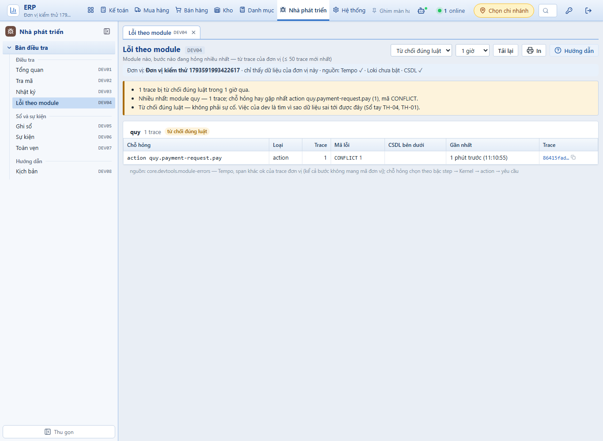
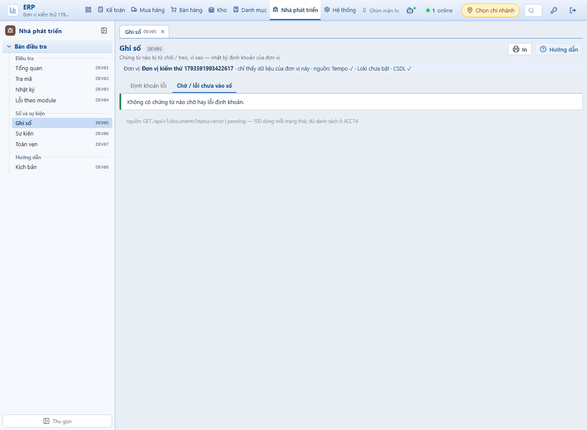
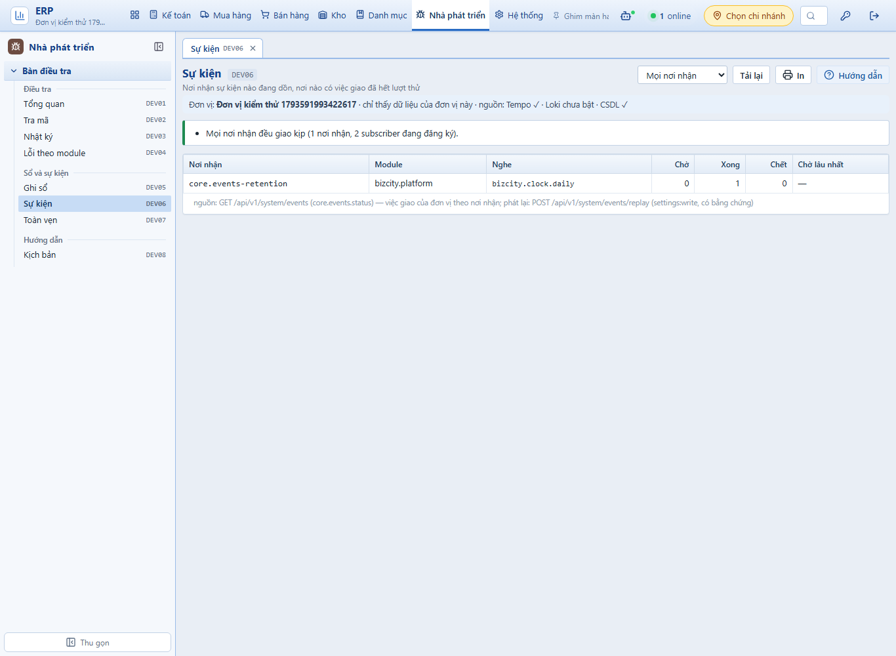
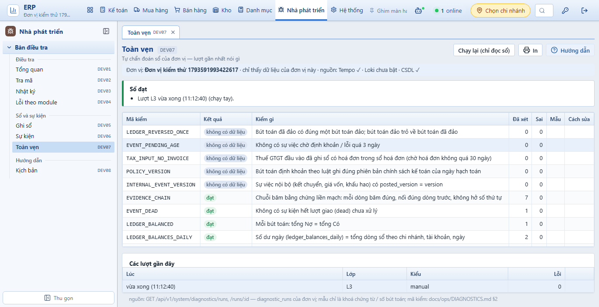
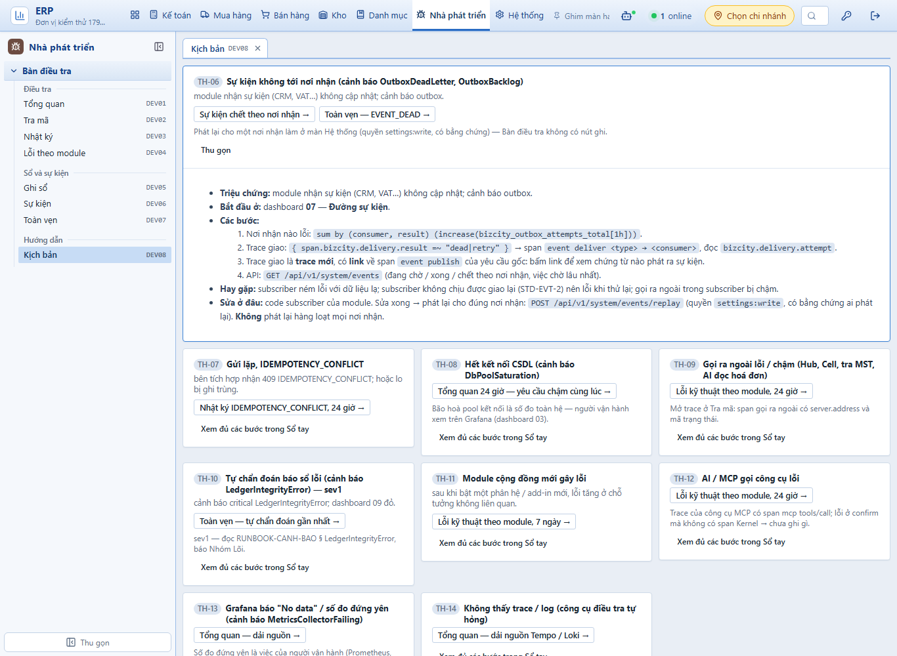
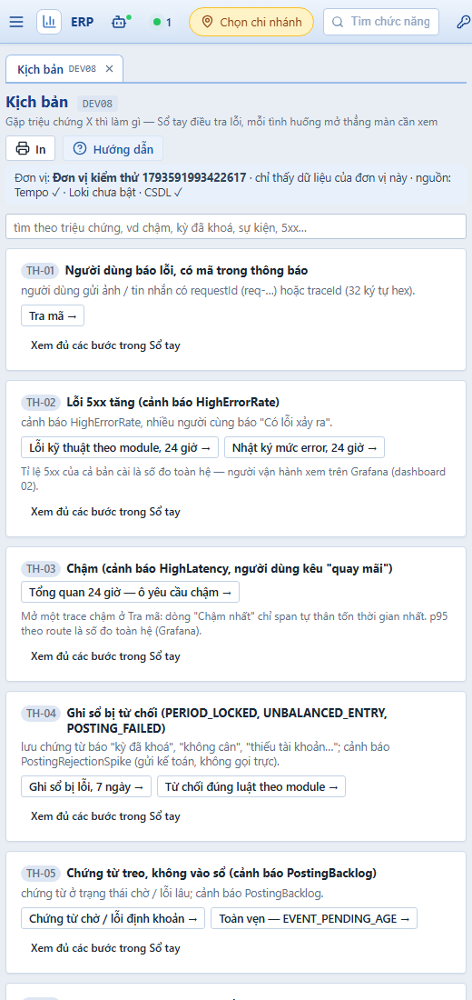

# PHASE-019 · Bằng chứng W4 — Lỗi theo module, Ghi sổ, Sự kiện, Toàn vẹn, Kịch bản (2026-11-02)
<!-- [2026-11-02 10:42 AM Johnny Chu - Chu Hoàng Anh] PHASE-019 — W4: bằng chứng ca T019-5, module-errors trên Tempo thật, năm màn DEV04–DEV08. -->

> Nhánh `feat/phase-019-w4-ban-dieu-tra-man-con` (từ `feat/phase-019-w3-ban-dieu-tra-web`). CSDL thử riêng `ketoan_test_p019`.

## Ca T019-5 — mỗi kịch bản mở đúng màn, bộ lọc điền sẵn — đạt

`apps/api/test/kich-ban.test.ts`, 4 ca (web không có bộ chạy test riêng; phần thuần ở `@ketoan/contracts` `ban-dieu-tra.ts`, màn dùng đúng các hàm này):

| Ca | Kiểm |
|---|---|
| Sổ tay ↔ kịch bản | `docs/ops/SO-TAY-DIEU-TRA-LOI.md` tách đủ TH-01…TH-14 (tên, thân, triệu chứng; thân dừng trước `## 3.`); khoá của `KICH_BAN` đúng bằng danh sách TH — thêm TH quên kịch bản là đỏ |
| màn có thật | mọi đường `/dev/…` trong `DEV_SCREENS` có `<Route>` trong `routes.tsx` và mục trong `menu.ts` |
| bộ lọc điền sẵn | mỗi link (≥ 14) dựng bằng `devLink` rồi đọc lại bằng `devParams` của màn đích → đúng từng giá trị, không tham số nào bị bỏ lặng lẽ; ô lọc Nhật ký điền sẵn thành đúng một bộ lọc API. Mẫu: TH-06 → `/dev/su-kien?xem=chet`, TH-05 → `/dev/toan-ven?kiem=EVENT_PENDING_AGE`, TH-07 → `/dev/nhat-ky?window=24h&q=IDEMPOTENCY_CONFLICT` |
| khuôn | `devParams` bỏ giá trị sai / chèn (`outcome=ok" \|\| true`, `q=") \| json`, `kiem=event_dead`) về mặc định; `devLink` ném khi tham số lạ |

## `core.devtools.module-errors` — chạy trên Tempo 2.6.1 thật

- Mẫu `({ span.bizcity.tenant = T } >> { span.bizcity.outcome = O }) || { T && O } | select(name, …)` chạy đúng: `>>` trả span con cháu (span action dưới span HTTP), `||` thêm span HTTP; `select(name)` trả tên span.
- Đơn vị thử trên `ketoan_test_p019`, dựng lại TH-01 (chi lại phiếu đã chi → 409, trace `86415fad…`) qua API chạy trên máy + Collector thật: màn gom đúng `module quy — action quy.payment-request.pay (1), mã CONFLICT`, câu kết luận "Từ chối đúng luật — không phải sự cố".

### Lỗi thật lộ ra — có từ W3, đã sửa

Gọi `searchSpans` khung 7 ngày trên Tempo thật → **400 "range specified by start and end exceeds 168h0m0s"**: `start` làm tròn xuống, `end` làm tròn lên giây → 168 giờ 1 giây. `core.devtools.traces?window=7d` của W3 hỏng cùng cách; test W3 không bắt được vì Tempo giả không chặn và phép so cho phép dư 1 giây. Sửa: hai mốc cùng làm tròn lên (đúng 604 800 giây). Tempo giả nay trả 400 như bản thật khi khoảng > 168 giờ; phép so siết thành `= 7 × 86400`. Kiểm đỏ trước: đổi lại cách làm tròn cũ → 2 ca trượt (traces W3, module-errors W4); cách mới → đạt.

## Ca kiểm tự động — `apps/api/test/ban-dieu-tra.test.ts`, 16 ca đạt (10 W2 + 4 W3 + 2 W4)

| Ca | Kiểm |
|---|---|
| module-errors | mẫu TraceQL đúng từng ký tự; ba trace (bước `vat.tinh-thue` lỗi hai lần — một lần có span `db insert vat_lines` bên dưới; một route không qua action) → `vat` 2 (`step vat.tinh-thue`, mã `INTERNAL_ERROR`, CSDL `db insert vat_lines`, trace gần nhất), `core` 1 (`HTTP GET …`); câu kết luận chỉ TH-11; phản hồi không có mã đơn vị, `so_tien`, số tiền (T019-7); `outcome=rejected` đổi mẫu, rỗng → câu "không có"; `window=30d`, `outcome=ok\|failed` → 400; `viewer` → 403; Tempo tắt → 503 `NOT_READY { backend: tempo, reason: off }` |
| API sẵn có | vai trò `developer` đọc được `posting-log`, `documents?status=error`, `system/events`, `system/diagnostics/runs` (các màn Ghi sổ / Sự kiện / Toàn vẹn); `POST /system/events/replay` → 403 (không nút ghi, U8) |

## Năm màn — chạy thật (API trên máy + Vite, CSDL `ketoan_test_p019`, Tempo thật)

| Màn | Ảnh |
|---|---|
| DEV05 Ghi sổ, thẻ Chờ / lỗi |  |
| DEV06 Sự kiện |  |
| DEV07 Toàn vẹn, mở từ kịch bản `?kiem=EVENT_PENDING_AGE` (dòng được tô) |  |
| DEV08 Kịch bản, mở `?th=TH-06` (thẻ mở rộng, toàn văn từ Sổ tay) |  |
| DEV08 khổ hẹp 520 px — một cột |  |

Hai lỗi giao diện thấy khi chụp, đã sửa: câu "chưa có lượt tự chẩn đoán" bị ngắt dòng ở chữ **Chạy lại** (CSS khối kết luận coi `<b>` con trực tiếp là tiêu đề); dòng mã kiểm được chọn không tô vì luật tô màu xen kẽ của bảng mạnh hơn.

Tra mã (DEV02) có thêm link **Làm gì tiếp — kịch bản TH-xx** khi tóm tắt khớp tình huống (U7). Tổng quan đọc `?window=24h` từ địa chỉ (kịch bản TH-03, TH-08).

## Toàn bộ

- `npx vitest run --root apps/api` trên `ketoan_test_p019`: **880 ca đạt, 1 bỏ qua, 2 trượt** — cả hai ở `mua-hang-kb.test.ts` (KB-14, KB-24; phân hệ Mua hàng, W4 không đụng), thời gian chạy bất thường (≈ 600 giây) vì lượt chạy trùng lúc kiểm kiểu + `vite build` trên cùng máy. 1 tệp (`self-service.test.ts`) không chạy xong do worker vitest thoát giữa chừng (như W2, W3).
- Chạy lại riêng `mua-hang-kb` + `self-service`: 2 tệp, **22 ca đạt**, 16 giây.
- Kiểm kiểu mọi workspace sạch; bộ kiểm cấu trúc ĐẠT (42 đạt, 0 không đạt); `vite build` đạt.

## Chưa trong W4

- Chưa có trace **lỗi kỹ thuật** thật để chụp Lỗi theo module ở chế độ đỏ (bản thử không có lỗi 5xx); phần gom theo bước đã kiểm bằng Tempo giả đúng khuôn bản thật.
- Chế độ Vận hành, link Grafana, check SC-DEV-1 → W5.
