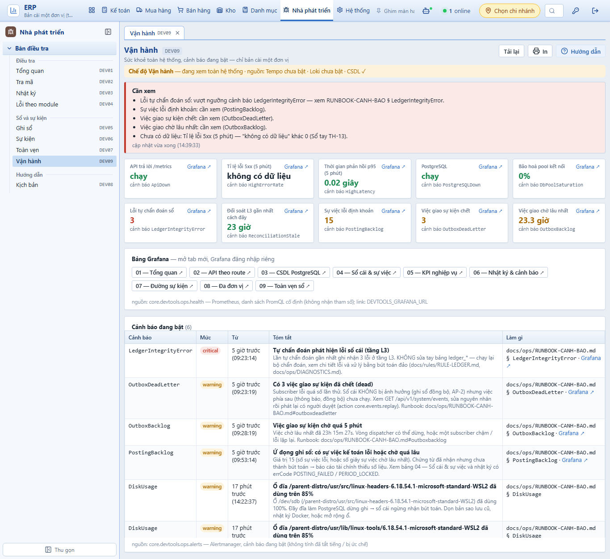
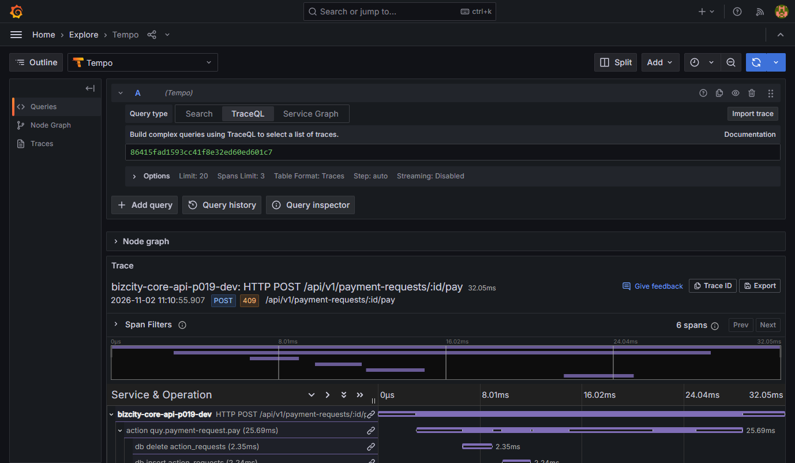

# PHASE-019 · Bằng chứng W5 — Vận hành, SC-DEV-1, Chép cho AI (2026-11-02)
<!-- [2026-11-02 02:40 PM Johnny Chu - Chu Hoàng Anh] PHASE-019 — W5: bằng chứng chế độ Vận hành chạy thật, link Grafana 11.4, SC-DEV-1, Chép cho AI. -->

> Nhánh `feat/phase-019-w5-van-hanh` (từ `main` @ e79b75b). CSDL thử `ketoan_test_p019`; chạy thật trên CSDL một đơn vị dựng riêng `ketoan_ops_p019` (xoá sau khi chụp).

## Chế độ Vận hành — chạy thật

Cách dựng: CSDL mới `ketoan_ops_p019`, `db/setup` seed **một** đơn vị (`vanhanh`); API của nhánh chạy trên máy với `DEVTOOLS_OPS=true`, `DEVTOOLS_PROMETHEUS_URL=http://127.0.0.1:9090`, `DEVTOOLS_ALERTMANAGER_URL=http://127.0.0.1:9093`, `DEVTOOLS_GRAFANA_URL=http://127.0.0.1:3000` (bộ giám sát đang chạy trên máy). Đăng nhập chủ đơn vị.

- `status`: `mode=ops`, Prometheus `up`, Alertmanager `up`, `grafanaUrl` có.
- `ops/health`: 10 số đo đọc đúng từ Prometheus thật; kết luận mức `bad` — `LedgerIntegrityError` (tự chẩn đoán sổ 3 lỗi), `PostingBacklog` (15 sự việc lỗi định khoản), `OutboxDeadLetter` (3), `OutboxBacklog` (chờ 23 giờ); tỉ lệ 5xx "không có dữ liệu" (không có lưu lượng) — không báo 0.
- `ops/alerts`: 6 cảnh báo đang bật, **khớp đúng** danh sách Alertmanager trả (`LedgerIntegrityError` critical, `OutboxDeadLetter`, `OutboxBacklog`, `PostingBacklog`, 2 × `DiskUsage`), kèm link bảng Grafana.

Các cảnh báo trên là của **bộ giám sát trên máy dev** (CSDL `ketoan` của bản cài thử trên máy), không phải do W5 tạo ra — ghi lại để chủ xem.

Lỗi giao diện thấy khi chụp, đã sửa: nhãn số đo dài đè lên link "Grafana ↗" (thêm lề phải cho nhãn).

## Link Grafana — mở thử trên Grafana 11.4

Link Explore khuôn `panes` (`schemaVersion=1`, nguồn `tempo`, `queryType: traceql`, truy vấn = mã trace) mở bằng Chrome headless với phiên đăng nhập Grafana thật (đăng nhập qua `/login`, đặt cookie qua DevTools Protocol; mật khẩu đọc từ `.env`, không in ra): trang `/explore`, tiêu đề "Explore - Tempo - Grafana", hiện đúng trace TH-01 `86415fad…` (6 span, `POST /api/v1/payment-requests/:id/pay` 409).

## SC-DEV-1 (R-OBS-9)

- Repo thật: ĐẠT (0 phát hiện).
- Ca tự kiểm `fixtures/repo-bad`: đúng 4 phát hiện — mẫu LogQL không gắn đơn vị (`tenant:…:noTenant`), giá trị chèn không qua `quote()` (`interp:…:q`), PromQL có tham số (`promql:…`), web gọi thẳng Loki `:3100` (`web:apps/web/src/phan-he/dev/bad.ts`). Không check nào khác đổi số phát hiện.
- Lượt đầu báo 2 phát hiện giả (dòng khai kiểu `expr: string`) → thu hẹp luật về dòng gán chuỗi cho `expr:`.

## Ca kiểm tự động — `apps/api/test/ban-dieu-tra.test.ts`, 20 ca đạt (W2 10 + W3 4 + W4 2 + W5 4)

| Ca | Kiểm |
|---|---|
| ops chưa mở | `DEVTOOLS_OPS` tắt → 403 "Vận hành chưa bật"; bật nhưng CSDL nhiều đơn vị → 403 "nhiều đơn vị"; `developer` → 403 "chủ đơn vị"; `viewer` → 403; **không truy vấn nào tới Prometheus** |
| nguồn Vận hành | PromQL không có `${` / `tenant`; gửi Prometheus đúng nguyên văn biểu thức; vector rỗng → `null`; mức theo ngưỡng (5xx 8% → bad, 1% → ok; API 0 → bad; việc chết 2 → warn); cảnh báo chỉ lấy `alertname` / `severity` (bỏ nhãn `tenant`, `instance`), `dashboard` lạ (`javascript:`) → null, critical trước |
| link Grafana | `/explore`, `schemaVersion=1`, `panes.a.datasource = tempo`, truy vấn = mã trace |
| Chép cho AI | từ phản hồi thật của `core.devtools.trace` (TH-01): có tóm tắt, cây span thụt lề cha → con, `action=…`, `table=payment_requests`, `(ngoại lệ AppError)`, chỗ tìm mã `defineAction({ id: 'quy.payment-request.pay' … })` trong `apps/api/src/phan-he/quy/`, mục TH-01 của Sổ tay, việc phải làm (test đỏ đúng mã `CONFLICT`, "từ chối đúng luật"); **không** có mã đơn vị, `so_tien`, số tiền, MST, tên khách, số phiếu, `bizcity.tenant` |

`apps/api/test/kich-ban.test.ts` (T019-5) vẫn đạt với màn mới `/dev/van-hanh` (route + menu) và kịch bản TH-13 → Vận hành.

## Toàn bộ

- `npx vitest run --root apps/api` trên `ketoan_test_p019` (chạy một mình, không kèm việc nặng khác): **115/115 tệp, 890 ca đạt, 1 bỏ qua**, 579 giây — không ca trượt, không worker thoát.
- Kiểm kiểu mọi workspace sạch; bộ kiểm cấu trúc ĐẠT (43 đạt — thêm SC-DEV-1 — 0 không đạt); tự kiểm bộ kiểm ĐẠT; `vite build` đạt.
