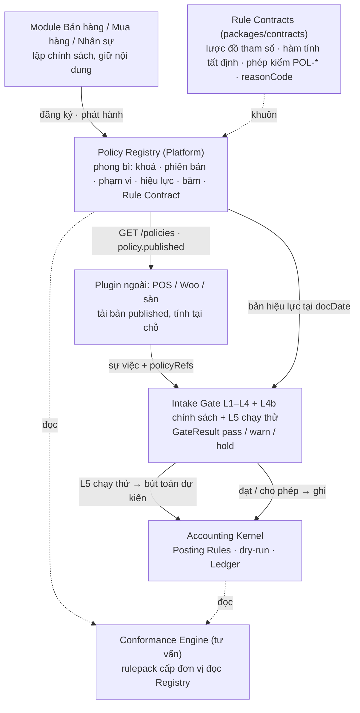

# PHASE-031 · 10 — Thiết kế: Policy Registry, Rule Contract, tầng kiểm L4b, bút toán dự kiến
<!-- [2026-11-06 09:47 PM Johnny Chu - Chu Hoàng Anh] PHASE-031 — thiết kế đề xuất theo ADR-0031: phong bì Registry, Rule Contract, vòng đời, phân phối cho plugin, policyRefs ở cửa nạp, L4b, bút toán dự kiến, vai Conformance Engine; ví dụ SALE-PROMO-001 mua 2 tặng 1 -->

> **Trạng thái:** đề xuất, chờ chủ dự án duyệt D031-* ([00](00-MASTER-PLAN.md) §3) và nhóm Lõi duyệt phần K2 (§5, §6). Mọi tên bảng / trường dưới đây là **đề xuất**; mã chỉ viết sau PR chốt thiết kế (R-FLOW).

## 1. Một câu

**Module sở hữu chính sách · Registry phát hành có phiên bản · plugin tính theo bản đã phát hành và gửi tham chiếu · Intake Gate tính lại để kiểm · Kernel dựng bút toán dự kiến và ghi sổ.**



## 2. Phong bì Registry (Platform, K1)

Một bảng chỉ thêm, theo khuôn `setting_values` (0074) và `posting_policy_versions` (0040):

| Cột | Nghĩa |
|---|---|
| `tenant_id` | RLS như mọi bảng |
| `policy_key` | mã ổn định do module đặt, vd `SALE-PROMO-001` (mã hiển thị; định danh là `policy_id` ULID — mã ≠ định danh, ADR-0028) |
| `policy_id`, `version` | định danh bất biến + số phiên bản tăng dần; `UNIQUE (tenant_id, policy_id, version)` |
| `owner_module` | `ban-hang` · `mua-hang` · `nhan-su` · `quy` … — chỉ module chủ được phát hành |
| `rule_contract` | `sale.promo.buy_x_get_y@1` … |
| `scope` | jsonb: `accounting_unit`, `branches[]`, `channels[]`, `customer_groups[]`, `warehouses[]` (rỗng = mọi) |
| `valid_from`, `valid_to` | hiệu lực theo **ngày chứng từ** |
| `status` | `draft` · `published` · `retired` |
| `store`, `store_ref` | nội dung nằm ở đâu: `module` (`mod_ban_hang.promotions:<id>`) · `settings` (khoá `setting_values`) · `inline` (jsonb ở chính dòng này, cho module nhỏ chưa có bảng riêng) |
| `content_hash` | băm chuẩn hoá của nội dung lúc phát hành (cùng hàm băm `document_versions`) |
| `legal_ref` | căn cứ (NĐ81/2018 Điều 7…), tuỳ chọn |
| `published_by/at`, `reason` | ai, khi nào, vì sao; vào `audit_logs` |
| `findings` | jsonb các cảnh báo lúc phát hành (vd `POL-ACC-001`) |

Ràng buộc: hai bản `published` cùng `policy_id` không chồng hiệu lực trên cùng phạm vi (kiểm ở ứng dụng + golden; trigger nếu nhóm Lõi muốn). Bản `published` không sửa: trigger chặn `UPDATE` cột nội dung, như sổ.

**Vì sao không gộp vào `setting_values`:** khoá cấu hình là một giá trị đọc theo phạm vi hẹp → rộng; chính sách có lược đồ riêng theo Rule Contract, có nhiều bản song song trên các phạm vi khác nhau (ba chương trình KM cùng chạy ở HN01), và được **chứng từ tham chiếu**. Ngưỡng duyệt — vốn đã ở `setting_values` — được Registry **đánh chỉ mục** với `store: settings`, không chép.

## 3. Rule Contract (packages/contracts)

```ts
// packages/contracts/src/rule-contracts/types.ts (đề xuất)
interface RuleContract<P, I, O> {
  id: `${string}@${number}`;                 // 'sale.promo.buy_x_get_y@1'
  domain: 'sale' | 'purchase' | 'hr' | 'approval' | 'custom';
  params: ZodType<P>;                        // lược đồ tham số; kiểm lúc phát hành
  publishChecks: (p: P, at: Date) => Finding[];   // trần pháp lý, chồng hiệu lực… (POL-PUB-*)
  evaluate: (p: P, input: I) => O;           // TẤT ĐỊNH, không I/O, không đồng hồ — POS và Core chạy cùng hàm
  verify: (p: P, input: I, claimed: O) => Finding[]; // so cái nguồn gửi với cái tính lại (POL-*)
  treatment: (o: O) => { reasonCode: string; lineKeys: string[] }[]; // cách ghi nhận, KHÔNG số tài khoản
}
```

- **Mẫu đã có:** engine mua hàng (`modules/mua-hang/domain/src/engine.ts`) đã đúng hình `evaluate`: hàm thuần, `policyApplies` (:378) lọc hiệu lực + phạm vi, `findPolicy` (:387) chọn phạm vi hẹp nhất rồi ưu tiên, `computeDoc` (:533) trả `trace[]` `{ policy, kind, text }`. Rule Contract là tách engine đó ra theo từng loại và thêm `version` + `hash` vào `trace`, không viết engine mới.
- `evaluate` là hàm thuần, xuất qua `@bizcity/contracts` (TypeScript) **và** một bản mô tả JSON đủ để plugin PHP / JS viết lại; golden chung (`T031-RC-*`) là thứ bảo đảm hai bên ra cùng kết quả.
- Rule Contract đầu tiên (W2) chỉ gồm những cái blueprint đã đặc tả: `sale.price_list@1` (BH04), `sale.promo.discount@1`, `sale.promo.buy_x_get_y@1` (BH05), `sale.credit_limit@1` (BH06), `approval.levels@1` (16 §5, `store: settings`), `purchase.contract_price@1` (MH, đơn mua theo hợp đồng), `custom@1` (chỉ phong bì).
- Nhân sự (phụ cấp, bậc lương) để sau: khi `modules/nhan-su` mở (S030-16).

## 4. Vòng đời và phát hành

| Bước | Ai | Kiểm | Kết quả |
|---|---|---|---|
| Lập `draft` | module chủ, quyền `<module>:pricing` (vd `ban-hang:pricing`) | lược đồ tham số | sửa thoải mái |
| Phát hành | quyền `<module>:policy.publish`, SoD tuỳ chính sách | `publishChecks` (trần NĐ81 → **chặn**); chồng hiệu lực → chặn; `treatment` có `reasonCode` chưa có trong chính sách định khoản tại `valid_from` → `POL-ACC-001` **cảnh báo** | dòng Registry `published`, `content_hash`, sự kiện `policy.published` |
| Đổi | như phát hành | như trên | phiên bản mới; bản cũ vẫn `published` tới `valid_to` mới (hệ thống tự đóng ở `valid_from − 1` như tham số pháp lý của Erp-vn, PHASE-030 · 20) |
| Ngừng | quyền phát hành | không có sự việc nào sau ngày ngừng tham chiếu | `retired`; sự việc tới sau mà còn tham chiếu → `POL-STALE-001` |

Không có `DELETE` cho bản đã phát hành (ADR-0028 D028-3).

## 5. Phân phối cho plugin và tham chiếu ngược (K2 ở phần cửa nạp)

**Đọc:** `GET /api/v1/policies?domain=sale&branch=HN01&channel=pos&at=2026-11-15` → danh sách `{ policyKey, policyId, version, ruleContract, scope, validFrom, validTo, contentHash, params }`. Khoá API phạm vi `policies:read`. Sự kiện `policy.published` / `policy.retired` qua outbox cho plugin kéo lại.

**Gửi:** `bizcity_ledger_intake@1` 1.6.0 (minor, thêm trường tuỳ chọn):

```jsonc
{
  "docType": "sale", "docKey": "wp-pos:hn01:sale:88123", "docDate": "2026-11-15", "branchCode": "HN01",
  "policyRefs": [ { "key": "SALE-PROMO-001", "version": 3, "hash": "sha256:9c1e…" } ],
  "lines": [
    { "lineKey": "1", "itemId": "01J…A", "qty": 2, "unitPrice": 150000, "amountBeforeTax": 300000, "taxCode": "VAT10" },
    { "lineKey": "2", "itemId": "01J…B", "qty": 1, "unitPrice": 0, "amountBeforeTax": 0, "isGift": true,
      "warehouseCode": "HN01-K1", "lotNo": "L2611", "taxCode": "VAT10",
      "policyRef": { "key": "SALE-PROMO-001", "version": 3, "line": "gift" } }
  ],
  "totals": { "beforeTax": 300000, "tax": 30000, "total": 330000 }
}
```

Nguồn cũ không gửi `policyRefs` vẫn được nhận như hôm nay; L4b khi đó chỉ chạy phần *"nghiệp vụ này lẽ ra có chính sách"* ở mức `info` (đơn vị chọn nâng lên `warn`).

## 6. Tầng kiểm L4b ở cửa nạp

Thứ tự trong tiền kiểm hiện có (`packages/kernel/src/modules/intake/preflight.ts:3-17`): L1 khuôn → L2 số học → L3 dữ liệu gốc → L4 nghiệp vụ → **L4b chính sách** → Guard → L5 chạy thử định khoản (`trial-posting.ts`) → ghi (hoặc bể chờ `intake_inbox`). Như các tầng khác, L4b gom **mọi** finding, không dừng ở cái đầu, và góp vào điểm 0–100. L4b **không đọc bảng của module**: chỉ đọc phong bì Registry + nội dung theo `store_ref` qua hàm Registry cấp (`policies.resolve(ref, at)`), để Kernel không phụ thuộc module.

| Mã | Câu hỏi | Mặc định |
|---|---|---|
| `POL-REF-001` | Tham chiếu tồn tại, băm khớp bản đã phát hành | `warn` |
| `POL-EFF-001` | Bản đó hiệu lực tại `docDate` cho chi nhánh / kênh / khách của sự việc | `warn` |
| `POL-STALE-001` | Đã có bản mới hơn hiệu lực tại `docDate` (POS offline dùng bản cũ) | `warn` |
| `POL-EVAL-001` | Tính lại bằng `evaluate` ra kết quả khác cái nguồn gửi (số lượng quà, mức giảm, giá) | `warn` |
| `POL-DATA-001` | Kết quả thiếu dữ liệu gốc: quà không có `itemId`, kho, lô khi mặt hàng quản lý lô | `warn` (L2 vẫn giữ quyền `hold` khi thiếu mặt hàng như hôm nay) |
| `POL-ACC-001` | Chính sách định khoản tại `docDate` chưa có `reasonCode` mà `treatment` chỉ | `hold` — không có cách ghi thì không ghi được, đúng như lỗi định khoản hiện nay |

Đơn vị đổi mức từng mã qua khoá `intake.policy.severity` (`setting_values`, loại A — R-GATE-9: mặc định cho phép; kế toán trưởng chọn nghiêm). Mỗi lần chạy L4b cho ra `GateResult { gate: 'validation', verdict, codes, ruleVersion: 'SALE-PROMO-001@3' }` vào bằng chứng (PHASE-030 · 21) và vào trường `policy_check` của phiên bản sự việc.

## 7. Bút toán dự kiến

Không thêm engine. Bút toán dự kiến **là** L5 chạy thử đã có: `postDocumentIn` thật trong savepoint rồi lùi (`trial-posting.ts:3-10`), cùng đường `POST /documents/submit?dryRun=1` (`document.actions.ts:121-132`) cho sự việc chưa lưu và `GET /documents/:id/preview` cho sự việc đã lưu. Commit Guard (`guard.ts:3-11`) hôm nay băm dữ liệu gốc + phiên bản chính sách định khoản + khoá kỳ; thêm băm các `policyRefs` để chính sách đổi giữa tiền kiểm và ghi thì cửa kiểm lại (`IN-GUARD-001`). Hai chế độ theo khoá `intake.policy.mode`:

- **gợi ý** — sự việc có L4b `warn` vào hàng việc *"Chờ kế toán xem"* kèm bút toán dự kiến và câu giải thích; kế toán bấm *Ghi sổ* hoặc *Trả về nguồn*. Sự việc L4b `pass` ghi luôn.
- **tự động** (mặc định cho POS, R-WF-16) — ghi luôn cả khi `warn`; hàng việc chỉ để xem lại sau.

Câu giải thích sinh từ finding + `treatment`, ví dụ: *"Đơn wp-pos:hn01:sale:88123 áp SALE-PROMO-001 bản 3 (hiệu lực 01–30/11/2026, HN01): 2 × A đủ điều kiện → tặng 1 × B. Dòng 2 ghi theo lý do XTA1.4 (hàng tặng kèm bán, giá tính thuế 0 — TT219 Điều 7 khoản 5)."*

## 8. Ví dụ đi hết đường: SALE-PROMO-001 bản 3, mua 2 tặng 1

| Bước | Ở đâu | Việc |
|---|---|---|
| 1 | Bán hàng (BH05) | lập `ban-hang.promotion` loại `gift_with_purchase`: A × 2 → B × 1, HN01, 01–30/11/2026 |
| 2 | Registry | phát hành `SALE-PROMO-001@3`, Rule Contract `sale.promo.buy_x_get_y@1`; `publishChecks`: giá trị B ≤ 50 % giá A (NĐ81 Điều 9) ✅; `treatment` → `XTA1.4` có trong chính sách định khoản ✅ |
| 3 | POS WP | nhận `policy.published`, tải bản 3, bán: đơn 2 × A, 1 × B giá 0 |
| 4 | POS → cửa nạp | `sale` kèm `policyRefs` (§5) |
| 5 | L4b | hiệu lực tại 15/11 ✅; tính lại: 2 A → 1 B ✅; B có `itemId`, kho, lô ✅; tiền / thuế khớp L1–L5 ✅; `XTA1.4` có ✅ → `pass` |
| 6 | Kernel | dry-run ra bút toán dự kiến; chế độ tự động → ghi; `posting_log` có `policy_version` định khoản, phiên bản sự việc có `policyRefs` |
| 7 | Truy vết | bút toán → sự việc v1 → `SALE-PROMO-001@3` (băm) → chương trình BH05 → người phát hành |

Ca lệch: POS gửi 2 × A + **2** × B → `POL-EVAL-001` (`warn`): vẫn ghi (tự động) hoặc vào hàng việc (gợi ý), câu: *"Chính sách cho 1 × B, đơn ghi 2 × B; 1 × B dư không thuộc khuyến mại đăng ký — xem lại: có thể là biếu tặng riêng (XQUA) hoặc bán giá 0 sai."*

## 9. Conformance Engine làm gì, không làm gì

| Làm (rulepack `policy`, cấp đơn vị, chỉ đọc) | Không làm |
|---|---|
| Tỷ lệ sự việc có L4b `warn` theo nguồn / chi nhánh / chính sách trong kỳ | chặn từng giao dịch |
| Chính sách `published` thiếu `reasonCode` định khoản | ghi sổ, sửa sự việc |
| Nguồn ngoài không gửi `policyRefs` cho nghiệp vụ có chính sách hiệu lực | đọc bảng module |
| Chính sách sắp hết hạn mà còn sự việc tham chiếu | tự phát hành / tự ngừng chính sách |
| KM thuộc diện thông báo Sở Công Thương chưa có số (NĐ81 Điều 17) | |

## 10. Truy vết và bằng chứng

- Phiên bản sự việc (`accounting_event_versions`) lưu `policyRefs` nguyên văn + kết quả L4b; khung nhìn truy vết (PHASE-025 W1, PHASE-029 W1) thêm một nút *Chính sách căn cứ*.
- Màn chính sách có tab *Chứng từ đã áp*: đếm và liệt kê sự việc theo `policy_id@version` — trả lời "chương trình này đã chi bao nhiêu hàng tặng".
- Không thêm kho bằng chứng (D028-13): dùng `audit_logs` cho phát hành, phiên bản sự việc cho áp dụng.
