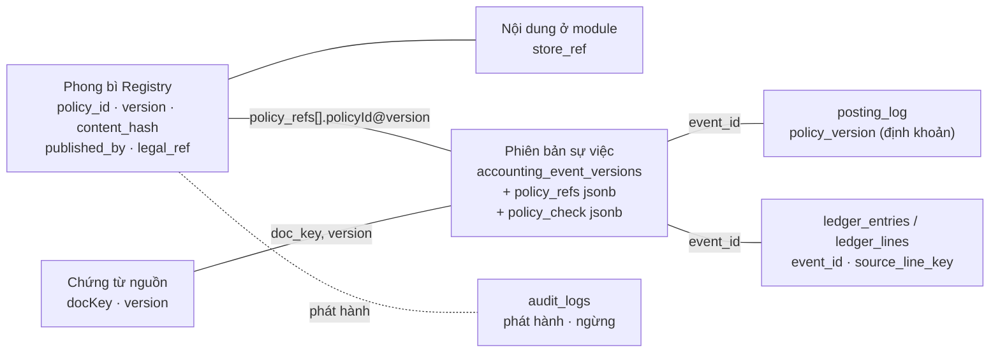

# PHASE-031 · 20 — Truy vết chính sách, hàng việc "Chờ kế toán xem", bảng theo dõi thực hiện chính sách
<!-- [2026-11-07 08:34 PM Johnny Chu - Chu Hoàng Anh] PHASE-031 — chủ dự án 07/11: vẽ mockup màn Chính sách + hàng việc "chờ kế toán xem", phương án truy vết, dashboard theo dõi thực hiện chính sách; ba yếu tố của bộ: nhất quán cross-module, xuyên suốt (continuous), truy vết (traceability); giữ luật lean -->

> **Trạng thái:** đề xuất. **Bản mẫu:** [mockups/chinh-sach.html](mockups/chinh-sach.html) (bốn tab: Chính sách · Chờ kế toán xem · Truy vết · Theo dõi thực hiện).
> **Luật lean áp cho tài liệu này:** không bảng truy vết riêng, không kho số liệu dashboard riêng, không hợp đồng mới. Mọi thứ là **khung nhìn chỉ đọc** (`bizcity_read.*`, ADR-0026) trên bảng đã có + phong bì Registry (S031-4) + hai cột jsonb trên phiên bản sự việc.

## 1. Ba yếu tố của bộ, đo bằng gì

| Yếu tố | Nghĩa trong bộ này | Đo bằng (tín hiệu chạy được) | Màn |
|---|---|---|---|
| **Nhất quán cross-module** | Một nghiệp vụ, một chính sách: Bán hàng nội bộ, POS WP, Woo, sàn dùng **cùng** `policy_key@version`, cùng hàm tính; Mua hàng và Nhân sự cùng khuôn phong bì | (a) tỷ lệ sự việc có `policyRefs` trên nghiệp vụ có chính sách hiệu lực, theo nguồn; (b) bản đang dùng của từng nguồn so với bản hiệu lực (độ trễ phiên bản); (c) không có hai chính sách `published` khác khoá cho cùng nghiệp vụ, cùng phạm vi, cùng ngày (T031-REG-2) | Chính sách → *Nơi dùng*; Theo dõi → *Độ phủ theo nguồn* |
| **Xuyên suốt (continuous)** | Chính sách hiệu lực tại **ngày chứng từ**, không tại ngày xem; đổi chính sách không làm đổi chứng từ cũ; tính lại chứng từ cũ ra số cũ | (a) chọn ngày bất kỳ → đúng một bản hiệu lực mỗi khoá × phạm vi; (b) không khoảng trống hiệu lực khi đổi bản (bản cũ tự đóng ở `valid_from − 1`); (c) T031-MH-1 tính lại phiếu cũ | Chính sách → *Dòng thời gian phiên bản* + bộ chọn *Xem tại ngày* |
| **Truy vết (traceability)** | Đi hai chiều: **xuôi** chính sách@bản → chứng từ → sự việc → bút toán; **ngược** bút toán → sự việc → chính sách căn cứ (băm) → người phát hành, căn cứ pháp lý | (a) mọi dòng sổ của sự việc có `policyRefs` nối được tới phong bì (0 dòng mồ côi); (b) băm `policyRefs` khớp `content_hash`; (c) kết quả L4b lưu cùng phiên bản sự việc | Truy vết; nút *Chính sách căn cứ* trên màn truy vết sẵn có |

Ba tín hiệu (a) của mỗi dòng là tiêu chí của trụ cột Policy trong `tru-cot.json` (S031-19).

## 2. Truy vết: nối bằng khoá thật, không bảng mới

| Nối | Khoá | Đã có? |
|---|---|---|
| bút toán → sự việc | `ledger_entries.event_id` (bắt buộc từ 0077) | ✅ |
| dòng sổ → dòng chứng từ | `ledger_lines.source_line_key` = `lineKey` | ✅ |
| sự việc → chứng từ nguồn | `doc_key`, `version` | ✅ |
| sự việc → chính sách định khoản | `posting_log.policy_version` | ✅ |
| sự việc → chính sách nghiệp vụ | `accounting_event_versions.policy_refs` (jsonb, nguyên văn từ nguồn, có `line`) | ☐ S031-9 (cột thêm, không bảng) |
| sự việc → kết quả kiểm | `accounting_event_versions.policy_check` (`GateResult[]` của L4b) | ☐ S031-9 |
| chính sách → người phát hành, căn cứ | phong bì + `audit_logs` | ☐ S031-4 |
| chứng từ mua → chính sách | `policyTrace[].policy` thêm `@version#hash` | ☐ S031-6 |

**Hai khung nhìn chỉ đọc** (một migration, `security_invoker`, trigger chỉ đọc như 0076):

- `bizcity_read.policy_application` — mỗi dòng: `tenant_id, policy_id, policy_key, version, event_id, doc_key, doc_version, doc_date, branch_id, source_system, line_key, verdict, codes[], posted` (bung `policy_refs` + `policy_check`). Cấp cho: tab *Chứng từ đã áp*, màn Truy vết chiều xuôi, mọi ô dashboard.
- `bizcity_read.policy_lineage(event_id)` — hàm trả chuỗi ngược cho một bút toán / sự việc: dòng sổ → sự việc → chứng từ → chính sách@bản (+ băm khớp?) → phát hành (ai, khi nào, căn cứ).

Chứng từ mua hàng (chưa đi qua `policy_refs` vì ghi sổ qua cửa nội bộ) được nối vào cùng khung nhìn bằng một nhánh `UNION` đọc `purchase_documents.data.policyTrace`, như cách 0076 gom hai phân hệ cũ.

`bizcity_lineage@1` thêm **một làn** `policy` (minor, 0.4.0-draft): Hành trình mặt hàng hiện thêm *"dòng này tặng theo SALE-PROMO-001@3"* — không màn mới.

## 3. Hàng việc "Chờ kế toán xem"

Không hàng việc mới. Thêm **một nhánh** vào `bizcity_read.document_queue` (0076):

| Cột view | Giá trị |
|---|---|
| `source` | `policy_review` |
| `source_id` | `event_id` của sự việc |
| `doc_type` | `docType` sự việc |
| `status_group` | `review` khi chế độ *gợi ý* và L4b `warn`; `info` khi chế độ *tự động* (đã ghi, xem lại sau); `hold` khi vào bể chờ (`POL-ACC-001`) — nhánh `intake` sẵn có đã hiện, không lặp |
| cờ | các mã `POL-*` |

Thao tác trên một việc (đều là action có quyền, ghi bằng chứng; không thao tác nào sửa sự việc):

| Nút | Khi | Làm gì |
|---|---|---|
| **Ghi sổ** | chế độ gợi ý, chưa ghi | nộp đúng phiên bản đã tiền kiểm (Commit Guard); bút toán = bút toán dự kiến đã xem |
| **Đánh dấu đã xem** | chế độ tự động, đã ghi | một dòng bằng chứng (như xác nhận khuyến nghị ở Posting Gate) |
| **Trả về nguồn** | mọi lúc trước ghi | sự kiện miền `policy.review.rejected` cho plugin, kèm mã + câu giải thích; nguồn gửi phiên bản mới |
| **Điều chỉnh** | đã ghi mà sai thật | mở luồng điều chỉnh / đảo sẵn có (ADR-0029 D-FIN-5); không sửa bút toán |
| **Mở chính sách** | mọi lúc | sang màn Chính sách tại bản đã áp |

Mỗi việc hiện: câu giải thích (từ finding + `treatment`), so sánh *nguồn gửi* ↔ *tính lại theo chính sách*, bút toán dự kiến (L5), chuỗi truy vết rút gọn.

## 4. Bảng theo dõi thực hiện chính sách

Mọi ô đọc `bizcity_read.policy_application` + phong bì; không bảng tổng hợp, không job đêm ở W4 (nếu chậm ở quy mô chuỗi trăm cửa hàng thì thêm materialized view — đo trước, như SCALE-1 của MDG).

| Ô | Câu hỏi của người xem | Công thức | Yếu tố |
|---|---|---|---|
| Đạt chính sách | bao nhiêu % sự việc áp chính sách qua L4b sạch | `pass / tổng có policy_refs` trong kỳ | truy vết |
| Lệch theo mã | lệch kiểu gì nhiều nhất | đếm `codes[]` | truy vết |
| Độ phủ theo nguồn | nguồn nào chưa gửi tham chiếu | sự việc có `policy_refs` / sự việc cùng nghiệp vụ có chính sách hiệu lực, theo `source_system` | nhất quán |
| Độ trễ phiên bản | nguồn nào đang bán bằng bản cũ | `POL-STALE-001` theo nguồn × chính sách; bản cuối mỗi nguồn gửi | nhất quán |
| Thực hiện chương trình | chương trình đã chạy tới đâu | số đơn áp, lượng / giá trị hàng tặng, chiết khấu đã cho, so với ngân sách (`gift_budget`) nếu có | xuyên suốt |
| Dòng thời gian | trong kỳ có những bản nào hiệu lực, có khoảng trống không | phong bì `valid_from / valid_to` | xuyên suốt |
| Sức khoẻ Registry | có chính sách nào thiếu cách ghi sổ, sắp hết hạn, đang `hold` | phong bì + `findings` lúc phát hành + bể chờ | cả ba |

Lọc trên một hàng: kỳ · chi nhánh · nguồn · module chủ · chính sách. Mỗi ô bấm được sang danh sách sự việc (cùng khung nhìn) → sang Truy vết.

Conformance Engine (D-POL-8) **đọc cùng khung nhìn** để ra khuyến nghị cấp đơn vị; dashboard và Engine không có hai cách đếm.

## 5. Việc

Đã vào [40](40-MASTER-CHECKLIST.md): S031-20..25, T031-TR-1..3 (checklist là nguồn trạng thái duy nhất).
