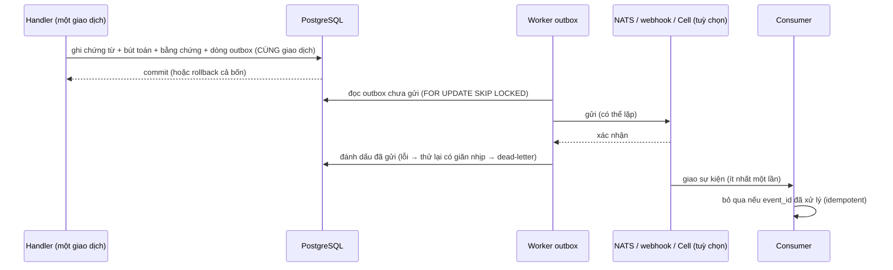

# RULE · Hạ tầng: bộ nhớ đệm, outbox, sao lưu (R-CACHE, R-OUTBOX, R-BAK)

> **Cấp:** Tier 0 / 1 (ghi từng luật) · **Phiên bản:** 1.0 · 2026-10-30 · **Chỉ mục:** [../00-CANON.md](../00-CANON.md)
> **Quyết định nền:** [ADR-0007](../adr/ADR-0007-goi-chia-se-va-ha-tang.md) — PostgreSQL là hạ tầng bắt buộc duy nhất. Redis, NATS là adapter tuỳ chọn, bật khi đo được nhu cầu. · **Công bố:** [CONG-BO-KIEN-TRUC §5](../CONG-BO-KIEN-TRUC.md)

Ba luật này chặn ba lỗi đắt nhất của phần mềm kế toán:
- người dùng vừa hạch toán 500 triệu mà màn hình vẫn hiện số dư cũ;
- sổ đã ghi nhưng hệ thống tích hợp không bao giờ nhận được sự kiện;
- có bản sao lưu nhưng không khôi phục được.

## 1. Bộ nhớ đệm (R-CACHE)

| Mã | Luật | Kiểm bằng |
|---|---|---|
| **R-CACHE-1** *(T0)* | **Không cache dữ liệu sổ:** số dư, sổ cái, công nợ, tồn kho, báo cáo tài chính, trạng thái chứng từ. Đọc luôn từ PostgreSQL | review; `accounting.balance.get` đọc thẳng sổ |
| **R-CACHE-2** *(T0)* | **Đọc nhất quán sau khi ghi:** yêu cầu đọc đến sau khi ghi sổ đã commit phải thấy bút toán đó, kể cả ở máy API khác | `test/mcp.test.ts` (số dư ngay sau hoá đơn) |
| **R-CACHE-3** | Được cache: danh mục ít đổi (hệ thống tài khoản, loại thuế, lý do, nhóm hạch toán, hình thức thanh toán), cấu hình định khoản, bảng năng lực. TTL tối đa 5 phút **và** huỷ đệm khi có ghi | review |
| **R-CACHE-4** *(T0)* | Khoá đệm có `tenant_id` + **phiên bản cấu hình** (`config_version` tăng khi ghi danh mục / cấu hình). Định khoản đọc cấu hình **trong cùng giao dịch ghi sổ**, không từ đệm cũ hơn phiên bản đó, để định khoản luôn tất định (STD-DOM-18) | review; test định khoản |
| **R-CACHE-5** | Huỷ đệm theo sự kiện sau commit (outbox, R-OUTBOX), không trước commit | review |
| **R-CACHE-6** | Mặc định đệm trong tiến trình (một máy). Nhiều máy API thì bật `adapters/redis`, cùng luật. Tắt Redis thì hệ thống vẫn đúng, chỉ chậm hơn (LAYOUT-8) | CI chạy không Redis |

## 2. Outbox: tách commit sổ khỏi phát sự kiện (R-OUTBOX)

**Vấn đề:** bút toán commit xong nhưng NATS đang tạm ngừng. Phát sự kiện trực tiếp thì sổ đã lưu mà hệ thống tích hợp không nhận được. Phát trước commit thì sự kiện có, sổ lại không có.

| Mã | Luật | Kiểm bằng |
|---|---|---|
| **R-OUTBOX-1** *(T0)* | Sự kiện miền ghi vào bảng outbox **trong cùng giao dịch** với dữ liệu gây ra nó. Không gọi NATS / HTTP / Cell trong handler (STD-EVT-1, STD-ACT-7) | SC-EVT-1 |
| **R-OUTBOX-2** *(T0)* | Phản hồi "đã ghi sổ" chỉ trả **sau** commit. Gửi sự kiện chạy sau, có thể xong sau khi đã trả phản hồi | runtime action |
| **R-OUTBOX-3** | Worker đọc bằng `FOR UPDATE SKIP LOCKED` (nhiều worker không gửi trùng một lượt), gửi, xác nhận, rồi đánh dấu. Lỗi thì thử lại có giãn nhịp; quá N lần thì chuyển dead-letter, có cảnh báo | test worker (PHASES 3) |
| **R-OUTBOX-4** *(T0)* | Gửi **ít nhất một lần**: consumer phải idempotent theo `event_id` (bảng `(consumer, event_id)` đã xử lý) | STD-EVT; test |
| **R-OUTBOX-5** | Thứ tự chỉ bảo đảm trong một chủ thể (`subject`, vd một chứng từ); consumer không giả định thứ tự toàn cục | tài liệu sự kiện |
| **R-OUTBOX-6** | NATS JetStream là **adapter chuyển tiếp** outbox (`adapters/nats`), bật khi có nhiều consumer / module ngoài tiến trình. Không có NATS thì subscriber trong tiến trình đọc thẳng outbox | ADR-0007; CI chạy không NATS |
| **R-OUTBOX-7** | Phát lại (replay) từ outbox theo khoảng thời gian / chủ thể, có bằng chứng ai phát lại | CLI `events replay` (PHASES 4) |

## 3. Sao lưu, PITR, kiểm khôi phục (R-BAK)

| Mã | Luật | Kiểm bằng |
|---|---|---|
| **R-BAK-1** *(T0)* | Sao lưu đầy đủ hằng ngày (`scripts/sao-luu.sh`, `pg_dump`). Giữ tối thiểu 14 bản ngày; có bản ngoài máy chủ, mã hoá | cron; [DEPLOY](../ops/DEPLOY.md) |
| **R-BAK-2** | Bản cài thật bật **PITR**: lưu WAL liên tục (WAL archiving: wal-g / pgBackRest) để khôi phục tới một thời điểm. Mục tiêu RPO ≤ 15 phút, RTO ≤ 4 giờ | `infrastructure/backup/` (PHASES G1-08) |
| **R-BAK-3** *(T0)* | **Bản sao lưu chưa kiểm khôi phục coi như chưa có.** Mỗi tuần, và trước mỗi lần nâng cấp, khôi phục vào CSDL tạm rồi chạy kiểm toàn vẹn: Nợ = Có, chuỗi bằng chứng, trigger, migration | `scripts/kiem-khoi-phuc.sh` |
| **R-BAK-4** | Khôi phục không làm chạy lại trigger trên dữ liệu đã ghi. `pg_dump` nạp dữ liệu trước rồi mới tạo trigger, nên chuỗi bằng chứng và sổ giữ nguyên | DG-EVD-1 trên bản khôi phục |
| **R-BAK-5** | Kết quả mỗi lần kiểm khôi phục ghi vào nhật ký (`backups/kiem-khoi-phuc.log`): ngày, tệp, số dòng, ĐẠT / KHÔNG ĐẠT | script |
| **R-BAK-6** | Sao lưu chứa dữ liệu kế toán và dữ liệu cá nhân: không đưa lên repo, không gửi qua kênh không mã hoá (R-SEC-10) | `.gitignore` (`backups/`) |
